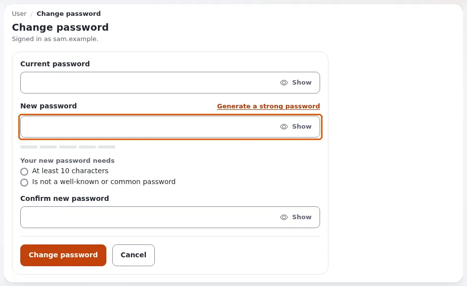
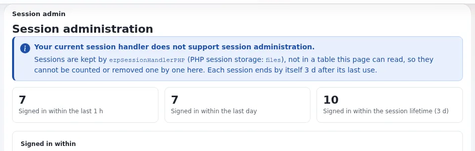
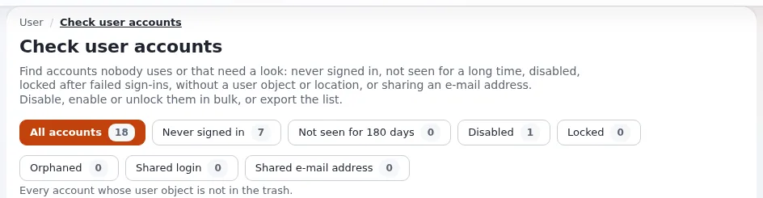

# Das Administratorpasswort ändern

Diese Seite richtet sich an Administratoren und an alle, die eine Exponential-Installation betreiben. Sie beschreibt
jeden unterstützten Weg, das Passwort des Administratorkontos (Login `admin`) oder eines anderen Kontos zu ändern: in
der Administration, für einen anderen Benutzer und auf der Kommandozeile. Sie erklärt, wie Passwörter gespeichert und
geprüft werden, was nach einer Änderung mit offenen Sitzungen geschieht und was zu tun ist, wenn sich niemand mehr
anmelden kann.

Das Passwort, mit dem eine neue Installation beginnt, beschreibt
[Das Standard-Administratorpasswort](standard-administratorpasswort.md). Den größeren Zusammenhang finden Sie unter
[Sicherheitshärtung](sicherheitshaertung.md).

> **Wichtig:** Jede neue Installation muss sofort ein neues Administratorpasswort erhalten und sollte für die tägliche
> Arbeit ein persönliches Administratorkonto bekommen. Siehe [Kontenhygiene](#kontenhygiene) weiter unten.

## Inhalt

1. [Das eigene Passwort in der Administration ändern](#das-eigene-passwort-in-der-administration-ändern)
2. [Das Passwort eines anderen Benutzers als Administrator ändern](#das-passwort-eines-anderen-benutzers-als-administrator-ändern)
3. [Ein Passwort auf der Kommandozeile ändern](#ein-passwort-auf-der-kommandozeile-ändern)
4. [Wie Passwörter gespeichert werden: HashType](#wie-passwörter-gespeichert-werden-hashtype)
5. [Passwortregeln](#passwortregeln)
6. [Was nach einer Änderung geschieht: Sitzungen und E-Mail](#was-nach-einer-änderung-geschieht-sitzungen-und-e-mail)
7. [Passwort vergessen?](#passwort-vergessen)
8. [Ausgesperrt: wenn sich kein Administrator anmelden kann](#ausgesperrt-wenn-sich-kein-administrator-anmelden-kann)
9. [Zweistufige Anmeldung und ein verlorenes Telefon](#zweistufige-anmeldung-und-ein-verlorenes-telefon)
10. [Velocity und PHP-FPM](#velocity-und-php-fpm)
11. [Kontenhygiene](#kontenhygiene)
12. [Was Sie nicht mehr tun sollten](#was-sie-nicht-mehr-tun-sollten)
13. [Quellen und Danksagung](#quellen-und-danksagung)

## Das eigene Passwort in der Administration ändern

Die Seite ist `user/password`: `/admin/user/password` beim standardmäßigen URL-Zugriff (der Teil vor `/user/password`
ist der Siteaccess Ihrer Administration). Es ist in jedem Design dieselbe Seite; nur der Weg dorthin unterscheidet sich.



| Design | Wo Sie es finden |
|---|---|
| **Admin 4** und **Admin 4 L** (dieselbe Kopfzeile) | Das Benutzermenü (die Schaltfläche mit Ihrem Namen in der Kopfzeile) > **Passwort ändern**. Oder **Mein Konto** > die Karte **Passwort** > **Passwort ändern**. |
| **Classic** (`admin`) | Der Kasten **Aktueller Benutzer** > **Passwort ändern**. |
| **AdminUI** | Das Benutzerfeld in der Seitenleiste > **Passwort ändern**. |
| Die öffentliche Site | **Passwort ändern** auf Ihrer Profilseite, unter `/user/password`. |

1. Geben Sie Ihr **Aktuelles Passwort** ein.
2. Geben Sie das **Neue Passwort** ein und dasselbe noch einmal unter **Neues Passwort bestätigen**. Die Seite zeigt,
   was das neue Passwort erfüllen muss (zum Beispiel *Mindestens 10 Zeichen*), und hakt jede Anforderung während der
   Eingabe ab. **Sicheres Passwort erzeugen** erstellt eines für Sie; **Anzeigen** macht das Eingegebene sichtbar.
3. Klicken Sie auf **Passwort ändern**.

Sie bleiben angemeldet, mit einer neuen Session-ID. Ihre Sitzungen in anderen Browsern und auf anderen Geräten werden
bei ihrer nächsten Anfrage abgemeldet, und eine E-Mail „Ihr Passwort wurde geändert“ geht an die Adresse des Kontos. Die
Seite nennt, wie viele andere Sitzungen beendet wurden.

Der Link ist ausgegraut oder fehlt, wenn Ihrer Rolle die Richtlinie **user/password** fehlt. Die Rolle Administrator
hat sie.

Einzelheiten der Seite: [Das Passwort ändern](../../eng-us/features/6.0/modern-password-change.md).

## Das Passwort eines anderen Benutzers als Administrator ändern

`user/password` ändert immer nur das Passwort des angemeldeten Benutzers. So setzen Sie ein Passwort für jemand anderen:

1. Öffnen Sie den Benutzer unter **Benutzer** (Admin 4: der Reiter **Benutzer**, oder suchen Sie nach dem Namen).
2. Klicken Sie auf **Bearbeiten**.
3. Geben Sie im Feld **Benutzerkonto** das neue Passwort unter **Passwort** und noch einmal unter **Passwort bestätigen**
   ein. Lassen Sie beide unverändert, um das aktuelle Passwort zu behalten: Sie enthalten einen Platzhalter, nicht das
   Passwort.
4. Klicken Sie auf **Zur Veröffentlichung schicken** (oder **Veröffentlichen**).

Es gelten dieselben Passwortregeln wie bei `user/password`, und es folgt dasselbe: Die offenen Sitzungen des Benutzers
werden abgemeldet, der Benutzer erhält die E-Mail „Ihr Passwort wurde geändert“, und die Änderung steht im Audit-Protokoll
(niemals das Passwort selbst). Teilen Sie dem Benutzer das neue Passwort über einen getrennten, sicheren Kanal mit und
bitten Sie ihn, es bei der ersten Anmeldung zu ändern. Noch besser: Lassen Sie ihn selbst **Passwort vergessen?**
verwenden, damit Sie sein Passwort nie kennen.

Der **Benutzername** (Login) lässt sich nicht mehr ändern, sobald ein Konto einen hat. Das ist ein Grund, ein
persönliches Administratorkonto anzulegen, statt täglich `admin` zu verwenden ([Kontenhygiene](#kontenhygiene)).

Um ein Konto abzuschalten oder seine fehlgeschlagenen Anmeldungen zurückzusetzen, verwenden Sie
**Benutzerkonten-Einstellungen konfigurieren** unterhalb des Felds **Benutzerkonto** auf der Seite des Benutzers
(`user/setting/<user id>`): **Benutzerkonto aktivieren**, **Maximale Anzahl fehlgeschlagener Anmeldeversuche** und
**Zurücksetzen** für die fehlgeschlagenen Versuche.

## Ein Passwort auf der Kommandozeile ändern

Das unterstützte Werkzeug ist `bin/php/resetuserpassword.php`, auch als Konsolenbefehl `exp:resetuserpassword`
verfügbar. Es setzt das Passwort über denselben Code wie das Bearbeitungsformular für Benutzer, daher gelten dieselben
Passwortregeln, derselbe Hash-Typ und dieselbe Behandlung der Sitzungen. Es funktioniert auch, wenn sich niemand mehr an
der Administration anmelden kann.

Führen Sie es im Wurzelverzeichnis der Installation aus, als der Benutzer, dem die Installation gehört, oder als `root`
des Betriebssystems.

**Als root-Benutzer des Betriebssystems** (keine Anmeldung bei Exponential nötig):

```bash
# generate a strong 24-character password for "admin" and print it once
./console exp:resetuserpassword --allow-root-user -u admin -g -l 24

# the same with the script itself
php bin/php/resetuserpassword.php --allow-root-user -u admin -g -l 24
```

`--allow-root-user` (kurz `-r`) wird abgelehnt, wenn Sie nicht wirklich der Betriebssystembenutzer `root` sind.

**Als anderer Administrator der Site** (kein root nötig):

```bash
./console exp:resetuserpassword -a <your login> -ap '<your password>' -u editor1 -g
```

Der mit `-a` angegebene Login muss sich mit dem mit `-ap` angegebenen Passwort anmelden können und die Rolle mit dem
Namen **Administrator** besitzen.

| Option | Bedeutung | Standard |
|---|---|---|
| `-u <login>` | das zu ändernde Konto | `admin` |
| `-g`, `--generate` | ein Passwort erzeugen (auch wenn weder `-g` noch `-p` angegeben ist) | an |
| `-l <length>` | Länge eines erzeugten Passworts | 16 |
| `-p <password>` | stattdessen dieses Passwort setzen | keiner |
| `-a <login>`, `-ap <password>` | als Administrator der Site autorisieren | keiner |
| `-r`, `--allow-root-user` | als root-Benutzer des Betriebssystems autorisieren | aus |
| `-s <siteaccess>` | der zu verwendende Siteaccess und damit die Datenbank | der Standard-Siteaccess |
| `-q` | nur Fehler und das erzeugte Passwort ausgeben | aus |

Was es meldet und was das bedeutet:

| Meldung | Bedeutung |
|---|---|
| `Password reset for user: <login>` und `Generated password: ...` | erledigt; das erzeugte Passwort wird einmal angezeigt |
| `Admin authentication required ...` | geben Sie `-a` und `-ap` an, oder führen Sie den Befehl als root mit `--allow-root-user` aus |
| `Admin authentication failed.` | das mit `-ap` angegebene Passwort ist falsch |
| `User '<login>' does not have the Administrator role.` | das autorisierende Konto ist kein Administrator |
| `Target user not found: <login>` | kein Konto hat diesen Login |
| `Target password does not validate. ...` | das Passwort verletzt eine Regel, zum Beispiel `The password must be at least 10 characters long.` |

Bewährte Praxis:

- **Verwenden Sie bevorzugt `-g`.** Ein mit `-p` oder `-ap` angegebenes Passwort ist für andere Benutzer des Rechners in
  der Prozessliste sichtbar und bleibt in Ihrer Shell-History. Wenn Sie eines eintippen müssen, setzen Sie ein
  Leerzeichen vor den Befehl (mit `HISTCONTROL=ignorespace` in Bash) oder löschen Sie die History danach.
- **Ändern Sie das erzeugte Passwort** bei Ihrer ersten Anmeldung in der Administration in eines, das nur Sie kennen.
- Der Befehl ändert das Passwort und sonst nichts. Er aktiviert **kein** deaktiviertes Konto, setzt keine
  fehlgeschlagenen Anmeldeversuche zurück und schaltet die zweistufige Anmeldung nicht ab; siehe
  [Ausgesperrt](#ausgesperrt-wenn-sich-kein-administrator-anmelden-kann).
- Er ist das richtige Werkzeug für jede Datenbank, die Exponential unterstützt (MySQL und MariaDB, PostgreSQL, SQLite,
  Oracle, MongoDB), weil er über den Kernel arbeitet und nicht über SQL.

Dieses Verhalten wurde am 18. Oktober 2026 an einem Wegwerfkonto geprüft: Ein erzeugtes Passwort meldet an, das alte
nicht mehr, der gespeicherte Hash hat den konfigurierten Typ, ein Passwort kürzer als `MinPasswordLength` wird
abgelehnt, `-q` gibt das erzeugte Passwort trotzdem aus, und ein autorisierendes Konto ohne die Rolle Administrator
wird abgelehnt.

Mehr: [Ein Benutzerpasswort auf der Kommandozeile zurücksetzen](../../eng-us/features/6.0/reset-user-password.md).

## Wie Passwörter gespeichert werden: HashType

Exponential speichert nie ein Passwort, nur einen Hash davon, in der Tabelle `ezuser` (`password_hash`, und den
Hash-Typ in `password_hash_type`). Der Typ für neue und geänderte Passwörter wird in `settings/site.ini` festgelegt:

```ini
[UserSettings]
HashType=php_default
UpdateHash=true
```

| `HashType` | Typ-ID | Was es ist | Verwenden? |
|---|---|---|---|
| `php_default` | 7 | PHPs `password_hash()` mit `PASSWORD_DEFAULT`: heute bcrypt, gesalzen, mit Arbeitsfaktor (Cost 12 seit PHP 8.4) | **ja, der Standard** |
| `bcrypt` | 6 | ausdrücklich gewähltes bcrypt | akzeptabel |
| `md5_user` | 2 | MD5 aus Login und Passwort, ungesalzen | nein: nur für sehr alte Daten |
| `md5_password` | 1 | MD5 des Passworts, ungesalzen | nein |
| `md5_site` | 3 | MD5 aus Site-Name, Login und Passwort; bricht, wenn sich der Site-Name ändert | nein |
| `plaintext` | 5 | das Passwort selbst | niemals |
| (MySQL `PASSWORD()`) | 4 | veraltet; seit MySQL 8.0 entfernt | niemals |

`UpdateHash=true` hasht einen älteren Hash bei der nächsten erfolgreichen Anmeldung des Benutzers mit dem aktuellen
`HashType` neu. Behalten Sie beide Werte wie ausgeliefert. Eine von einer alten Version aktualisierte Installation kann
für Konten, die sich seither nicht angemeldet haben, noch MD5-Hashes enthalten; geben Sie diesen Benutzern ein neues
Passwort (oder lassen Sie sie **Passwort vergessen?** verwenden), statt abzuwarten.

Ändern Sie diese Einstellungen nur in einem Override (`settings/override/site.ini.append.php`), nie in der
ausgelieferten Datei.

## Passwortregeln

Die Regeln, die jedes Formular prüft (`user/password`, Registrierung, das Bearbeitungsformular für Benutzer, die
Kommandozeile), sind:

```ini
[UserSettings]
MinPasswordLength=10      # shipped value; counted in bytes; 3 when the setting is missing
GeneratePasswordLength=16 # generated passwords (the page's button uses at least 12)

[PasswordSettings]        # every rule off by default, so an upgrade refuses nothing new
RequireLowercase=disabled
RequireUppercase=disabled
RequireDigit=disabled
RequireSymbol=disabled
MinCharacterClasses=0     # at least this many of the four kinds above (0 to 4)
ForbidLogin=disabled      # must not contain the login name
ForbidCurrentPassword=disabled
```

Seit 6.0.15 lehnt jedes Formular außerdem ein bekanntes oder häufiges Passwort ab, gleich welcher Länge („Das neue
Passwort ist bekannt oder zu häufig. Bitte wählen Sie ein anderes.“): die Wörter der gemeinsamen Liste und ihre
einfachen Abwandlungen, siehe
[Die Liste bekannter Passwörter](standard-administratorpasswort.md#die-liste-bekannter-passwörter).

```ini
[UserSettings]
WeakPasswordCheck=enabled      # disabled: the rules above only, as before 6.0.15
#WeakPasswordList[]=ourcompany # more words
WeakPasswordFile=              # a file with more words, one per line
```

Die Prüfung greift, wenn ein Passwort gesetzt wird; ein bestehendes Passwort wird bei der Anmeldung nie abgelehnt.

Für Administratoren zählt Länge mehr als Zusammensetzungsregeln: Eine Produktionsrichtlinie mit
`MinPasswordLength=15` sowie `ForbidLogin=enabled` und `ForbidCurrentPassword=enabled` empfiehlt
[Kapitel 13.6 der Installationsanleitung](../installation/13-sicherheitshaertung.md#136-passwörter-und-anmeldung), das auch die
Gründe erklärt (NIST SP 800-63B-4).

Zwei weitere Einstellungen schützen die Anmeldung selbst:

```ini
[UserSettings]
MaxNumberOfFailedLogin=0  # 0: no lockout. 10 locks an account after 10 failed attempts
TrustedIPList[]           # addresses or networks that are never locked out
```

Eine Sperre erlaubt es auch jedem, ein bekanntes Konto zu sperren, deshalb ist sie standardmäßig aus; das Audit-Protokoll
meldet das Erraten von Passwörtern in jedem Fall (`brute_force`, `brute_force_user`). Wenn Sie sie einschalten, tragen
Sie das Büro- oder VPN-Netz in `TrustedIPList[]` ein, damit Ihre eigenen Administratoren einen Zugang behalten.

## Was nach einer Änderung geschieht: Sitzungen und E-Mail

Festgelegt in `site.ini [PasswordSettings]`, beide standardmäßig eingeschaltet:



- **`EndOtherSessions=enabled`**: Eine Anmeldung speichert einen Stempel des Passworts in der Sitzung; ändert sich das
  Passwort, passt keine andere Sitzung dieses Benutzers mehr, und jede wird bei ihrer nächsten Anfrage abgemeldet, mit
  jedem Session-Handler. Die Sitzung, die die Änderung vorgenommen hat, erhält eine neue Session-ID. Das macht eine
  Passwortänderung nach der Übernahme eines Kontos überhaupt erst wirksam: Wer ein gestohlenes Session-Cookie besitzt,
  wird abgemeldet. Es gilt für jeden Weg, ein Passwort zu ändern: `user/password`, das Bearbeitungsformular für
  Benutzer, **Passwort vergessen?** und die Kommandozeile.
- **`ChangeNotificationMail=enabled`**: Der Benutzer erhält „Ihr Passwort wurde geändert“ (Kategorie *Kontosicherheit*,
  die niemand abschalten kann; die E-Mail enthält nie das Passwort). So erfährt ein Benutzer von einer Änderung, die er
  nicht selbst vorgenommen hat.

Um **alle** Sitzungen aller Benutzer zu beenden (nach einer vermuteten Kompromittierung), verwenden Sie mit dem
Datenbank-Session-Handler **Setup** > **Sitzungen** > **Alle Sitzungen entfernen**, oder siehe
[Sitzungen](../anleitungen/sitzungen.md). Ein neues Site-Geheimnis meldet ebenfalls alle einmal ab.

## Passwort vergessen?

Die Anmeldeseite bietet **Passwort vergessen?** (`user/forgotpassword`), für jedes Konto einschließlich der
Administratoren:

1. Der Benutzer gibt die E-Mail-Adresse des Kontos ein.
2. Exponential schickt eine E-Mail mit einem Link. Die Seite antwortet gleich, ob ein Konto diese Adresse hat oder
   nicht, sodass sich damit nicht herausfinden lässt, wer ein Konto hat.
3. Der Link funktioniert einmal und nur eine Stunde lang (`site.ini [UserSettings] ForgotPasswordKeyLifetime=3600`, in
   Sekunden; die E-Mail nennt die Dauer). Wird er geöffnet, erhält das Konto ein neues erzeugtes Passwort
   (`GeneratePasswordLength` Zeichen), das an dieselbe Adresse geschickt wird. Der Benutzer meldet sich an und ändert es
   sofort.
4. Ein zu spät geöffneter Link zeigt „Dieser Link ist abgelaufen.“ mit der Möglichkeit, einen neuen anzufordern; der
   alte Link wird entfernt. Unbenutzte Links werden entfernt, wenn sie ablaufen. `ForgotPasswordKeyLifetime=0` lässt
   einen Link bis zu seiner Verwendung gültig, wie vor 6.0.15; ein kürzerer Wert (900, eine Viertelstunde) verkleinert
   das Zeitfenster für ein Postfach, das jemand anderes gelesen hat.

Das funktioniert nur, wenn das Konto eine echte E-Mail-Adresse hat und die Site E-Mails versenden kann. Geben Sie dem
Administratorkonto gleich nach der Installation eine echte, überwachte Adresse
([Kapitel 10.1](../installation/10-nach-der-installation.md#101-erste-anmeldung-und-das-administratorpasswort)).
Jede Anforderung und jedes Zurücksetzen wird im Audit-Protokoll erfasst (niemals der Schlüssel oder das Passwort).

## Ausgesperrt: wenn sich kein Administrator anmelden kann

Gehen Sie diese Punkte der Reihe nach durch; jeder ist ein unterstützter Weg. Sie benötigen Shell-Zugang zum Server.

1. **Ein anderer Administrator** ändert Ihr Passwort (siehe oben) oder klickt unter
   **Benutzerkonten-Einstellungen konfigurieren** für Ihre fehlgeschlagenen Anmeldungen auf **Zurücksetzen**.
2. **Passwort vergessen?**, wenn die E-Mail-Adresse Ihres Kontos funktioniert.
3. **Die Kommandozeile**, als root-Benutzer des Betriebssystems:

   ```bash
   ./console exp:resetuserpassword --allow-root-user -u admin -g -l 24
   ```

   Verwenden Sie `-u <your login>` für ein persönliches Administratorkonto.
4. **Das Konto wurde durch fehlgeschlagene Anmeldungen gesperrt** (`MaxNumberOfFailedLogin`), und kein anderer
   Administrator kann auf **Zurücksetzen** klicken: Melden Sie sich von einer Adresse in
   `[UserSettings] TrustedIPList[]` an, oder setzen Sie vorübergehend `MaxNumberOfFailedLogin=0` in
   `settings/override/site.ini.append.php`, leeren Sie den INI-Cache und deployen Sie (siehe unten), melden Sie sich an,
   klicken Sie auf **Zurücksetzen** und stellen Sie die Einstellung wieder her.
5. **Das Konto ist deaktiviert** (**Benutzerkonto aktivieren** aus): Ein anderer Administrator schaltet es wieder ein.
   Gibt es keinen, verwenden Sie das Notfallkonto aus [Kontenhygiene](#kontenhygiene).
6. **Zweistufige Anmeldung, und das Telefon ist weg**: siehe den nächsten Abschnitt.

Danach in jedem Fall: Ändern Sie das Passwort in eines, das nur Sie kennen, prüfen Sie im Audit-Protokoll
(`./console exp:audit tail --channel=access --lines=50`), was vorher geschah, und finden Sie heraus, warum Sie
ausgesperrt waren. Eine Sperre, die Sie nicht selbst verursacht haben, kann ein Angriff sein.

Wenn Ihnen nur noch die Datenbank selbst bleibt (zum Beispiel kein PHP auf der Kommandozeile), siehe den letzten Ausweg
unter [Was Sie nicht mehr tun sollten](#was-sie-nicht-mehr-tun-sollten).

## Zweistufige Anmeldung und ein verlorenes Telefon

Ist die Erweiterung `sevenx_authentication_2fa` aktiv, genügt ein Passwort allein nicht mehr zur Anmeldung
([Zweistufige Anmeldung](../anleitungen/zwei-faktor-anmeldung.md)). Ein neues Passwort ändert nichts an der zweiten Stufe.

- **Ein anderer Administrator** öffnet das Objekt des Benutzers, setzt das Feld **Zweistufige Anmeldung** auf
  **Einmalcode per E-Mail** oder **Deaktiviert** und veröffentlicht. Der Benutzer meldet sich an und richtet die App
  erneut ein.
- **Kein anderer Administrator kann sich anmelden** (der einzige Administrator hat das Telefon verloren): Die zweite
  Stufe fragt der Login-Handler `sevenxUser2fa` ab. Als Notfallmaßnahme nehmen Sie ihn in
  `settings/override/site.ini.append.php` aus `[UserSettings] LoginHandler[]` heraus (behalten Sie `standard`), leeren
  den INI-Cache und deployen, melden sich mit dem Passwort an, stellen das Feld **Zweistufige Anmeldung** des Kontos auf
  **Deaktiviert** oder auf E-Mail-Codes, nehmen dann den Handler wieder auf und deployen erneut. Solange er fehlt,
  meldet sich **jedes** Konto allein mit seinem Passwort an: Tun Sie es in einem kurzen Zeitfenster, am besten mit auf
  Ihre eigene Adresse beschränkter Administration (Kapitel 13.5) oder mit der Site im Wartungsmodus, und vermerken Sie
  es in Ihrem Änderungsprotokoll. Richten Sie danach die App erneut ein.

Die Wiederherstellungsdetails der Erweiterung selbst stehen in ihrer `README.md` und in `doc/two-factor-pages.md`.

## Velocity und PHP-FPM

- Eine Passwortänderung ist eine Änderung in der Datenbank: Sie wirkt sofort, unter Apache mit PHP-FPM, nginx,
  FrankenPHP und Exponential Velocity gleichermaßen. Nichts braucht einen Neustart oder das Leeren eines Caches.
- Eine Änderung von **Einstellungen** (`HashType`, `MinPasswordLength`, `[PasswordSettings]`,
  `MaxNumberOfFailedLogin`, `LoginHandler[]`) erfordert das Leeren des INI-Caches und einen Neustart der Velocity-Worker,
  was `exp:velocity deploy` in der richtigen Reihenfolge erledigt:

  ```bash
  php bin/php/ezcache.php --clear-tag=ini --allow-root-user
  ./console exp:velocity deploy --allow-root-user     # Velocity; reload PHP-FPM yourself without it
  ```

- Führen Sie die Kommandozeilenwerkzeuge als der Benutzer aus, dem die Installation gehört (oder als root mit
  `--allow-root-user`, wo die Dokumentation das vorsieht). Dateien, die ein root-Lauf in `var/` anlegt, müssen für den
  Benutzer des Webservers beschreibbar bleiben
  ([Kapitel 13.11](../installation/13-sicherheitshaertung.md#1311-dateiberechtigungen-und-eigentümer)).

## Kontenhygiene

Das Konto `admin` gibt es in jeder Installation, daher ist sein Login-Name der erste, den ein Angreifer versucht.
Verwenden Sie es nicht für die tägliche Arbeit:



1. **Legen Sie ein persönliches Administratorkonto an.** Erstellen Sie unter **Benutzer** > **Administrator users**
   einen **Benutzer** mit einem eigenen Login (nicht `admin`, nicht `administrator`, möglichst nicht Ihre öffentliche
   E-Mail-Adresse), einer echten E-Mail-Adresse und einem starken Passwort. Konten in **Administrator users** erhalten
   die Rolle **Administrator** über die Gruppe; prüfen Sie das unter **Rollen und Richtlinien** > **Administrator** >
   **Zuweisungen**. Ein Konto pro Person, damit das Audit-Protokoll zeigt, wer was getan hat.
2. **Schalten Sie die zweistufige Anmeldung** dafür ein und verlangen Sie sie für Administratoren
   ([Zweistufige Anmeldung](../anleitungen/zwei-faktor-anmeldung.md)).
3. **Melden Sie sich mit dem neuen Konto an** und prüfen Sie, dass es alles kann, was Sie brauchen.
4. **Stellen Sie `admin` als Anmeldung still.** Zwei unterstützte Wege; wählen Sie einen:
   - **Deaktivieren.** Öffnen Sie den Benutzer `admin` > **Benutzerkonten-Einstellungen konfigurieren** > entfernen Sie
     das Häkchen bei **Benutzerkonto aktivieren** > **OK**. Ein deaktiviertes Konto kann sich nicht anmelden, seine
     offenen Sitzungen enden bei ihrer nächsten Anfrage, und es hat keine Rechte.
     **Bevor Sie das tun**, setzen Sie `[UserSettings] UserCreatorID` in `settings/override/site.ini.append.php` auf die
     Objekt-ID eines aktivierten Administratorkontos (Ihres persönlichen oder eines eigenen Dienstkontos): Der
     ausgelieferte Wert `14` ist `admin`, und Kommandozeilenwerkzeuge wie das Leeren des Papierkorbs, das Entfernen von
     Teilbäumen und die Inhaltsjobs sowie die Selbstregistrierung handeln als dieses Konto. Leeren Sie danach den
     INI-Cache, deployen Sie und führen Sie eines dieser Werkzeuge einmal zur Kontrolle aus.
   - **Aktiviert lassen, aber unbrauchbar machen.** Geben Sie ihm ein langes Zufallspasswort, das niemand aufbewahrt
     (`./console exp:resetuserpassword --allow-root-user -u admin -g -l 64`, und schreiben Sie es nicht auf), behalten
     Sie `UserCreatorID=14` und verlassen Sie sich auf das Notfallverfahren unten. Wählen Sie diesen Weg, wenn Sie
     `UserCreatorID` nicht ändern können.

   Die Aktion **Deaktivieren und verschieben** von **Benutzerkonten prüfen** (`user/deactivate`, siehe
   [Benutzerkonten prüfen](../../eng-us/features/6.0/user-hygiene.md)) ist für gewöhnliche Konten gedacht: Sie lehnt den anonymen
   Benutzer, `UserCreatorID`, das Konto `admin` und Sie selbst absichtlich ab und ist daher nicht der Weg, `admin`
   stillzulegen.
5. **Halten Sie ein Notfallverfahren bereit, schriftlich und getestet.** Zum Beispiel: die root-Shell des Servers plus
   `./console exp:resetuserpassword --allow-root-user -u <login> -g -l 24` für jedes Administratorkonto; ein
   deaktiviertes `admin` schaltet ein anderer Administrator wieder ein. Bewahren Sie das Verfahren (kein Passwort) dort
   auf, wo die Personen in Rufbereitschaft es finden, und testen Sie es einmal im Jahr an einer Kopie der Site.
6. **Überprüfen Sie die Konten regelmäßig**: **Benutzer** > **Benutzerkonten prüfen** listet Konten auf, die sich nie
   angemeldet haben, seit Monaten nicht gesehen wurden, deaktiviert oder gesperrt sind oder einen Login oder eine
   E-Mail-Adresse teilen. Überprüfen Sie auch die Zuweisungen der Rolle **Administrator**; das Audit-Protokoll schlägt bei
   neuen Zuweisungen der Administratorrolle Alarm (`admin_role_granted`).

## Was Sie nicht mehr tun sollten

Ältere Anleitungen, darunter der Community-Wiki-Artikel, den diese Seite ersetzt, nennen Wege, die falsch oder
unsicher sind oder in Exponential 6 nicht mehr funktionieren:

- **Berechnen Sie keinen MD5-Hash in SQL** (`MD5(CONCAT(...))`, `MD5("admin\npassword")`), und setzen Sie kein
  Passwort auf den bekannten Hash von `publish` zurück. MD5-Hashes sind ungesalzen und schnell zu knacken; der bekannte
  Hash ist das Erste, was ein Angreifer versucht.
- **Ändern Sie nicht `eZUser::authenticateHash()`** so, dass es jedes Passwort akzeptiert, nicht einmal für eine Minute.
  Dann meldet sich jedes Konto mit jedem Passwort an, für jeden, der es versucht.
- **Setzen Sie nicht `CheckValidity=true`, um „das Setup noch einmal auszuführen“.** Auf einer installierten Site zeigt
  der Einrichtungsassistent nur noch „Diese Website ist bereits installiert“; ihn erneut auszuführen ist eine
  Neuinstallation, die die Datenbank überschreibt.
- **Lassen Sie das Passwort nicht in einer Datei liegen**: Löschen Sie `var/log/initial-admin-password` nach der ersten
  Anmeldung, und bewahren Sie ein Passwort nie in `kickstart.ini`, einer Shell-History oder einem Ticket auf.

**Letzter Ausweg, nur die Datenbank.** Wenn PHP auf der Kommandozeile nicht verfügbar ist und Sie einen Hash von Hand
setzen müssen, berechnen Sie einen bcrypt-Hash außerhalb der Datenbank und speichern Sie ihn mit Typ 7:

```bash
# reads the password from the keyboard without echo; prints only the hash
read -rs P && printf '%s' "$P" | php -r 'echo password_hash(stream_get_contents(STDIN), PASSWORD_DEFAULT), PHP_EOL;'; unset P
```

```sql
UPDATE ezuser SET password_hash = '<the hash>', password_hash_type = 7 WHERE login = 'admin';
```

Erstellen Sie vorher ein Backup. Leeren Sie danach den Benutzer-Cache (`php bin/php/ezcache.php --clear-id=user_info_cache
--allow-root-user`), damit andere Sitzungen dieses Kontos enden, melden Sie sich an und ändern Sie das Passwort noch
einmal in der Administration, damit E-Mail, Audit-Eintrag und Sitzungsbehandlung wie vorgesehen ablaufen. Das Konto
braucht außerdem seine Zeile in `ezuser_setting` mit `is_enabled = 1`: Ein Konto ohne diese Zeile kann sich nicht
anmelden.

## Quellen und Danksagung

Teile dieser Seite, die Liste älterer Methoden zum Zurücksetzen und das Verfahren nur über die Datenbank, sind dem
Community-Wiki-Artikel ["Reseting the admin password in eZ publish"](https://ezpedia.exponential.earth/en/solution/reseting_the_admin_password_in_ez_publish)
auf eZpedia entnommen, seit 2006 verfasst von kracker, xavier, Graham Brookins und weiteren Mitwirkenden und verbreitet
unter der GNU Free Documentation License. Der übernommene Text wurde für Exponential 6 neu geschrieben und korrigiert
und wird wie die übrige Dokumentation unter der GNU Free Documentation License 1.3 oder einer späteren Version
verbreitet (<https://www.gnu.org/licenses/fdl-1.3.html>; der Copyright- und Erlaubnisvermerk ist
`doc/eng-us/README-LICENSE.md`). Alles andere auf dieser Seite wurde anhand des Quellcodes von Exponential 6 geschrieben.

**Demo-Modus.** Auf einer öffentlichen Demo (Umgebungsvariable `EXP_DEMO_MODE=1`, ein Banner **Demo-Modus** in der Administration) funktioniert keiner der Wege auf dieser Seite für einen Administrator: Die Seite, der Link „Passwort vergessen?“, das Bearbeitungsformular, `exp:resetuserpassword` und die Webdienste lehnen alle ab mit „Diese Installation ist eine öffentliche Demo: Die Passwörter von Administratoren können nicht geändert oder zurückgesetzt werden.“ Um es zu ändern, entfernt der Betreiber des Servers zuerst die Variable. [Demo-Modus](demomodus.md).

## Verwandte Seiten

- [Das Standard-Administratorpasswort](standard-administratorpasswort.md)
- [Sicherheitshärtung](sicherheitshaertung.md)
- [Ihr Konto und die Anmeldung](konten-und-anmeldung.md)
- [Das Passwort ändern](../../eng-us/features/6.0/modern-password-change.md),
  [Ein Benutzerpasswort auf der Kommandozeile zurücksetzen](../../eng-us/features/6.0/reset-user-password.md)
- [Kapitel 10.1: Erste Anmeldung und das Administratorpasswort](../installation/10-nach-der-installation.md#101-erste-anmeldung-und-das-administratorpasswort),
  [Kapitel 13: Sicherheitshärtung für die Produktion](../installation/13-sicherheitshaertung.md)
- [Zweistufige Anmeldung](../anleitungen/zwei-faktor-anmeldung.md), [Sitzungen](../anleitungen/sitzungen.md),
  [Benutzerkonten prüfen](../../eng-us/features/6.0/user-hygiene.md), [Audit](../../eng-us/bc/6.0/audit.md)
