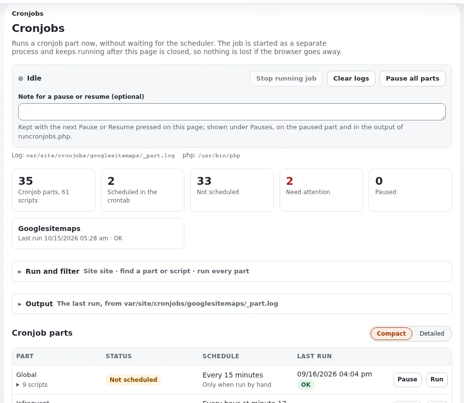

# Die Cronjob-Konsole

Diese Seite ist für Support-Mitarbeitende, die die geplanten Jobs eines Kunden ohne Shell ansehen, und für
Systemadministratoren, die entscheiden, was Kunden dort tun dürfen. Sie beantwortet: was **Setup > Cronjobs** zeigt, was es
von der PHP-Konfiguration einer Hosting-Plattform braucht, wie das Anhalten funktioniert, welche Teile es nie startet und wie
Sie es einem Kunden übergeben.

Das vollständige Benutzerhandbuch ist [Cronjobs: ausführen, planen und verfolgen](../../../anleitungen/cronjobs.md); die Referenz
der Funktion ist [Cronjob-Konsole](../../../../eng-us/features/6.0/cronjobs-console.md). Was die Teile tun, steht auf
[Cronjobs](cronjobs.md).

## Inhalt

1. [Was die Seite tut](#was-die-seite-tut)
2. [Was sie von der Plattform braucht](#was-sie-von-der-plattform-braucht)
3. [Wer sie nutzen darf](#wer-sie-nutzen-darf)
4. [Teile anhalten](#teile-anhalten)
5. [Teile, die die Seite nicht startet](#teile-die-die-seite-nicht-startet)
6. [Dateien, die die Seite führt](#dateien-die-die-seite-führt)
7. [Support-Szenarien](#support-szenarien)
8. [Checkliste](#checkliste)

## Was die Seite tut

**Setup > Cronjobs** (`/setup/cronjobs`) zeigt eine Karte oder Zeile pro Teil:



- ob die Crontab ihn ausführt, seinen Zeitplan in Worten, seinen nächsten und letzten Lauf;
- den Shell-Befehl, der ihn ausführt, mit einer Schaltfläche **Kopieren**;
- seine Skripte, mit dem, was jedes tut (aus der `@description` des Skripts);
- **Teil starten** und, pro Skript, **Starten**, für die unter **Für Website ausführen** gewählte Website;
- **Ausgabe**, die dem laufenden Job live folgt; **Laufenden Job anhalten**; **Protokolle leeren**;
- **Anhalten** und **Fortsetzen** pro Teil und **Alle Teile anhalten**;
- einen Abschnitt **Crontab** mit dem, was die Crontab jetzt enthält, und vorgeschlagenen Zeilen für Teile, die nichts ausführt.

Es läuft immer nur ein Job, der aus der Seite gestartet wurde. Jobs, die die Crontab startet, sind getrennte Prozesse; die
Sperren der Skripte halten beide auseinander. Alles funktioniert ohne JavaScript.

## Was sie von der Plattform braucht

Hosting-Plattformen schränken PHP oft ein. Die Seite sagt, was fehlt, statt zu scheitern:

| Braucht | Für | Wenn es fehlt |
|---|---|---|
| eine PHP-Binärdatei für die Kommandozeile | einen Job als eigenen Prozess starten | die Seite sagt es in Rot, und jede Schaltfläche zum Starten ist deaktiviert |
| `proc_open` | einen Job starten | „proc_open ist deaktiviert, daher kann ein Cronjob nicht über die Oberfläche gestartet werden. Führen Sie ihn in einer Shell aus.“ |
| `exec` | die Crontab lesen (`crontab -l`) | die Seite öffnet sich trotzdem und sagt, welche Funktion fehlt |
| `posix_kill` | **Laufenden Job anhalten** | die Seite öffnet sich trotzdem und sagt, welche Funktion fehlt |
| `runcronjobs.php` im Wurzelverzeichnis der Installation | jeden Lauf | die Seite nennt den Pfad, den sie erwartet hat |

Die Binärdatei ist `cronjob.ini [AdminSettings] PhpCliPath`, wenn gesetzt, sonst die erste ausführbare Datei aus
`PHP_BINDIR/php`, `/usr/bin/php` und `/usr/local/bin/php`; nie die PHP-FPM-Binärdatei, die die Web-Anfrage beantwortet. Auf
einem Host mit mehreren PHP-Versionen setzen Sie `PhpCliPath` auf die, auf der die Website läuft:

```ini
# settings/override/cronjob.ini.append.php
[AdminSettings]
PhpCliPath=/opt/<php version>/bin/php
```

Oder mit dem INI-Befehl (der Bereich `global` schreibt `settings/override`), dann leeren Sie den INI-Cache:

```bash
./console exp:ini set cronjob.ini/AdminSettings/PhpCliPath /opt/<php version>/bin/php global
php bin/php/ezcache.php --clear-tag=ini
```

> **Hinweis**
> Die Seite liest die Crontab des Systembenutzers, als der der Webserver läuft. Eine Crontab, die für einen anderen Benutzer
> eingerichtet ist (root, ein Benutzer für das Ausrollen), wird nicht gezeigt, und ihre Teile erscheinen als *Nicht geplant*,
> obwohl sie laufen. Richten Sie die Crontabs der Kunden unter dem Benutzer der Website ein, wie
> [Cronjobs](cronjobs.md#welcher-benutzer-welches-php) es empfiehlt.

## Wer sie nutzen darf

Die Seite und ihr Ausgabestrom brauchen die Richtlinie `setup/managecronjobs`; in einer neuen Installation hat sie nur die
Rolle Administrator. Einen Job auszuführen nutzt die Ressourcen des Servers und wirkt auf Inhalte (Benachrichtigungen werden
verschickt, Links geprüft, Inhaltsjobs laufen); entscheiden Sie also pro Tarif, ob die eigenen Administratoren des Kunden sie
erhalten oder ob sie bei Ihrem Support-Team bleibt.

**Laufenden Job anhalten** sendet `SIGTERM`, nicht `SIGKILL`, damit das Skript seine Sperre freigeben kann. Es scheitert mit
„Dem Prozess <pid> konnte kein Signal gesendet werden. Er gehört möglicherweise einem anderen Benutzer.“, wenn der Job als
anderer Systembenutzer läuft als der Webserver, der die Anfrage beantwortet, zum Beispiel wenn die Worker von Velocity und
PHP-FPM als verschiedene Benutzer laufen.

## Teile anhalten

Einen angehaltenen Teil lässt `runcronjobs.php` aus, wer ihn auch startet: die Crontab, `./console cron:<part>`, die Befehle
`cron:` von Velocity oder die Seite ([Cronjob-Teile anhalten](../../../../eng-us/features/6.0/cronjob-pause.md)). Ein Teil, der während
seines Laufs angehalten wird, beendet das gerade laufende Skript und lässt den Rest aus. Der Hinweis sagt, seit wann, von wem
und warum:

```text
Notice: The cronjob part 'frequent' is paused (Setup > Cronjobs). Paused since 2026-10-15 13:05 CEST by admin: Index rebuild until noon.
```

- Jeder Lauf, den eine Pause auslässt, wird in `cronjob_skipped.log` im Log-Verzeichnis festgehalten.
- Der Zustand ist eine Datei pro Teil, `cronpart_deactivated_<part>.txt`, in `<cache directory>/cronjob_control/` oder in
  `cronjob.ini [PauseSettings] Directory` unterhalb des var-Verzeichnisses. `Pause=disabled` schaltet die Prüfung aus.
- **Das Verzeichnis folgt dem Siteaccess.** Wenn die Crontab `-s <site>` mit einem anderen var-Verzeichnis als die
  Administration ausführt, setzen Sie `[PauseSettings] Directory`, damit beide dieselben Dateien finden.
- **Mehrere Server**: Die Dateien sind lokal, es sei denn, das Verzeichnis wird geteilt.
- Queue-Worker, die als systemd-Dienst laufen, sind keine Cronjobs und arbeiten weiter; halten Sie dafür den Dienst an.

> **Tipp**
> Anhalten ist der sichere Weg, Jobs während eines Wartungsfensters oder einer Migration zurückzuhalten: Es braucht auf keinem
> Server eine Änderung der Crontab, und die Seite zeigt, wer was angehalten hat.

## Teile, die die Seite nicht startet

`cronjob.ini [AdminSettings] ForbiddenParts[]` wird mit `cluster_maintenance` (bereinigt den Cluster-Speicher) und `unlock`
(gibt Sperren frei, die andere Prozesse halten) ausgeliefert. Beide sind zerstörerisch und gehören in die Hände eines
Administrators an einer Shell, nicht auf eine Schaltfläche; ihre Karten zeigen *Gesperrt*, und der Shell-Befehl auf der Karte
zeigt weiterhin, wie sie ausgeführt werden. Fügen Sie der Liste in einer Überschreibung eigene Teile hinzu, wenn ein Kunde sie
nicht aus dem Browser starten darf.

## Dateien, die die Seite führt

Unterhalb des var-Verzeichnisses des Siteaccess der Administration, in `cronjobs/`
([Cronjobs, Abschnitt 14](../../../anleitungen/cronjobs.md#14-protokolle-und-die-dateien-die-die-seite-führt)):

| Datei | Enthält |
|---|---|
| `cronjobs/<part>/_part.log` | die Ausgabe jedes Laufs eines ganzen Teils aus der Seite |
| `cronjobs/<part>/<script>.log` | die Ausgabe jedes Laufs eines Skripts |
| `cronjobs/error.log` (`ErrorFile`) | die Standardfehlerausgabe von Läufen aus der Seite |
| `cronjobs/history.json` | die Läufe (höchstens `HistoryLength`, 100) |
| `cronjobs/state.json`, `cronjobs/run.pid` | den gerade laufenden Job |

Läufe, die die Crontab startet, schreiben dorthin, wohin ihre Zeile sie umleitet; die Seite liest diese Dateien nicht. Rotieren
Sie die Logs pro Teil mit logrotate des Systems.

## Support-Szenarien

| Ticket | Was Sie auf der Seite tun |
|---|---|
| „Benachrichtigungen kommen nicht mehr“ | prüfen Sie, dass `frequent` *Geplant* und nicht *Angehalten* ist; führen Sie ihn aus und lesen Sie die **Ausgabe** |
| „Wir haben Inhalte importiert, und nichts ist indiziert“ | führen Sie den Standard-Teil (global) für die richtige Website aus |
| „Ein Job hängt“ | **Laufenden Job anhalten**; gehört er einem anderen Benutzer, halten Sie ihn aus einer Shell an |
| „Alles während unserer Migration anhalten“ | **Alle Teile anhalten** mit einer Notiz; danach fortsetzen |
| „Welche Crontab-Zeile brauche ich?“ | kopieren Sie den vorgeschlagenen Eintrag aus **Crontab** |

## Checkliste

- [ ] `PhpCliPath` nennt die PHP-Binärdatei, auf der die Website läuft.
- [ ] `proc_open`, `exec` und `posix_kill` sind für das Konto erlaubt, oder die Einschränkungen sind für den Support dokumentiert.
- [ ] Die Crontabs der Kunden sind unter dem Benutzer eingerichtet, den die Seite liest.
- [ ] `setup/managecronjobs` wird bewusst und pro Tarif vergeben.
- [ ] Zerstörerische Teile bleiben in `ForbiddenParts[]`.
- [ ] Auf mehreren Servern zeigt `[PauseSettings] Directory` auf gemeinsamen Speicher.

## Verwandte Seiten

- [Cronjobs](cronjobs.md)
- [Wartungsmodus](wartungsmodus.md)
- [PHP-Einstellungen für Exponential](../grundlagen/php-einstellungen-fuer-exponential.md)
- [Cron und Shell-Zugang](../control-panels/cron-und-shell-zugang.md)
- [Support-Stufen](../geschaeft/support-stufen-fuer-exponential-hosting.md)
- [Freie Dokumentation](../../freie-dokumentation.md): Diese Seite darf unter der GNU FDL 1.3 frei kopiert, übersetzt und verbessert werden.
