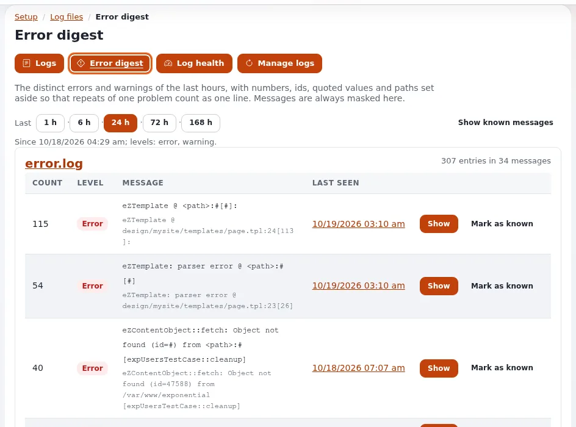

# Log-Viewer und Log-Rotation

Diese Seite ist für Support-Mitarbeitende, die die Logs von Kunden lesen, und für Systemadministratoren, die verhindern, dass
Logdateien Festplatten füllen. Sie beantwortet: wo die Logs einer Website gelesen werden, wer sie lesen darf und was maskiert
wird, wie Sie die Zeilen einer gescheiterten Anfrage finden und wie Rotation, Komprimierung und Bereinigung auf einem Host
funktionieren, auf dem mehrere Benutzer dieselben Logs schreiben.

Die vollständigen Referenzen sind [Der Log-Viewer](../../../../eng-us/features/6.0/log-viewer.md) und
[Log-Rotation und Bereinigung](../../../../eng-us/features/6.0/log-rotation.md).

## Inhalt

1. [Setup > Logdateien](#setup--logdateien)
2. [Wer Logs lesen darf](#wer-logs-lesen-darf)
3. [Die Zeilen einer Anfrage finden](#die-zeilen-einer-anfrage-finden)
4. [Die Logs des Webservers im Viewer](#die-logs-des-webservers-im-viewer)
5. [Dasselbe aus einer Shell](#dasselbe-aus-einer-shell)
6. [Wie der Kernel seine Logs rotiert](#wie-der-kernel-seine-logs-rotiert)
7. [Bereinigen und komprimieren](#bereinigen-und-komprimieren)
8. [Mit logrotate des Systems](#mit-logrotate-des-systems)
9. [Checkliste](#checkliste)

## Setup > Logdateien

**Setup > Logdateien** (`/setup/logs`) zeigt jedes Log der Installation: `error.log`, `warning.log`, `notice.log`, `debug.log`,
`deprecated.log`, `auth.log`, die Anfrage-Logs `404.log` und `security.log`, die Cronjob-Logs, die Logs jeder Website und der
Erweiterungen und ihre Rotationen (`.gz` nur lesend). Ein Navigator gruppiert sie als **Kern**, **Seite**, **Extensions**,
**Webserver** und **Rotierte Archive**, mit Größe, letztem Schreiben und Zeilen pro Minute.


- Jede Ansicht hat einen **Permalink** ohne Query-String, etwa `/setup/logs/view/error`, sicher zum Einfügen in ein Ticket.
- Eine Datei wird mit kurzen Anfragen **live verfolgt**; nichts hält einen Serverprozess offen.
- Die **Suche** deckt eine Datei, jedes Kernel-Log oder jede Datei ab, wahlweise mit Rotationen, nach Text oder begrenztem
  regulärem Ausdruck, Stufe, Zeitraum, Siteaccess, Anfrage, Client oder Fehlerreferenz.
- **Zustand der Logs** (`/setup/logshealth`) zeigt die Festplattennutzung gegenüber `[HealthSettings] DiskBudget`
  (mitgeliefert 256 MB, eine Warnung ab 80 %), die am schnellsten wachsenden Logs, Dateien, die der Webserver nicht schreiben
  kann, und gemischte Eigentümer.
- **Fehlerübersicht** (`/setup/logsdigest`) listet die verschiedenen Fehler und Warnungen der letzten 24 Stunden auf,
  gruppiert und gezählt.

## Wer Logs lesen darf

Drei Richtlinien des Moduls `setup`, die in einer neuen Installation nur die Rolle Administrator hat:

| Richtlinie | Erlaubt |
|---|---|
| `setup/logs` | den Viewer öffnen, verfolgen und suchen, einen Bereich herunterladen |
| `setup/managelogs` | rotieren, leeren, ein Archiv entfernen, jeweils nur, wenn in `[ActionSettings]` eingeschaltet |
| `setup/unmasklogs` | E-Mail-Adressen, IP-Adressen und Geheimnisse so zeigen, wie sie geschrieben wurden, nur für diesen Viewer |

Datenschutz ist standardmäßig an: E-Mail-Adressen, IP-Adressen (`[RedactionSettings] MaskIPs=enabled`), Passwörter, Tokens,
Schlüssel, Sitzungs-IDs und Cookies werden maskiert, und die Werte geheimer Einstellungen werden nie gezeigt. Der Viewer ist
**standardmäßig nur lesend**: In `settings/logviewer.ini [ActionSettings]` ist nur `Download=enabled` eingeschaltet
ausgeliefert; `Rotate`, `Truncate`, `DeleteArchives` und `Compress` kommen mit `disabled`. Jede Ansicht und jede Aktion wird
im Audit festgehalten.

> **Tipp**
> Wenn der eigene Administrator eines Kunden um Zugang zu den Logs bittet, geben Sie `setup/logs` einer seiner Rollen, und
> behalten Sie `setup/unmasklogs` und `setup/managelogs` bei Ihren Support-Mitarbeitenden. Logs anderer Kunden sind nie
> sichtbar: Jede Installation zeigt nur ihre eigenen Dateien.

## Die Zeilen einer Anfrage finden

Eine Fehlerseite zeigt eine Referenz wie `ERR-0123456789`, und dieselbe Referenz steht in `error.log`
([Einen Fehler über seine Referenz finden](../../../anleitungen/fehler-anhand-der-referenz-finden.md)):



1. Fragen Sie den Kunden nach der Referenz und ungefähr, wann es geschah.
2. **Setup > Logdateien**, Feld **Fehlerreferenz**, **Suchen**; oder öffnen Sie
   `/setup/logs/view/error/(reference)/ERR-0123456789/(scope)/kernel/(rotations)/1`.
3. Der Eintrag wird mit **Same request** gezeigt: den Warnungen, Hinweisen und Debug-Zeilen dieser Anfrage und einem Link zu den
   Audit-Einträgen derselben Minute.

Nicht gefunden? Das Log ist vielleicht weggerottiert, oder die Anfrage wurde von einem anderen Knoten ausgeliefert: Jeder Server
hält sein eigenes `var/log`.

## Die Logs des Webservers im Viewer

Die Zugriffs- und Fehlerlogs des Webservers können im selben Viewer gezeigt werden. Sie sind standardmäßig aus und werden nie
erraten: Nennen Sie sie mit einem Schlüssel in `settings/override/logviewer.ini.append.php`:

```ini
[LogViewerSettings]
LogList[]=webserver-access
LogList[]=webserver-error
LogPath[webserver-access]=/var/www/vhosts/<domain>/logs/access_ssl_log
LogPath[webserver-error]=/var/www/vhosts/<domain>/logs/error_log
```

Die Pfade oben sind die eines Plesk-Servers; verwenden Sie die Pfade Ihres Panels oder Ihres virtuellen Hosts. So konfigurierte
Logs werden von Exponential nie rotiert oder bereinigt: Das Programm, das sie schreibt, ist für ihre Rotation zuständig.
Velocity schreibt seine eigenen Zugriffs- und Fehlerlogs unter `var/vc/qbix/log/` und rotiert sie nach Datum
([8.3.12 Logs](../../../installation/08-die-website-ausliefern.md#8312-logs)).

## Dasselbe aus einer Shell

`./console exp:logs` (`bin/php/explogs.php`) nutzt dieselben Einstellungen, Dateien, Maskierungen und Grenzen:

```bash
./console exp:logs --list                                   # files by group, size, time, lines a minute
./console exp:logs --tail=var/log/error.log --lines=50      # the last 50 entries
./console exp:logs --tail=var/log/error.log --follow        # follow it (Ctrl-C ends)
./console exp:logs --search=timeout --file=var/log/error.log --rotations --level=error,warning
./console exp:logs --reference=ERR-0123456789               # the reference and its request
```

## Wie der Kernel seine Logs rotiert

Eine Rotation dient dem ganzen Kernel (`expLogRotator`): Wenn ein Log `site.ini [FileSettings] LogFileMaxSize` überschreitet,
rotiert der nächste Schreibvorgang es nach `.1`, ältere Archive rücken auf, und Archive über `LogFileRotateCount` hinaus werden
entfernt.

| Einstellung (`site.ini [FileSettings]`) | Mitgeliefert | Bedeutung |
|---|---|---|
| `LogFileMaxSize` | `2097152` (2 MB) | Größe, bei der der nächste Schreibvorgang das Log rotiert |
| `LogFileRotateCount` | `3` | behaltene Archive; `0` schaltet die Rotation nach Größe aus |
| `LogFileCompress` | `disabled` | `enabled` komprimiert Archive ab `.2` (`.1` nie: eine Anfrage schreibt vielleicht noch hinein) |
| `LogFileMaxAge` | `0` | Tage, nach denen eine Bereinigung ein Archiv entfernt; `0` ist keine Altersgrenze |
| `LogFilePermissions` | `0666` | Modus eines neu angelegten Logs |

Die Konstanten `EZPUBLISH_LOG_MAX_FILE_SIZE`, `CUSTOM_LOG_MAX_FILE_SIZE`, `EZPUBLISH_LOG_ROTATE_FILES` und
`CUSTOM_LOG_ROTATE_FILES` in `config.php` haben Vorrang vor diesen Einstellungen.

**Sicher mit zwei Schreibern.** Auf einem Host, auf dem Velocity als root und PHP-FPM als Benutzer der Website läuft, schreiben
beide dieselben Logs. Eine Rotation nimmt eine exklusive Sperre, prüft darunter die Größe erneut und legt das neue Log mit
Eigentümer, Gruppe und Modus des alten an, sodass keiner der Benutzer mit einem Log endet, das der andere nicht schreiben kann.

Grenzen pro Log gehören in `settings/logviewer.ini [RotationSettings]`, nach dem Schlüssel des Logs (`MaxSize[debug]`,
`Keep[debug]`, `Compress[error]`, `MaxAgeDays[error]`); ein Log ohne Eintrag nutzt die Werte aus `site.ini`.

## Bereinigen und komprimieren

```bash
./console exp:logs --archives                    # each log, its archives, sizes and limits
./console exp:logs --rotate-all --dry-run        # what would be rotated
./console exp:logs --prune --dry-run             # archives beyond the limits
./console exp:logs --prune                       # remove them
./console exp:logs --compress                    # compress plain archives from .2 on
```

Exit-Codes: `0` erledigt, `1` nichts zu tun, `2` ein unbekannter Name oder ein Fehler. Rotationen und Bereinigungen werden im
Prüfprotokoll festgehalten (`system.log.rotate`, `system.log.delete`). Für einen nächtlichen Job planen Sie den Cronjob-Teil
`logs`, der in keinem Standard-Teil ist:

```text
15 3 * * * cd /path/to/installation && php runcronjobs.php -q logs
```

## Mit logrotate des Systems

Wenn stattdessen `logrotate` des Systems `var/log` verwaltet, setzen Sie `LogFileRotateCount=0`, damit der Kernel nicht
zusätzlich rotiert, und nutzen Sie dort `copytruncate` oder `create <mode> <owner> <group>`. Ihre eigenen Cron-Ausgabedateien
(`cron-*.log`) brauchen immer logrotate, da der Kernel sie nicht schreibt
([10.10](../../../installation/10-nach-der-installation.md#1010-logs-und-log-rotation)).

> **Warnung**
> Lassen Sie `[DebugSettings] DebugOutput=enabled` in der Produktion nie eingeschaltet: Es zeigt Besuchern Interna und schreibt
> viel.

## Checkliste

- [ ] Support-Mitarbeitende haben `setup/logs`; `setup/unmasklogs` und `setup/managelogs` sind auf die beschränkt, die sie brauchen.
- [ ] Die Grenzen der Rotation passen zur Festplatte: Mit den mitgelieferten Werten belegt ein Log mit seinen Archiven höchstens etwa 8 MB.
- [ ] Entweder der Kernel oder logrotate rotiert `var/log`, nicht beide.
- [ ] Der Cronjob-Teil `logs` oder ein geplantes `exp:logs --prune` setzt Altersgrenzen durch.
- [ ] Zustand der Logs zeigt keine Dateien, die der Webserver nicht schreiben kann.
- [ ] Logs des Webservers sind im Viewer konfiguriert, wo Support-Mitarbeitende sie brauchen.

**Demomodus in Setup > Logdateien.** `security.log` gruppiert die Zeilen von Prozessen, die im Demomodus laufen, als `demo/mode`; eine Zeile pro Prozess, sodass eine ausgelastete Demo eine Zeile pro neuem Worker hinzufügt, nicht pro Anfrage. [Demomodus für Hoster](../sicherheit/demomodus-fuer-hoster.md).

## Verwandte Seiten

- [Anfrage-Logs](anfrage-logs.md), [Sicherheitslog](sicherheitslog.md)
- [Überblick über die Überwachung](ueberblick-ueber-die-ueberwachung.md)
- [Festplatte voll](../runbooks/festplatte-voll.md) (Runbook)
- [Aufbewahrung von Logs und Daten](../sicherheit/aufbewahrung-von-logs-und-daten.md)
- [Der Log-Viewer](../../../../eng-us/features/6.0/log-viewer.md) (Referenz der Funktion)
- [Freie Dokumentation](../../freie-dokumentation.md): Diese Seite darf unter der GNU FDL 1.3 frei kopiert, übersetzt und verbessert werden.
