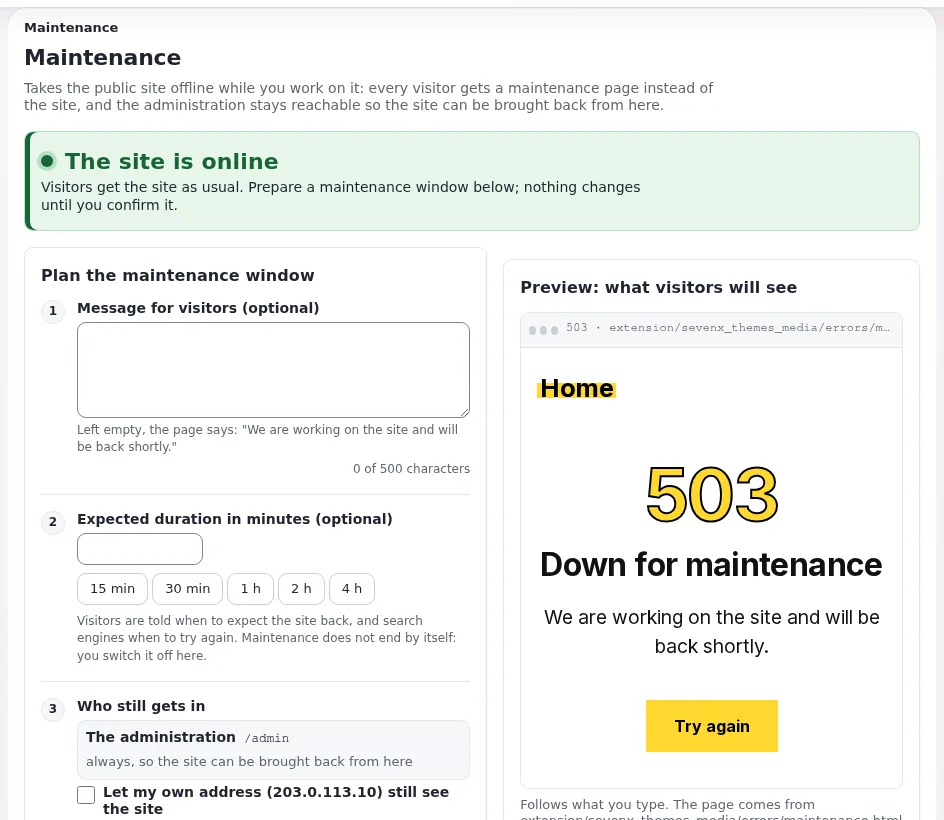

# Wartungsmodus

Diese Seite ist für Systemadministratoren und Support-Mitarbeitende, die Upgrades, Importe, Wiederherstellungen und Reparaturen
auf gehosteten Exponential-Websites ausführen. Sie beantwortet: wie Sie eine Website vom Netz nehmen und zurückbringen, was
Besucher und Suchmaschinen sehen, wer die Website noch erreicht, worauf Sie auf einer Hosting-Plattform achten müssen (getrennte
Hostnamen für die Administration, Proxys, Caches, Cron) und wie Sie wieder hineinkommen, wenn etwas schiefging.

Die vollständige Anleitung ist [Wartungsmodus: die Website vom Netz nehmen und zurückbringen](../../../anleitungen/wartungsmodus.md);
die Referenz der Funktion ist [Wartungsmodus](../../../../eng-us/features/6.0/maintenance-mode.md).

## Inhalt

1. [Was er tut](#was-er-tut)
2. [Ein- und ausschalten](#ein--und-ausschalten)
3. [Wer noch hineinkommt](#wer-noch-hineinkommt)
4. [Die Zustandsdatei und der Weg zurück](#die-zustandsdatei-und-der-weg-zurück)
5. [Caches, Proxys und CDNs](#caches-proxys-und-cdns)
6. [Cron, Installer und Ausrollen](#cron-installer-und-ausrollen)
7. [Die Seite, die Besucher sehen](#die-seite-die-besucher-sehen)
8. [Fehlersuche](#fehlersuche)
9. [Checkliste](#checkliste)

## Was er tut

Solange die Wartung an ist, wird jede Anfrage an `index.php`, `index_rest.php` und `index_treemenu.php` mit einer
eigenständigen Wartungsseite beantwortet, bevor die Einstellungen oder die Datenbank berührt werden:

- Status `503 Service Unavailable` mit `Retry-After` (die Sekunden bis zum erwarteten Ende, oder 120, wenn keines angegeben ist);
- `Cache-Control: no-store` und `X-Robots-Tag: noindex`, sodass kein Cache und keine Suchmaschine die Seite behält;
- Bilder, Styles, Skripte und Schriften werden weiter ausgeliefert, sodass die Seite ihr Aussehen behält;
- Befehle und Cronjobs in einer Shell laufen weiter: Die Wartung betrifft nur Web-Anfragen.

Ein 503 mit `Retry-After` ist die Antwort, die Suchmaschinen als „später wiederkommen“ verstehen: Die Seiten behalten ihren Platz
im Index. Weil die Prüfung vor den Einstellungen und der Datenbank läuft, braucht die Seite nichts, was während des Fensters
kaputt sein könnte.

## Ein- und ausschalten

Aus einer Shell, im Installationsverzeichnis, als Benutzer der Website (als root fügen Sie `--allow-root-user` hinzu):



```bash
php bin/php/maintenance.php on --message="Back at 06:00 UTC" --until=2h --allow-admin
php bin/php/maintenance.php status
php bin/php/maintenance.php off
./console exp:maintenance on|off|status      # the same through the console
```

| Option | Bedeutung |
|---|---|
| `--message="..."` | was die Seite statt des Standardtexts sagt |
| `--until=30m`, `2h`, `"2026-09-28 06:00"` | das erwartete Ende, Besuchern gezeigt und als `Retry-After` gesendet |
| `--allow-ip=<address>,<address>` | Adressen, die die Website weiterhin sehen |
| `--allow-admin` | `/admin` erreichbar halten; ohne die Option ist auch die Administration vom Netz |

Aus der Administration: **Setup > Wartung** (`/setup/maintenance`, Richtlinie `setup / administrate`) tut dasselbe, mit einer
Nachricht, einer Dauer mit einem Klick, wer noch hineinkommt, einer Live-Vorschau der Seite und einer erforderlichen
Bestätigung. Sie zeigt, wer die Wartung eingeschaltet hat, seit wann, bis wann und ob Sie selbst die Website sehen.

> **Warnung**
> Das erwartete Ende ist ein Versprechen, kein Zeitschalter: Die Wartung endet nicht von selbst, wenn es verstreicht. Nehmen Sie
> das Ausschalten in das Runbook jedes Fensters auf, und lassen Sie Ihre Überwachung einen Alarm auslösen, wenn ein Fenster
> überzogen wird ([Zustandsprüfungen und Verfügbarkeit](zustandspruefungen-und-verfuegbarkeit.md)).

Jedes Ein- und Ausschalten wird als `system.maintenance.change` in das Prüfprotokoll geschrieben; die Seite listet die letzten
acht auf.

## Wer noch hineinkommt

| Wer | Wie |
|---|---|
| Die Administration unter `/admin` | immer, wenn von der Seite aus geschaltet; mit `--allow-admin` aus einer Shell |
| Angegebene Adressen | `--allow-ip` oder das Feld für andere Adressen auf der Seite; jede Adresse wird genau verglichen, Bereiche und Netze (`10.0.0.0/8`) werden nicht unterstützt |
| Ihre eigene Adresse | die Option auf der Seite, mit der Ihre eigene Adresse die Website weiter sieht |
| Der Browser eines laufenden Setup-Assistenten | sein eigenes Cookie (`exp_setup_wizard`) |

Zwei Fallen auf Hosting-Plattformen:

- **Eine Administration unter einem eigenen Hostnamen.** Die Seite hält Pfade unter `/admin` erreichbar. Eine Administration,
  die über einen eigenen Hostnamen (`https://edit.example.com/setup/maintenance`) oder unter einem anderen Pfad erreicht wird,
  liegt **nicht** unter `/admin`: Wird die Wartung von dort eingeschaltet, sperrt sie diese Adresse aus. Nutzen Sie die Adresse
  unter `/admin`, erlauben Sie Ihre eigene Adresse, oder halten Sie eine Shell bereit.
- **Proxys.** Eine erlaubte Adresse muss die sein, die PHP sieht. Hinter einem Load Balancer oder Reverse Proxy ist das nur dann
  die Adresse des Besuchers, wenn dem Proxy vertraut wird (`[HTTPHeaderSettings] TrustedProxies[]`); sonst scheint jeder
  Besucher vom Proxy zu kommen ([Mehrere Web-Knoten](mehrere-web-knoten.md#der-load-balancer-und-vertrauenswürdige-proxys)).

## Die Zustandsdatei und der Weg zurück

Der ganze Zustand ist eine Datei, `var/maintenance.json`. Solange sie existiert, binden die Front-Controller
`kernel/classes/expmaintenance.php` ein und antworten mit der Seite; solange sie nicht existiert, kostet es einen Aufruf von
`is_file()` pro Anfrage. Eine Markierung, die sich nicht lesen lässt, bedeutet trotzdem Wartung: Eine Wartungsseite ist besser
als eine halb geänderte Website.

**Das Löschen der Datei beendet die Wartung**, was auch immer sonst falsch ist:

```bash
rm /path/to/installation/var/maintenance.json
```

Das ist der Weg zurück für Support-Mitarbeitende, wenn die Administration ausgesperrt ist und PHP auf der Kommandozeile nicht
läuft. Auf mehreren Knoten mit eigenen Verzeichnissen `var/` hat jeder Knoten seine eigene Datei: Schalten Sie auf jedem Knoten
ein und aus.

## Caches, Proxys und CDNs

- **Der HTTP-Cache.** Das Ein- und Ausschalten verschiebt die Verzeichnisse des HTTP-Caches (`var/<site>/cache/exphttpcache`)
  nach `var/tmp/<site>-exphttpcache-before-maintenance-<time>-<pid>`, statt sie zu löschen; entfernen Sie diese später, um den
  Platz freizugeben.
- **Velocity.** Die erzeugte Konfiguration der Website nennt die Markierung als Pausendatei des Antwort-Caches, sodass während des
  Fensters weder der Cache von Velocity noch der HTTP-Cache der Anwendung antwortet (Velocity 0.0.4.34 oder später). Der Befehl
  leert den Antwort-Cache von Velocity, wenn er umschaltet; wenn Apache die Seite der Administration ausliefert, leeren Sie ihn
  nach dem Ausschalten selbst: `./console exp:velocity cache clear --allow-root-user`.
- **Ein CDN oder Reverse Proxy** speichert die Wartungsseite nicht (`no-store`), hält aber vielleicht noch Seiten von vor dem
  Fenster. Leeren Sie ihn, wenn das Fenster Inhalte geändert hat.

## Cron, Installer und Ausrollen

- **Cronjobs laufen weiter.** Halten Sie die Teile, die nicht gegen eine halb geänderte Website laufen dürfen, auf
  **Setup > Cronjobs** an, oder entfernen Sie sie für das Fenster aus der Crontab, und führen Sie sie danach erneut aus
  ([Cronjobs](cronjobs.md)).
- **Der Kickstarter** schaltet die Wartung für seinen Lauf ein und aus, wenn die Website installiert und geprüft ist. Nach einem
  gescheiterten Schritt lässt er die Wartung an, damit keine halb installierte Website gezeigt wird; auch die Administration ist
  während eines Kickstarter-Laufs vom Netz. War die Wartung schon an, lässt er dieses Fenster, wie es ist.
- **Der Setup-Assistent im Web** schaltet sie beim ersten abgeschickten Schritt mit einer Frist ein (`expMaintenance::WIZARD_LEASE`,
  900 Sekunden im Code), die mit jedem Schritt erneuert wird, sodass ein verlassener Assistent die Website von selbst zurückgibt.
- **Ausrollen** (`exp:velocity deploy`) schaltet die Wartung weder ein noch aus. Öffnen Sie selbst ein Fenster für ein Ausrollen,
  das die Datenbank oder viele Dateien ändert ([Änderungen ausrollen](aenderungen-ausrollen.md)).

## Die Seite, die Besucher sehen

Die Seite ist die `errors/maintenance.html` des aktiven Themes, wenn eine aktive Erweiterung eine hat, sonst
`share/maintenance.html`: eine eigenständige HTML-Datei mit Platzhaltern für die Nachricht und das erwartete Ende. Um sie für einen
Kunden zu gestalten, geben Sie der Theme-Erweiterung des Kunden eine eigene `errors/maintenance.html`
([Abschnitt 8 der Anleitung](../../../anleitungen/wartungsmodus.md#8-die-wartungsseite-und-ihre-vorschau)).

> **Tipp**
> Schreiben Sie die Nachricht in den Worten des Kunden und geben Sie eine Endzeit mit Zeitzone an: „Wir aktualisieren den Shop.
> Zurück um 06:00 UTC.“ Der Support erhält dann weniger Tickets mit der Frage, ob die Website nicht erreichbar ist.

## Fehlersuche

| Symptom | Abhilfe |
|---|---|
| Die Administration zeigt die Wartungsseite | sie liegt nicht unter `/admin`, oder `--allow-admin` fehlte: `php bin/php/maintenance.php off` oder `var/maintenance.json` löschen |
| „Sie ist an, aber die Website wird normal angezeigt“ | Ihre Adresse ist erlaubt, oder ein CDN hält die Seite noch: prüfen Sie aus einem anderen Netz mit `curl -sI` |
| Ein erlaubter Tester erhält die Wartungsseite | die Adresse, die PHP sieht, weicht ab (Proxy, IPv6): schlagen Sie sie im Zugriffslog nach |
| „var/maintenance.json is not writable“ | machen Sie `var/` für den Benutzer des Webservers beschreibbar; prüfen Sie den Eigentümer einer vorhandenen Markierung |
| Die Website kommt mit alten Seiten zurück | leeren Sie den Antwort-Cache von Velocity, leeren Sie das CDN |
| **Eine Installation läuft**, und nichts wird installiert | ein Kickstarter-Lauf ist gescheitert und hat sie angelassen: reparieren, dann ausschalten |
| Die REST-API antwortet mit 503 | die API ist auch ein Front-Controller: erlauben Sie die Adressen ihrer Clients oder halten Sie das Fenster kurz |

Die vollständige Tabelle steht in [Abschnitt 15 der Anleitung](../../../anleitungen/wartungsmodus.md#15-fehlerbehebung).

## Checkliste

- [ ] Das Fenster ist dem Kunden mit einer Zeitzone angekündigt, und die Nachricht sagt, wann die Website zurück ist.
- [ ] Die Administration wird unter `/admin` erreicht, oder Ihre Adresse ist erlaubt, oder eine Shell ist offen.
- [ ] Cron-Teile, die nicht laufen dürfen, sind für das Fenster angehalten.
- [ ] Vor der Änderung wurde ein Backup erstellt.
- [ ] Die Wartung wird am Ende auf jedem Knoten ausgeschaltet; der Cache von Velocity und das CDN sind geleert.
- [ ] Die zur Seite verschobenen Verzeichnisse des HTTP-Caches in `var/tmp/` werden später entfernt.

## Verwandte Seiten

- [Zustandsprüfungen und Verfügbarkeit](zustandspruefungen-und-verfuegbarkeit.md)
- [Kunden-Websites aktualisieren](kunden-websites-aktualisieren.md), [Änderungen ausrollen](aenderungen-ausrollen.md)
- [Wiederherstellung und Wiederherstellungstests](wiederherstellung-und-wiederherstellungstests.md)
- [Website nicht erreichbar](../runbooks/website-nicht-erreichbar.md) (Runbook)
- [Anleitung zum Wartungsmodus](../../../anleitungen/wartungsmodus.md)
- [Freie Dokumentation](../../freie-dokumentation.md): Diese Seite darf unter der GNU FDL 1.3 frei kopiert, übersetzt und verbessert werden.
