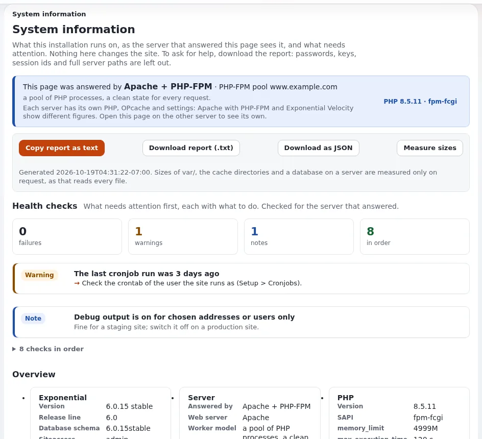

# Zustandsprüfungen und Verfügbarkeit

Diese Seite ist für Systemadministratoren, die die Überwachung der Verfügbarkeit und Zustandsprüfungen von Load Balancern für
Exponential-Websites einrichten, und für Produktmanager, die die Verfügbarkeit in einem Hosting-Tarif beschreiben. Sie
beantwortet: welche URLs Sie von außen anfragen, wie eine gesunde Antwort aussieht, wie sich ein geplantes Wartungsfenster
zeigt, welche Prüfungen auf dem Server selbst laufen und was Velocity hinzufügt.

Exponential hat keine einzelne Zustands-URL; das Installationsbuch empfiehlt, eine Prüfung von außen mit den Statusbefehlen im
Inneren zu kombinieren ([10.11](../../../installation/10-nach-der-installation.md#1011-überwachung-und-zustandsprüfungen)). Die innere Hälfte
steht auf [Überblick über die Überwachung](ueberblick-ueber-die-ueberwachung.md).

## Inhalt

1. [Prüfungen von außen](#prüfungen-von-außen)
2. [Geplante Wartung ist kein Ausfall](#geplante-wartung-ist-kein-ausfall)
3. [Prüfungen auf dem Server](#prüfungen-auf-dem-server)
4. [Velocity: Zustandsendpunkt und Watchdog](#velocity-zustandsendpunkt-und-watchdog)
5. [Zustandsprüfungen des Load Balancers](#zustandsprüfungen-des-load-balancers)
6. [Verfügbarkeit in einem Hosting-Tarif](#verfügbarkeit-in-einem-hosting-tarif)
7. [Checkliste](#checkliste)

## Prüfungen von außen

Zwei Anfragen decken die öffentliche Website und die Anwendung dahinter ab:

| Prüfung | Befehl | Gesund |
|---|---|---|
| Die Website antwortet | `curl -s -o /dev/null -w '%{http_code} %{time_total}\n' https://www.example.com/` | `200` und eine Zeit, die Sie kennen |
| Die Administration antwortet | `curl -s -o /dev/null -w '%{http_code}\n' https://www.example.com/admin/user/login` | `200` |

Die Startseite wird oft aus einem Cache ausgeliefert (dem Antwort-Cache von Velocity, dem HTTP-Cache, einem CDN), sodass sie
antworten kann, während die Datenbank nicht erreichbar ist. Das ist ein Grund, wie das Installationsbuch auch die Anmeldeseite
der Administration zu prüfen; eine Seite, deren Inhalt Sie prüfen können (ein Wort, das nur die gerenderte Seite enthält), ist
stärker als ein Statuscode. Messen Sie die Zeit jedes Mal vom selben Ort aus; ein einzelner Seitenaufruf beweist nichts
([Ausrollen](../../../anleitungen/bereitstellung.md#8-machen-sie-sie-schnell)).

> **Tipp**
> Richten Sie den Monitor auf die Adresse, die Besucher nutzen, einschließlich HTTPS, sodass auch ein abgelaufenes Zertifikat
> oder eine kaputte Weiterleitung einen Alarm auslöst. Fügen Sie pro Knoten oder Engine-Port eine zweite Prüfung hinzu, wenn Sie
> mehrere betreiben.

## Geplante Wartung ist kein Ausfall

Solange der Wartungsmodus an ist, erhält jede Seitenanfrage die Wartungsseite mit diesen Headern
([Anleitung zum Wartungsmodus](../../../anleitungen/wartungsmodus.md#1-was-der-wartungsmodus-tut)):

```text
HTTP/1.1 503 Service Unavailable
Retry-After: <seconds until the expected end, or 120 when none is given>
Cache-Control: no-store, no-cache, must-revalidate, private
X-Robots-Tag: noindex
```

Suchmaschinen lesen ein 503 mit `Retry-After` als „später wiederkommen“. Für Ihre Überwachung:

- Pausieren Sie die Prüfung für das Fenster, oder lassen Sie sie ein 503 mit `Retry-After` akzeptieren, solange
  `php bin/php/maintenance.php status` meldet, dass die Wartung an ist.
- Lösen Sie einen Alarm aus, wenn das Fenster länger dauert als angekündigt: Die Wartung endet nie von selbst, wenn die
  erwartete Zeit verstreicht. Die Seite der Administration warnt, sobald das Ende überschritten ist; Ihr Monitor sollte es auch.
- Bilder, Styles und Skripte werden während der Wartung weiter ausgeliefert; eine Prüfung auf eine statische Datei bleibt grün.

Siehe [Wartungsmodus](wartungsmodus.md).

## Prüfungen auf dem Server

Führen Sie diese nach Zeitplan als Benutzer der Website aus und lösen Sie bei einem Exit-Status ungleich null einen Alarm aus:



```bash
./console exp:systeminfo --json                      # exit 1 when a health check fails
php bin/php/cache.php status --json --allow-root-user   # ends in PASS
php bin/php/audit.php verify --allow-root-user          # exit 0: every chain intact
df -h /path/to/installation                             # room for caches, logs and a backup
```

`exp:systeminfo` meldet die Zustandsprüfungen von **Setup > Systeminformationen** für das PHP der Kommandozeile: PHP-Version
und Erweiterungen, OPcache, `memory_limit`, `max_execution_time` und mehr, jeweils mit dem, was zu tun ist
([Systeminformationen, Zustandsprüfungen](../../../anleitungen/systeminformationen.md#3-zustandsprüfungen)). Öffnen Sie die Seite der
Administration über jeden Server, den Sie betreiben, um die Prüfungen des PHP zu sehen, das Besucher bedient.

## Velocity: Zustandsendpunkt und Watchdog

Eine Website, die Exponential Velocity ausliefert, hat einen Zustandsendpunkt des Servers selbst
([Kontrollzentrum von Velocity](../../../../eng-us/features/6.0/velocity-control-panel.md)):

```bash
curl -s http://127.0.0.1:8088/Q/health
```

Er antwortet jedem mit `{"status":"ok"}` und gibt Kennzahlen nur einem Administrator. Er sagt Ihnen, dass der Serverprozess
antwortet; er rendert keine Seite der Website, behalten Sie also die externen Seitenprüfungen bei. `/Q/metrics` liefert Text im
Format von Prometheus für einen Scraper; der Zugriff von anderen Maschinen wird durch
`settings/velocity.ini [DashboardSettings]` (`Token`, `Remote`) geregelt. Port `8088` ist der mitgelieferte Port für reines HTTP
der Engine `qbix` (`[ServerSettings] Port`).

Der **Watchdog** ist ein systemd-Timer, der die Standard-Engine wieder startet, wenn sie nicht läuft und niemand das wollte (ein
Absturz, ein Abbruch wegen Speichermangels, ein Neustart, dessen Aufrufer beendet wurde):

```bash
./console exp:velocity watchdog install --allow-root-user   # service and timer, enabled
./console exp:velocity watchdog status --allow-root-user    # timer, markers, last check and last start
```

Er prüft alle `[WatchdogSettings] Interval` Sekunden (mitgeliefert `45`), rührt nie einen laufenden Server an, ob er antwortet
oder nicht, und hält sich nach drei gescheiterten Starts in Folge zurück. Er schreibt `var/log/velocity-watchdog.log` und
Audit-Ereignisse ([Der Watchdog](../../../../eng-us/bc/6.0/velocity-engines.md#the-watchdog-expvelocity-watchdog)). Einen Server, der läuft,
aber nicht antwortet, muss Ihre Überwachung erkennen.

## Zustandsprüfungen des Load Balancers

Ein Load Balancer braucht eine günstige Anfrage, die scheitert, wenn ein Knoten nicht ausliefern kann. Möglichkeiten aus den
Quellen oben:

| Möglichkeit | Vorteile | Nachteile |
|---|---|---|
| Die Anmeldeseite der Administration | läuft durch den Kernel, wie die Seiten der Besucher | schwerer als eine statische Datei |
| `/Q/health` von Velocity | günstig, für Monitore gemacht | sagt, dass der Serverprozess antwortet, nicht dass die Website rendert |
| Eine statische Datei | am günstigsten | bleibt grün, wenn PHP kaputt ist |

Was immer Sie wählen: Stellen Sie sicher, dass ein Knoten im Wartungsmodus oder mit angehaltener Engine herausgenommen wird und
dass die Prüfung keine Sitzungen anlegt oder Caches mit einem Eintrag pro Anfrage füllt.

## Verfügbarkeit in einem Hosting-Tarif

Die Zahlen eines Verfügbarkeitsversprechens sind eine geschäftliche Entscheidung; die Quellen nennen keine. Was die Plattform
Ihnen gibt, um ein solches Versprechen zu halten:

- Wartungsfenster, die mit einem sauberen 503 und einem erwarteten Ende antworten, statt mit Fehlern;
- einen Watchdog, der Velocity nach einem Absturz neu startet;
- Statusbefehle mit Exit-Codes für automatische Prüfungen;
- Logs und ein Prüfprotokoll, um einen Vorfall im Nachhinein zu erklären.

Siehe [SLA-Optionen](../geschaeft/sla-optionen-fuer-exponential-hosting.md), wie Sie sie formulieren.

## Checkliste

- [ ] Eine externe Prüfung fragt die Startseite und die Anmeldeseite der Administration über HTTPS an.
- [ ] Wartungsfenster werden im Monitor pausiert oder am 503 mit `Retry-After` erkannt.
- [ ] Ein überzogenes Wartungsfenster löst einen Alarm aus.
- [ ] `exp:systeminfo`, der Cache-Status und die Prüfung des Audits laufen auf dem Server nach Exit-Code.
- [ ] Der Watchdog von Velocity ist installiert, wo Velocity die Website ausliefert, und sein Log wird beobachtet.
- [ ] Prüfungen des Load Balancers nehmen einen Knoten heraus, wenn er keine Seite rendern kann.

## Verwandte Seiten

- [Überblick über die Überwachung](ueberblick-ueber-die-ueberwachung.md)
- [Wartungsmodus](wartungsmodus.md)
- [Velocity für Hoster](../server/velocity-fuer-hoster.md)
- [Website nicht erreichbar](../runbooks/website-nicht-erreichbar.md), [Velocity startet nicht](../runbooks/velocity-startet-nicht.md),
  [Ablauf von Zertifikaten](../runbooks/ablauf-von-zertifikaten.md) (Runbooks)
- [SLA-Optionen](../geschaeft/sla-optionen-fuer-exponential-hosting.md)
- [Freie Dokumentation](../../freie-dokumentation.md): Diese Seite darf unter der GNU FDL 1.3 frei kopiert, übersetzt und verbessert werden.
