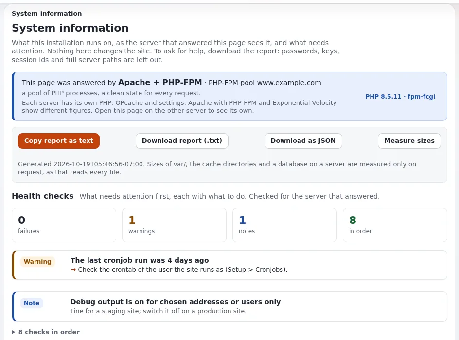

# Managed Hosting

Diese Seite ist für Hosting-Anbieter, die **verwaltetes** Exponential-Hosting anbieten möchten, bei dem der Hoster nicht nur
die Maschine bereitstellt, sondern auch die Plattform der Website für den Kunden betreibt: Updates, Backups, Überwachung,
Sicherheit. Sie beantwortet, welche Aufgaben ein solcher Dienst üblicherweise übernimmt, welches Werkzeug in Exponential jede
davon unterstützt, wie Sie aufschreiben, wer was tut, und was 7x, der Verwalter des Projekts, selbst anbietet. Sie nennt keine
Preise oder Service-Level: Das sind Entscheidungen eines Hosters ([SLA-Optionen](../geschaeft/sla-optionen-fuer-exponential-hosting.md)).



## Inhalt

1. [Was „verwaltet“ abdecken kann](#was-verwaltet-abdecken-kann)
2. [Die Werkzeuge für jede Aufgabe](#die-werkzeuge-für-jede-aufgabe)
3. [Eine Zuständigkeitsmatrix](#eine-zuständigkeitsmatrix)
4. [Die Änderungen des Kunden und Ihre auseinanderhalten](#die-änderungen-des-kunden-und-ihre-auseinanderhalten)
5. [Zugang für Ihre Mitarbeitenden](#zugang-für-ihre-mitarbeitenden)
6. [7x als verwaltender Hoster](#7x-als-verwaltender-hoster)
7. [Checkliste](#checkliste)

## Was „verwaltet“ abdecken kann

| Bereich | Nicht verwaltet | Verwaltet (Optionen) |
|---|---|---|
| Maschine, Betriebssystem, PHP | Hoster oder Kunde | Hoster |
| Webserver oder Velocity, Zertifikate | Kunde | Hoster |
| Updates von Exponential und Erweiterungen | Kunde | Hoster, nach vereinbartem Zeitplan und mit einem Testschritt |
| Backups von Datenbank und Dateien, Wiederherstellungstests | Kunde | Hoster |
| Überwachung und Durchsicht der Logs | Kunde | Hoster |
| Sicherheitshärtung und Reaktion auf Vorfälle | Kunde | Hoster, mit dem Kunden für Inhalte und Benutzer |
| Inhalte, Benutzer, Rollen | Kunde | Kunde |
| Eigener Code (Erweiterungen, Designs) | Kunde oder seine Agentur | Kunde oder seine Agentur; der Hoster rollt ihn aus |

## Die Werkzeuge für jede Aufgabe

| Aufgabe | Werkzeug in Exponential | Wo es beschrieben ist |
|---|---|---|
| Updates und neue Pakete | **ezupdate**: **Setup > Updates and packages** (`/update/dashboard`); eine Prüfung, die nichts ändert, ein Probelauf, eine Bestätigung des Backups und die eigene Ausgabe von Composer während des Laufs; auch auf der Kommandozeile (`php extension/ezupdate/bin/php/ezupdate.php`) | [ezupdate](../../../../en/us/features/6.0/extensions/ezupdate.md), [Automatische Updates mit ezupdate](../betrieb/automatische-updates-mit-ezupdate.md) |
| Vor einem Upgrade | **Setup > Upgrade-Prüfung** (`/setup/systemupgrade`): Konsistenz von Dateien und Datenbank, nur lesend | [Die Upgrade-Prüfung](../../../../en/us/guides/upgrade-check.md) |
| Upgrade | die Update-Dateien und Upgrade-Schritte des Release | [Kapitel 11](../../../../en/us/install/11-upgrading.md), [Kunden-Websites aktualisieren](../betrieb/kunden-websites-aktualisieren.md) |
| Backups | Wartungsmodus, das Datenbankwerkzeug der Engine, `tar` der Dateien | [10.9 Backups und Wiederherstellung](../../../../en/us/install/10-after-installing.md#109-backups-and-restore) |
| Die Website vom Netz nehmen | **Setup > Wartung** oder `php bin/php/maintenance.php on ... / off / status` | [Wartungsmodus](../../../../en/us/guides/maintenance-mode.md) |
| Zustand | **Setup > Systeminformationen** (`/setup/info`) und `exp:system:info` | [Systeminformationen](../../../../en/us/guides/system-information.md) |
| Logs | **Setup > Logdateien** (`setup/logs`), mit Permalinks; Rotation | [Log-Viewer](../../../../en/us/features/6.0/log-viewer.md), [Log-Viewer und Log-Rotation](../betrieb/log-viewer-und-log-rotation.md) |
| Geplante Jobs | **Setup > Cronjobs**, das Teile ausführt und Crontab-Zeilen vorschlägt | [Cronjobs](../../../../en/us/guides/cronjobs.md) |
| Wer hat was getan | das Prüfprotokoll | [Das Prüfprotokoll](../../../../en/us/features/6.0/audit-trail.md), [Prüfprotokoll für Hoster](../sicherheit/pruefprotokoll.md) |
| Codeänderungen ausrollen | `exp:velocity deploy` (Autoloads, Caches, Neuladen von PHP-FPM, Neustart von Velocity in Reihenfolge) | [8.3.14](../../../../en/us/install/08-serving-the-site.md#8314-deploying-a-change-expvelocity-deploy) |
| Leistungsprüfungen | `exp:benchmark` | [Benchmark](../../../../en/us/features/6.0/benchmark.md) |

> **Hinweis**
> Ein verwaltetes Backup besteht aus der Datenbank **und** `var/storage`, `settings/override` und `settings/siteaccess`, im
> selben Moment erstellt, außerhalb des Servers gespeichert und einmal auf einer anderen Maschine wiederhergestellt, um zu
> beweisen, dass es funktioniert. Die Checkliste für die erste Woche im Installationsbuch verlangt genau das
> ([10.15](../../../../en/us/install/10-after-installing.md#1015-a-checklist-for-the-first-week)).

## Eine Zuständigkeitsmatrix

Schreiben Sie eine pro Kunde, und bewahren Sie sie mit dem Vertrag auf. Ein Ausgangspunkt:

```text
Customer: <customer>     Site: <domain>     Plan: <plan name>     Reviewed: <date>

Task                                   Host   Customer   Agency   Notes
Operating system and PHP updates        R                          window: <when>
Exponential and extension updates       R      A                   test on staging first
Custom extensions and designs                  A          R        host deploys
Backups (database + files)              R                          kept: <generations>
Restore test                            R      I                   last: <date>
Certificates                            R
Monitoring and alerts                   R      I
Security incidents                      R      I          C
Content, users and roles                       R

R = does it, A = approves, C = consulted, I = informed
```

## Die Änderungen des Kunden und Ihre auseinanderhalten

Auf einer verwalteten Installation können sich Einstellungen, die in der Administration geändert werden, und Einstellungen,
die Sie ausrollen, widersprechen. Ohne Vorkehrungen schreiben der INI-Editor, die Editoren für Werkzeugleisten und Menüs und
der Template-Editor `*.ini.append.php`- und `.tpl`-Dateien in das Release-Verzeichnis, wo die Versionsverwaltung sie nicht
sieht und das nächste Ausrollen sie verwirft
([Konfiguration über das Ausrollen verwaltet](../../../../en/us/features/6.0/managed-by-deployment.md)).

Zwei Möglichkeiten:

- **`ManagedByDeployment=enabled`** pro Siteaccess (`[ConfigurationSettings]`): Die Konfiguration kommt nur aus dem
  Ausrollen; die schreibenden Ansichten antworten, als wären sie ausgeschaltet, und `eZINI::save()` verweigert. Lesende
  Ansichten, die Logs und die Kommandozeile bleiben offen. Das passt zu einem Hoster, der jede Konfigurationsänderung ausrollt.
- **Lassen Sie es aus**, und vereinbaren Sie, dass Konfigurationsänderungen im Browser Sache des Kunden sind; sichern Sie
  `settings/` und vergleichen Sie vor jedem Ausrollen.

## Zugang für Ihre Mitarbeitenden

- Geben Sie allen Ihren Mitarbeitenden ein eigenes Administratorkonto, nie ein gemeinsames, sodass das Prüfprotokoll die
  Person nennt ([Die Administration einschränken](../sicherheit/die-administration-einschraenken.md)).
- Nutzen Sie für diese Konten die zweistufige Anmeldung ([Zweistufige Anmeldung](../sicherheit/zweistufige-anmeldung.md)).
- Shell-Zugang als Benutzer der Website, nicht als root, sodass Dateien, die Ihre Mitarbeitenden anlegen, für die Website
  beschreibbar bleiben ([8.7.2](../../../../en/us/install/08-serving-the-site.md#872-one-user-or-one-group)).

## 7x als verwaltender Hoster

7x, der Verwalter des Projekts, verkauft Dienste rund um die quelloffene Software; die Software selbst bleibt frei. Sein
Angebot umfasst verwaltetes Hosting („Exponential Website Hosting“ und „Exponential Platform SSD Hosting“), Support- und
Wartungsverträge und Upgrades von älteren Versionen. Preise und Bedingungen stehen auf der Website von 7x, nicht hier
([Wer ist 7x?](../../../../en/us/help/who-is-7x.md#services-and-hosting)).

Exponential ist freie Software: Jeder Hoster darf verwaltetes Exponential-Hosting anbieten, und ein Kunde darf zwischen
Hostern wechseln. Siehe [Mit dem Projekt und 7x zusammenarbeiten](../geschaeft/mit-dem-projekt-und-7x-zusammenarbeiten.md) und
[Lizenzierung für Hoster](../geschaeft/lizenzierung-fuer-hoster.md).

## Checkliste

- [ ] Die Aufgaben, die der Dienst übernimmt, sind pro Tarif aufgeschrieben.
- [ ] Für jeden Kunden gibt es eine Zuständigkeitsmatrix.
- [ ] Updates: ezupdate installiert, Prüfung und Probelauf vor jedem Update, ein Staging-Schritt.
- [ ] Backups mit Wartungsmodus, außerhalb des Standorts, Wiederherstellung getestet.
- [ ] Überwachung: Systeminformationen, Logs und Ausgabe von Cron nach Zeitplan durchgesehen.
- [ ] `ManagedByDeployment` pro Siteaccess entschieden.
- [ ] Persönliche Konten der Mitarbeitenden mit zweistufiger Anmeldung.

## Verwandte Seiten

- [Ein Hosting-Modell wählen](ein-hosting-modell-waehlen.md)
- [Support-Stufen](../geschaeft/support-stufen-fuer-exponential-hosting.md), [SLA-Optionen](../geschaeft/sla-optionen-fuer-exponential-hosting.md)
- [Checkliste: monatlicher Betrieb](../checklisten/checkliste-fuer-den-monatlichen-betrieb.md)
- [Freie Dokumentation](../../../../en/us/help/free-documentation.md): Diese Seite darf unter der GNU FDL 1.3 frei kopiert, übersetzt und verbessert werden.
