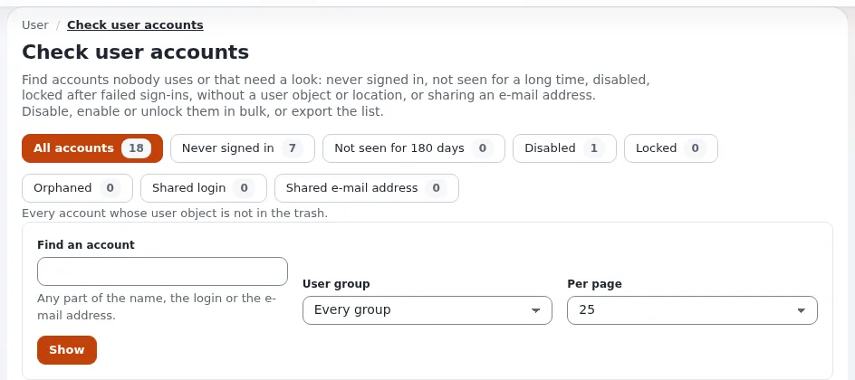

# Erste Anmeldung und Standardpasswörter

Diese Seite ist für die Menschen bei einem Hoster, die Exponential-Websites bereitstellen und an Kunden übergeben: Systemadministratoren,
das Team für Automatisierung und Support-Mitarbeitende. Jede Installation beginnt mit einem Administratorkonto, Anmeldename `admin`. Was
sein Passwort ist, hängt davon ab, wie die Website installiert wurde. Diese Seite sagt Ihnen, was jeder Installer hinterlässt und wie Sie
die erste Anmeldung sicher an einen Kunden übergeben.




> **Warnung**
> Diese Seite gibt nie ein Passwort aus. Das historische Standardpasswort des mitgelieferten Datenbank-Seeds und jede Regel zu erzeugten
> Passwörtern sind auf [Das Standard-Administratorpasswort](../../standard-administratorpasswort.md) dokumentiert. Kopieren Sie kein festes
> Passwort in Skripte, Tickets, Willkommensmails oder Kundendokumentation.

## Inhalt

1. [Was jeder Installer hinterlässt](#was-jeder-installer-hinterlässt)
2. [Bereitstellung ohne bekanntes Passwort](#bereitstellung-ohne-bekanntes-passwort)
3. [Übergabe an den Kunden](#übergabe-an-den-kunden)
4. [Nach der ersten Anmeldung](#nach-der-ersten-anmeldung)
5. [Migrierte und importierte Websites](#migrierte-und-importierte-websites)
6. [Wenn sich niemand anmelden kann](#wenn-sich-niemand-anmelden-kann)
7. [Checkliste](#checkliste)

## Was jeder Installer hinterlässt

Aus [Das Standard-Administratorpasswort](../../standard-administratorpasswort.md#kurz-gesagt):

| Wie die Website installiert wurde | Passwort nach der Installation |
|---|---|
| Setup-Assistent im Browser | das im Assistenten eingegebene; es gibt keinen Standard; kurze und bekannte Passwörter werden abgelehnt |
| Kickstarter mit `kickstart.ini` | `[site_admin] Password=`; wenn leer, kürzer als `MinPasswordLength` oder bekannt, ein zufälliges Passwort mit 20 Zeichen, einmal ausgegeben und nach `var/log/initial-admin-password` geschrieben |
| Installation über die Konsole (`exp:install`) | `--password=`, wenn lang genug und nicht bekannt; sonst ein zufälliges Passwort mit 24 Zeichen, in der Zusammenfassung ausgegeben und nach `var/log/initial-admin-password` geschrieben |
| Der mitgelieferte Datenbank-Seed, von Hand geladen, ohne Installer | der historische Standard, allen bekannt; siehe die oben verlinkte Seite |
| Seitenpakete | keine Änderung: Pakete bringen keine Konten mit |

Kein Installer von Exponential 6 lässt den historischen Standard bestehen. Er überlebt nur dort, wo eine Datenbank ohne Installer aus dem
Seed angelegt wurde, wo der Assistent angewiesen wurde, eine solche Datenbank zu behalten, oder auf einer migrierten alten Website.

`var/log/initial-admin-password` wird mit dem Modus `0600` geschrieben, nur für den Eigentümer. Die Logs des Laufs (`var/log/kickstart.log`,
`var/log/exp-install-<date>.ini`) maskieren Passwörter.

## Bereitstellung ohne bekanntes Passwort

Für die automatische Bereitstellung ist der Installer der Konsole das übliche Werkzeug
([exp:install für Hoster](../bereitstellung/exp-install-fuer-hoster.md), [Kickstarter](../bereitstellung/der-kickstarter-fuer-hoster.md)):

- Lassen Sie den Installer das Passwort erzeugen, oder übergeben Sie eines aus Ihrem Geheimnisspeicher (`--password="${ADMIN_PASSWORD}"`).
  Schreiben Sie nie ein Passwort in ein Skript, ein Image oder eine Vorlage.
- Geben Sie nicht jedem Kunden dasselbe Passwort, und leiten Sie es nicht aus der Domain oder der Kundennummer ab.
- Holen Sie ein erzeugtes Passwort aus der Zusammenfassung oder aus `var/log/initial-admin-password`, legen Sie es in Ihren
  Geheimnisspeicher oder den Übergabekanal des Kunden, und löschen Sie die Datei.
- Wenn Sie `kickstart.ini`-Dateien behalten, legen Sie sie mit dem Modus `0600` an, committen Sie sie nie und entfernen Sie sie nach dem
  Lauf.
- Fügen Sie der Liste bekannter Passwörter Ihre eigenen Wörter hinzu (den Namen des Unternehmens, den Namen des Produkts), damit Kunden sie
  später nicht wählen können:

```ini
# settings/override/site.ini.append.php
[UserSettings]
WeakPasswordList[]=<your company name>
WeakPasswordFile=settings/weak-passwords.txt
```

Die Installer prüfen die Liste immer; `WeakPasswordCheck` steuert die Formulare.

## Übergabe an den Kunden

Ein Hoster wählt, wie der Kunde die erste Anmeldung bekommt. Möglichkeiten, die das Passwort aus gewöhnlicher Mail heraushalten:

- ein Einmal-Link Ihres Geheimnisspeichers oder Kundenportals;
- ein Passwort, das auf einen zufälligen Wert gesetzt ist, und eine Mail **Passwort vergessen?** an die echte Adresse des Kunden, die
  einmal und eine Stunde lang funktioniert (`ForgotPasswordKeyLifetime=3600`);
- ein persönliches Administratorkonto für die verantwortliche Person beim Kunden, bei der Bereitstellung angelegt, mit `admin` als
  Notfallkonto des Hosters (siehe unten).

Wofür Sie sich auch entscheiden: Geben Sie dem Konto eine echte, überwachte E-Mail-Adresse: **Passwort vergessen?** und die Mail, dass das
Passwort geändert wurde (`ChangeNotificationMail=enabled`), gehen dorthin.

## Nach der ersten Anmeldung

Aus [Nach der ersten Anmeldung](../../standard-administratorpasswort.md#nach-der-ersten-anmeldung):

1. Ändern Sie das Passwort ([Das Administratorpasswort ändern](../../administratorpasswort-aendern.md)).
2. Geben Sie dem Konto eine echte E-Mail-Adresse.
3. Löschen Sie `var/log/initial-admin-password`.
4. Entfernen Sie `kickstart.ini`, wenn eine genutzt wurde.
5. Legen Sie ein persönliches Administratorkonto pro Person an und nutzen Sie `admin` nicht mehr zur Anmeldung
   ([Kontenpflege](../../administratorpasswort-aendern.md#kontenhygiene)).
6. Schalten Sie die zweistufige Anmeldung für Administratoren ein ([Zweistufige Anmeldung](zweistufige-anmeldung.md)).

## Migrierte und importierte Websites

Eine Website, die von einer alten Linie migriert wurde, oder eine Datenbank, die aus einem alten Dump wiederhergestellt wurde, trägt
vielleicht noch den historischen Standard. Setzen Sie sofort ein neues zufälliges Passwort:

```bash
./console exp:resetuserpassword --allow-root-user -u admin -g -l 24
```

Der Befehl setzt das Passwort über denselben Code wie das Formular zum Bearbeiten von Benutzern, sodass dieselben Regeln und derselbe
Hash-Typ gelten. `--allow-root-user` wird verweigert, es sei denn, Sie sind wirklich der `root` des Betriebssystems. Pakete von Dritten
können Benutzerkonten mit eigenen Passwort-Hashes mitbringen; prüfen Sie sie vor der Installation.

## Wenn sich niemand anmelden kann

Die unterstützten Wege, in Reihenfolge ([Ausgesperrt](../../administratorpasswort-aendern.md#ausgesperrt-wenn-sich-kein-administrator-anmelden-kann)):

1. ein anderer Administrator der Website ändert das Passwort oder setzt die gescheiterten Anmeldungen zurück;
2. **Passwort vergessen?**, wenn die Mail des Kontos funktioniert;
3. die Kommandozeile als `root`-Benutzer des Betriebssystems, wie oben (`-u <login>` für ein persönliches Konto);
4. eine Sperre durch `MaxNumberOfFailedLogin`: Melden Sie sich von einer Adresse in `TrustedIPList[]` an, oder heben Sie die Einstellung
   für den Moment auf;
5. zweistufige Anmeldung mit einem verlorenen Telefon: Ein Administrator setzt das Feld *Zweistufige Anmeldung* des Benutzers auf
   E-Mail-Codes oder deaktiviert.

Prüfen Sie danach das Prüfprotokoll (`./console exp:audit tail --channel=access --lines=50`): Eine Sperre, die niemand verursacht hat,
kann ein Angriff sein. Halten Sie dieses Verfahren neben dem Verfahren zur Wiederherstellung bereit, und testen Sie es.

## Checkliste

- [ ] Die Bereitstellung setzt nie ein festes oder geteiltes Passwort; Passwörter kommen vom Installer oder aus dem Geheimnisspeicher.
- [ ] `var/log/initial-admin-password` und `kickstart.ini` nach jedem Lauf der Bereitstellung entfernt.
- [ ] Die erste Anmeldung erreicht den Kunden über einen anderen Kanal als gewöhnliche Mail.
- [ ] Das Administratorkonto hat eine echte, überwachte E-Mail-Adresse.
- [ ] Persönliche Konten pro Person; `admin` stillgelegt oder nur als dokumentiertes Notfallkonto behalten.
- [ ] Migrierte Websites: Administratorpasswort mit `exp:resetuserpassword` ersetzt.
- [ ] Notfallverfahren aufgeschrieben und getestet.

**Öffentliche Demos.** Eine Demo, die ihre Anmeldung veröffentlicht, läuft mit `EXP_DEMO_MODE=1`: Die Installer behalten das veröffentlichte Passwort (`publish`, `publishing`) unverändert, und niemand kann ein Administratorpasswort ändern oder zurücksetzen, solange die Variable gesetzt ist. Das ist der eine Fall, in dem ein bekanntes Administratorpasswort beabsichtigt ist. [Demomodus für Hoster](demomodus-fuer-hoster.md).

## Verwandte Seiten

- [Sicherheit für Hoster: Überblick](README.md)
- [Das Standard-Administratorpasswort](../../standard-administratorpasswort.md)
- [Das Administratorpasswort ändern](../../administratorpasswort-aendern.md)
- [Bereitstellung: Überblick](../bereitstellung/README.md)
- [Die Administration einschränken](die-administration-einschraenken.md)
- [Freie Dokumentation](../../freie-dokumentation.md): Diese Seite darf unter der GNU FDL 1.3 frei kopiert, übersetzt und verbessert werden.
