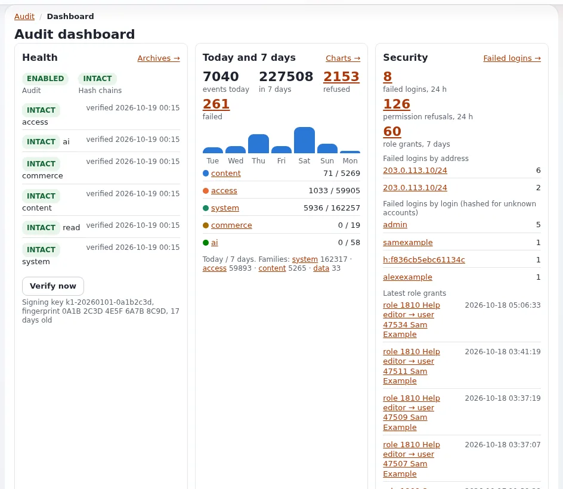
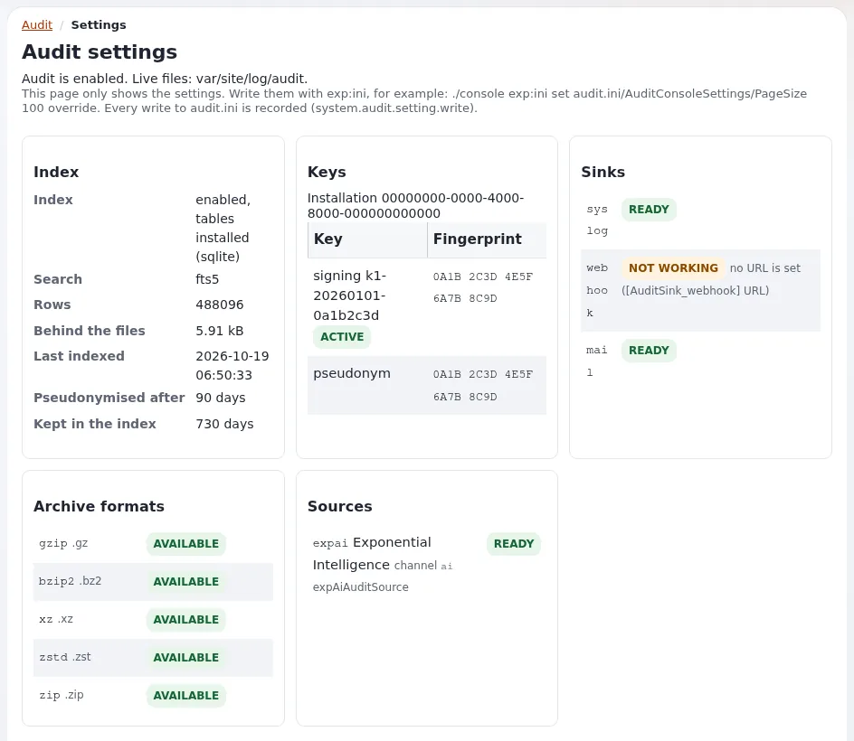

# Prüfprotokoll

Diese Seite ist für Systemadministratoren und Sicherheitsverantwortliche bei einem Hoster. Jede Exponential-6-Website führt eine
manipulationssichtbare Aufzeichnung darüber, wer was getan hat: Anmeldungen und Fehlschläge, Änderungen an Rollen und Einstellungen,
entfernte Inhalte, ausgeführte Befehle, Bestellungen. Es ist standardmäßig an und braucht keine Einrichtung, aber ein Hoster hat drei
Aufgaben: seinen Cronjob am Laufen halten, seine Alarme zu einem Menschen bringen und eine Kopie außerhalb der Maschine halten. Die
Kurzreferenz ist [Das Prüfprotokoll](../../../../en/us/features/6.0/audit-trail.md); die vollständige Anleitung ist [Audit](../../../../en/us/bc/6.0/audit.md).

## Inhalt

1. [Was festgehalten wird](#was-festgehalten-wird)
2. [Die Befehle, die ein Hoster nutzt](#die-befehle-die-ein-hoster-nutzt)
3. [Der Cronjob](#der-cronjob)
4. [Die Kette prüfen](#die-kette-prüfen)
5. [Alarme](#alarme)
6. [Von der Maschine weiterleiten](#von-der-maschine-weiterleiten)
7. [Schlüssel](#schlüssel)
8. [Festplatte, Schreibfehler und Cluster](#festplatte-schreibfehler-und-cluster)
9. [Checkliste](#checkliste)

## Was festgehalten wird

Jeder Eintrag ist eine JSON-Zeile in einer Datei pro Kanal und Tag, `var/<site>/log/audit/<channel>-<YYYY-MM-DD>.jsonl`, und jede Zeile
trägt den Hash der Zeile davor, sodass eine geänderte, entfernte oder eingefügte Zeile sichtbar wird.



| Kanal | Beispiele | Aktuell / archiviert (Tage) |
|---|---|---|
| `content` | veröffentlichen, verschieben, entfernen, verbergen, Papierkorb, Versionen, Klassen | 90 / 730 |
| `access` | Anmeldung, gescheiterte Anmeldung, verweigerte Ansicht, Kontosperre, Rollenzuweisung, Zurücksetzen des Passworts | 90 / 730 |
| `system` | geschriebene Einstellungen, geleerte Caches, Läufe von Cronjobs, Befehle, Paketinstallationen, Wartung, Ausrollen | 90 / 730 |
| `commerce` | Bestellungen, Zahlungen (nie Kartendaten), Mehrwertsteuer, Währungen | 90 / 730 |
| `read` | stichprobenartige Ansichten, Suchen, Downloads; nur wenn Lesezugriffe eingeschaltet sind | 30 / 90 |

Datenschutz als Standard: Adressen auf /24 und /48 gekürzt, Sitzungen gehasht, User Agents gekürzt, Passwörter, Tokens und Geheimnisse
nie festgehalten. Einstellungen zu Aufbewahrung und Datenschutz: [Aufbewahrung von Logs und Daten](aufbewahrung-von-logs-und-daten.md) und
[Compliance und DSGVO](compliance-und-dsgvo.md).

Wer es innerhalb der Website lesen darf: die Richtlinien `audit/read` und `audit/manage`, in einer neuen Installation nur bei der Rolle
Administrator. Der Reiter **Audit** der Administration ist `/audit/dashboard`.

## Die Befehle, die ein Hoster nutzt

```bash
./console exp:audit status --allow-root-user                       # enabled, directory, key, each channel intact or broken
./console exp:audit verify --allow-root-user                       # exit 0 intact, 1 broken, 2 error
./console exp:audit verify --archives --allow-root-user            # the archives as well
./console exp:audit tail --channel=access --lines=20 --allow-root-user
./console exp:audit alerts recipients --allow-root-user            # who receives alert mail, and why
./console exp:audit sinks list --allow-root-user
```

`exp:audit` hat außerdem `channels`, `show`, `checkpoint`, `search` (`--query=<text>`), `rotate`, `archive`, `restore`, `purge`,
`reindex`, `pseudonymise`, `export`, `import`, `key`, `alerts` und `cron`
([Von der Kommandozeile](../../../../en/us/features/6.0/audit-trail.md#from-the-command-line)).

## Der Cronjob

Der Cronjob-Teil `audit` ist in der Gruppe `frequent` von `settings/cronjob.ini`. Jeder Lauf indiziert, liefert die Warteschlangen der
Senken aus und wertet Alarmregeln aus; einmal am Tag (nach `RotateAfter`, 00:15 Ortszeit der Website) schließt er Tagesdateien, prüft
jeden Kanal, archiviert, was älter als `LiveDays` ist, bereinigt, was älter als `ArchiveDays` ist, pseudonymisiert alte Indexzeilen und
schreibt einen signierten Checkpoint ([4.1 Cron](../../../../en/us/bc/6.0/audit.md#41-cron)).

```text
*/5 * * * * cd /var/www/vhosts/<domain>/<installation> && php runcronjobs.php -q frequent
```

Führen Sie ihn als Benutzer der Website aus. Ein Lauf nimmt eine Sperre, sodass sich Läufe nie überschneiden. Das Dashboard des Audits
warnt, wenn der Teil seit einer Stunde nicht gelaufen ist. Planung pro Kunde: [Cronjobs](../betrieb/cronjobs.md).

## Die Kette prüfen

`exp:audit verify` endet mit 0 (unversehrt), 1 (gebrochen) oder 2 (Fehler), passt also zu jedem Überwachungssystem:



```bash
./console exp:audit verify -q --allow-root-user || <your alert command>
```

Wenn eine Kette **BROKEN** ist: Bearbeiten oder entfernen Sie nichts. Notieren Sie Datei, Zeile und Art, kopieren Sie das Verzeichnis an
einen sicheren Ort und vergleichen Sie mit dem, was den Server verlassen hat (syslog-Kopien, Empfänger des Webhooks, Checkpoints, Archive)
([4.4 Prüfen und wiederherstellen](../../../../en/us/bc/6.0/audit.md#44-verify-and-restore)). Folgen Sie dann
[Kompromittierte Website](../runbooks/kompromittierte-website.md).

## Alarme

Zu den mitgelieferten Regeln gehören `brute_force` (20 Fehlschläge aus einem Netz in 5 Minuten), `brute_force_user` (10 für ein Konto in
15 Minuten) und `admin_role_granted`. Mail geht an die `Recipients[]` der Regel, sonst an `[AuditAlertSettings] Recipients[]`, sonst an
`[AuditSink_mail] Receivers[]`, sonst an die `AdminEmail` der Website
([4.5 Alarme](../../../../en/us/bc/6.0/audit.md#45-alerts-and-their-recipients)).

Entscheiden Sie mit jedem Kunden, wer Alarme erhält: der Administrator des Kunden, das Sicherheitspostfach des Hosters oder beide.
Empfänger können Adressen, benannte Gruppen, Benutzer, Benutzergruppen oder Rollen sein:

```ini
# settings/override/audit.ini.append.php
[AuditAlertSettings]
Recipients[]
Recipients[]=admin
Recipients[]=address:security@example.com
```

Mail wird nur vom Cronjob versandt, höchstens eine pro Regel und Empfänger innerhalb von `[AuditSink_mail] Throttle` (900 s).

## Von der Maschine weiterleiten

Eine Senke schickt Einträge vom Server weg, damit eine kompromittierte Maschine ihre eigene Geschichte nicht stillschweigend umschreiben
kann ([Sicherheitshärtung](../../../../en/us/help/security-hardening.md#watching-logs-the-request-classifier-and-the-audit-trail)).

| Senke | Transport |
|---|---|
| `[AuditSink_syslog]` | `Transport=local` (nativer Socket von journald, sonst `/dev/log`; `journalctl -t exponential`), `journald`, `devlog`, `udp`, `tcp`, `tls` (`Host`, `Port`) |
| `[AuditSink_webhook]` | ein signierter HTTPS-POST (HMAC-SHA-256 über Zeitstempel und Inhalt), mit Warteschlange und Wiederholungen |
| `[AuditSink_mail]` | Mail bei kritischen Ereignissen |

```ini
# settings/override/audit.ini.append.php: every channel to a central collector
[AuditSink_syslog]
Transport=tcp
Host=logs.example.com
Port=514

[AuditChannel_content]
Sinks[]=syslog

[AuditChannel_commerce]
Sinks[]=syslog
```

Netzwerktransporte laufen über die Warteschlange und werden vom Cronjob-Teil versandt. Ein Hoster, der eine zentrale Log-Plattform
betreibt, kann das jedem Kunden anbieten; siehe [Sicherheitslog](../betrieb/sicherheitslog.md) für die anderen Sicherheitsquellen.

## Schlüssel

`settings/override/audit.ini.append.php` enthält eine ID der Installation, die Signaturschlüssel und den Pseudonymschlüssel, beim ersten
Ereignis erzeugt (Modus `0640`, nie committet). Sichern Sie sie als Geheimnis mit dem Rest von `settings/override/`: Ohne die
Signaturschlüssel lassen sich damit signierte Archive und Checkpoints nicht mehr prüfen. Erneuern Sie den Signaturschlüssel jährlich oder
sofort, wenn er gelesen worden sein könnte (`exp:audit key rotate`; starten Sie danach Velocity neu, wenn ein Worker den alten behält)
([4.6 Schlüssel](../../../../en/us/bc/6.0/audit.md#46-keys)). Schlüssel aus einem Geheimnisspeicher: `[AuditKeySettings] GenerateKeys=disabled`
und die Schlüssel selbst in settings/override bereitstellen.

## Festplatte, Schreibfehler und Cluster

- **Festplatte.** Die aktuellen Dateien und Archive wachsen mit der Aktivität; Archive werden komprimiert (standardmäßig gzip).
  `ArchiveDir` liegt am besten auf einem anderen Dateisystem oder einem Mount, dem der Webserver Dateien hinzufügen, sie aber nicht ändern
  kann.
- **Schreibfehler.** `[AuditSettings] OnWriteFailure=continue` (Standard): Eine volle Festplatte nimmt die Website nicht vom Netz; der
  Fehler steht in `error.log` als `AUDIT-UNWRITTEN`. `refuse`: Sicherheitsrelevante Aktionen (POSTs der Administration an sensible
  Ansichten, geschriebene Einstellungen) werden mit 503 verweigert, solange ihr Kanal nicht geschrieben werden kann
  ([Wenn das Audit nicht schreiben kann](../../../../en/us/features/6.0/audit-trail.md#when-the-audit-cannot-write-onwritefailure)).
  Beobachten Sie den Speicherplatz in beiden Fällen ([Festplatte voll](../runbooks/festplatte-voll.md)).
- **Mehrere Webserver.** Ein gemeinsames `LogDir` auf einem Dateisystem mit POSIX-Sperren über Server hinweg (NFSv4, CephFS, GlusterFS),
  eine Schlüsseldatei, die jeder Server teilt, Schlüssel einmal erzeugt, bevor die anderen Server festhalten
  ([6.3 Cluster](../../../../en/us/bc/6.0/audit.md#63-cluster)).
- **Bestehende Installationen**, die auf 6.0.15 aktualisiert wurden, legen die Indextabellen mit
  `php update/common/scripts/6.0/createaudittables.php` an.

## Checkliste

- [ ] Die Cronjob-Gruppe `frequent` läuft alle paar Minuten als Benutzer der Website.
- [ ] `exp:audit verify` in der Überwachung, mit Alarm bei einem Exit ungleich null.
- [ ] Empfänger von Alarmen mit dem Kunden vereinbart und mit `exp:audit alerts recipients` geprüft.
- [ ] Eine Senke leitet mindestens `access` und `system` von der Maschine weiter.
- [ ] `audit.ini.append.php` als Geheimnis gesichert; Erneuerung der Schlüssel geplant.
- [ ] `audit/read` nur bei den Rollen, die es brauchen.
- [ ] Speicherplatz für aktuelle Dateien und Archive überwacht; `OnWriteFailure` entschieden.

**Ereignisse des Demomodus.** `system.demo.mode` (Warnung, immer festgehalten) kennzeichnet jeden Prozess, der mit `EXP_DEMO_MODE=1` gestartet ist; verweigerte Änderungen und Zurücksetzungen des Administratorpassworts tragen den Grund `demo_mode`. Auf der Website eines Kunden ist beides ein Vorfall. [Demomodus für Hoster](demomodus-fuer-hoster.md).

## Verwandte Seiten

- [Sicherheit für Hoster: Überblick](README.md)
- [Das Prüfprotokoll (Funktion)](../../../../en/us/features/6.0/audit-trail.md)
- [Audit (vollständige Anleitung)](../../../../en/us/bc/6.0/audit.md)
- [13.14 Das Audit-Log](../../../../en/us/install/13-security-hardening.md#1314-the-audit-log)
- [Sicherheitslog](../betrieb/sicherheitslog.md)
- [Freie Dokumentation](../../../../en/us/help/free-documentation.md): Diese Seite darf unter der GNU FDL 1.3 frei kopiert, übersetzt und verbessert werden.
