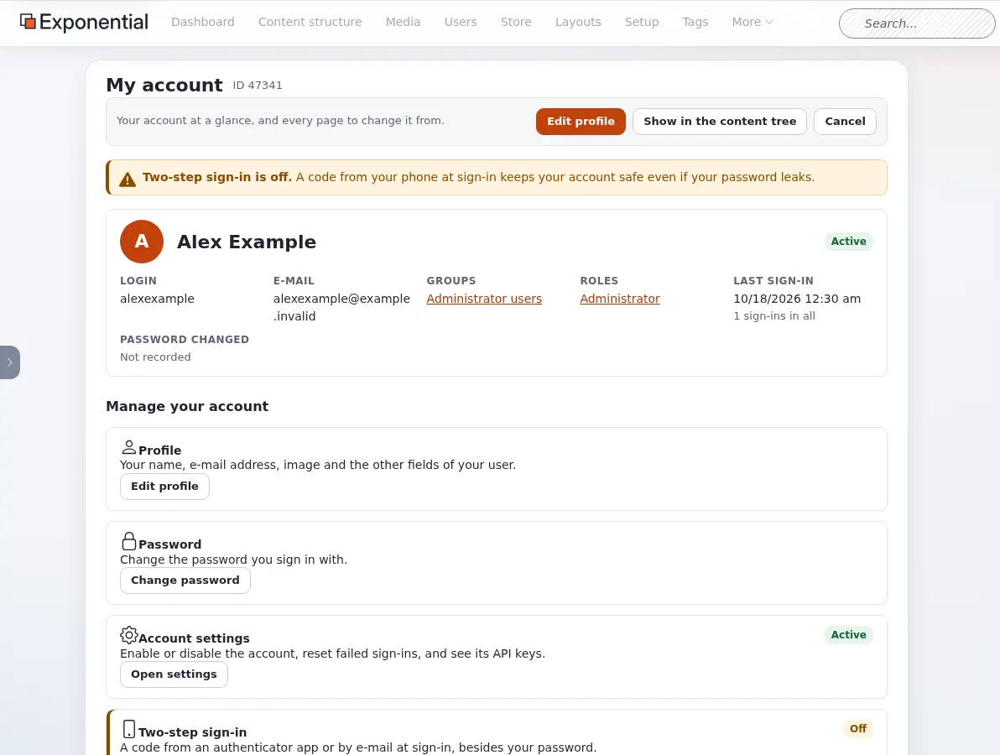
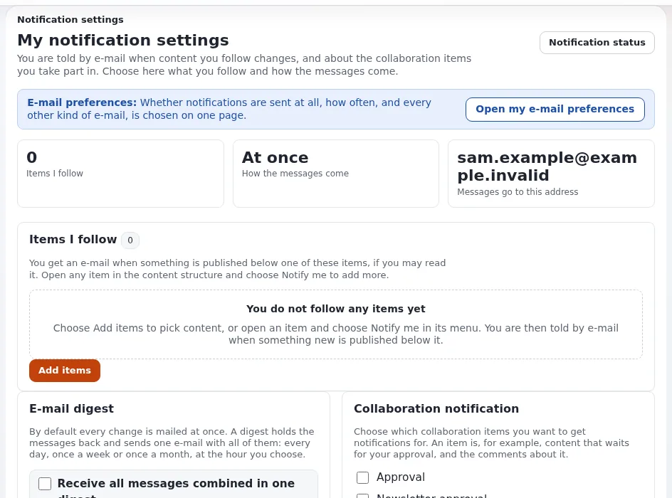

# Ihr Konto und die Anmeldung

Diese Seite ist für alle, die ein Konto haben, auf der Site oder in der Administration. Sie erklärt, wie Sie sich an-
und abmelden, was zu tun ist, wenn Sie Ihr Passwort vergessen haben, und wie Sie Ihr Konto mit der zweistufigen
Anmeldung schützen.

## Anmelden

Alle Einzelheiten der Anmeldeseiten: [Anmelden im Editor](anmelden-im-editor.md) und
[Anmelden in der Administration](anmelden-in-der-administration.md).

1. Wählen Sie auf der Site **Login** (oft im Benutzermenü der Kopfzeile), oder öffnen Sie die Adresse der
   Administration.
2. Geben Sie Ihren **Benutzernamen** und Ihr **Passwort** ein und klicken Sie auf **Anmelden** (auf der Site
   **Login**).
3. Ist für Ihr Konto die zweistufige Anmeldung eingeschaltet, geben Sie den Code ein, nach dem die nächste Seite
   fragt. Siehe [Zweistufige Anmeldung](#zweistufige-anmeldung).

Zum Anmelden muss Ihr Browser Cookies annehmen.

## Abmelden

In der Administration verwenden Sie die letzte Schaltfläche der Kopfzeile, einen Pfeil, der ein Kästchen verlässt
(**Abmelden**). Auf der Site wählen Sie **Abmelden** im Benutzermenü oder auf Ihrer Profilseite. Melden Sie sich an
einem gemeinsam genutzten Computer immer ab.

## Ein Konto registrieren

Wo eine Site Besuchern die Registrierung erlaubt, bietet die Anmeldeseite **Registrieren** (oder **Neues Konto
registrieren**) an. Geben Sie Ihren Namen, einen Benutzernamen, ein Passwort und Ihre E-Mail-Adresse ein. Kreuzen Sie
unter **E-Mails von uns (optional)** nur die E-Mails an, die Sie erhalten möchten; das können Sie später ändern.
Manche Sites schicken einen Link zur Bestätigung Ihrer Adresse, bevor das Konto benutzt werden kann.

## Wenn Sie Ihr Passwort vergessen haben

1. Wählen Sie auf der Anmeldeseite **Passwort vergessen?**.
2. Geben Sie die E-Mail-Adresse Ihres Kontos ein und klicken Sie auf die Schaltfläche (auf der Site **Link
   zusenden**).
3. Folgen Sie den Anweisungen in der E-Mail, die Sie erhalten. Sehen Sie im Spam-Ordner nach, wenn innerhalb weniger
   Minuten nichts ankommt.

Wenn Sie keinen Zugang mehr zu dieser E-Mail-Adresse haben, bitten Sie einen Administrator, Ihr Passwort
zurückzusetzen.

## Mein Konto

In der Administration führt **Profil bearbeiten** in der linken Spalte des Dashboards oder Ihr Name im Benutzermenü
zu **Mein Konto**: Ihr Konto auf einen Blick (Login, E-Mail-Adresse, Gruppen, Rollen, letzte Anmeldung) und alle
Seiten, auf denen Sie es ändern können.

| Karte | Was Sie tun können |
|---|---|
| **Profil** | Ihren Namen, Ihre E-Mail-Adresse, Ihr Bild und die übrigen Felder ändern (**Profil bearbeiten**). |
| **Passwort** | **Passwort ändern**. |
| **Kontoeinstellungen** | Nur für Rollen, die Konten verwalten: das Konto aktivieren oder deaktivieren, fehlgeschlagene Anmeldungen zurücksetzen. |
| **Zweistufige Anmeldung** | Den zweiten Schritt ein- oder ausschalten. Siehe unten. |
| **API-Schlüssel** | Nur für Rollen, die sie verwenden dürfen: persönliche Schlüssel für Ihre eigenen Skripte und Werkzeuge. |
| **Lesezeichen** | Ihre Lesezeichen, in Ordnern. |
| **Benachrichtigungen** | Die Inhalte, denen Sie folgen, und wie oft Sie von Änderungen erfahren. |
| **E-Mail-Einstellungen** | Welche E-Mails Sie bekommen, ein Download Ihrer E-Mail-Daten, oder alle optionalen E-Mails abbestellen. |

Auf der Site enthält Ihre Seite **Benutzerprofil** dieselben Links: E-Mail-Einstellungen, zweistufige Anmeldung,
Ihre Entwürfe, Ihre wartenden Objekte und Ihre Benachrichtigungseinstellungen.

## Ihr Passwort ändern

1. Öffnen Sie **Passwort ändern** (Benutzermenü, Dashboard oder **Mein Konto**).
2. Geben Sie Ihr **Aktuelles Passwort** ein und dann zweimal das **Neue Passwort**. Die Seite zeigt, was das neue
   Passwort erfüllen muss, zum Beispiel *Mindestens 10 Zeichen*, und prüft es während der Eingabe. **Sicheres
   Passwort erzeugen** erstellt eines für Sie; **Anzeigen** zeigt, was Sie eingegeben haben.
3. Klicken Sie auf **Passwort ändern**.

Verwenden Sie ein Passwort, das Sie nirgendwo sonst benutzen. Ein Passwortmanager merkt es sich für Sie.

## Zweistufige Anmeldung

Mit der zweistufigen Anmeldung öffnet Ihr Passwort allein Ihr Konto nicht mehr: Nach dem Passwort fragt die
Anmeldung nach einem sechsstelligen Code aus einer App auf Ihrem Telefon oder aus einer E-Mail. Wer Ihr Passwort
erfährt, kommt trotzdem nicht hinein.

### Einschalten

1. Öffnen Sie **Mein Konto** und klicken Sie auf der Karte **Zweistufige Anmeldung** auf **Einschalten** (auf der
   Site: **Zweistufige Anmeldung** auf Ihrer Profilseite).
2. Wählen Sie unter **Zweiter Schritt bei der Anmeldung**, wie Sie bestätigen, dass Sie es sind:
   - **Authenticator-App (TOTP)**: ein Code aus einer App wie Google Authenticator, Microsoft Authenticator, Authy
     oder 1Password. Funktioniert ohne Netzverbindung. Empfohlen.
   - **Einmalcode per E-Mail**: Bei jeder Anmeldung wird ein Code an Ihre E-Mail-Adresse geschickt.
   - **Aus**: Das Passwort allein meldet Sie an.
3. Für die App: Fügen Sie in der App ein Konto hinzu und scannen Sie den QR-Code, oder tippen Sie den darunter
   angezeigten Schlüssel ein. Geben Sie dann den Code, den die App zeigt, unter **Geben Sie den Code ein, den die App
   zeigt** ein. Solange dieser Code nicht stimmt, ändert sich nichts.
4. Klicken Sie auf **Einstellungen speichern**. Die neue Einstellung gilt ab Ihrer nächsten Anmeldung.

### Damit anmelden

Geben Sie nach Ihrem Passwort den Code ein, den die App für die Site zeigt (oder den aus der E-Mail; er steht auch
im Betreff). Jeder Code gilt nur einmal, und der Code einer App wechselt alle 30 Sekunden. Nach fünf falschen Codes
beginnt die Anmeldung wieder mit dem Passwort.

### Ändern oder ausschalten

Der Wechsel zu Codes per E-Mail, das Ausschalten oder das Zurücksetzen verlangt zuerst einen aktuellen Code aus der
App, damit niemand an einem Computer, an dem Sie angemeldet geblieben sind, Ihr Konto schwächen kann.

### Telefon verloren?

Wenden Sie sich an einen Administrator. Er kann Ihr Konto auf Codes per E-Mail umstellen oder den zweiten Schritt
ausschalten; danach melden Sie sich an und richten die App auf Ihrem neuen Telefon wieder ein.

Manche Sites verlangen die zweistufige Anmeldung von allen. Sie werden dann bei Ihrer ersten Anmeldung direkt nach
dem Passwort aufgefordert, sie einzurichten.

## E-Mails und Benachrichtigungen

- **Meine E-Mail-Einstellungen** legt fest, welche E-Mails Sie von der Site bekommen: Benachrichtigungen zu
  Inhalten, Freigaben, Newsletter und andere. Jede optionale E-Mail lässt sich dort abbestellen.
- **Meine Benachrichtigungseinstellungen** listet die Objekte auf, denen Sie folgen. Sie erhalten eine E-Mail, wenn
  darunter etwas veröffentlicht wird. Um einem Objekt zu folgen, wählen Sie in seinem Menü **Zu meinen
  Benachrichtigungen hinzufügen** oder auf der Einstellungsseite **Einträge hinzufügen**. Eine **Zusammenfassung**
  sammelt die Nachrichten in einer E-Mail pro Tag, Woche oder Monat statt einer pro Änderung.

**Auf einer öffentlichen Demo** (ein Hinweisbalken **Demo-Modus** in der Administration) lassen sich die Passwörter von Administratorkonten weder ändern noch zurücksetzen; andere Konten funktionieren wie gewohnt. [Demo-Modus](demomodus.md).

## Mehr erfahren

- [Zweistufige Anmeldung](../anleitungen/zwei-faktor-anmeldung.md), für Administratoren, die sie einrichten.
- [Erste Schritte](erste-schritte.md)
