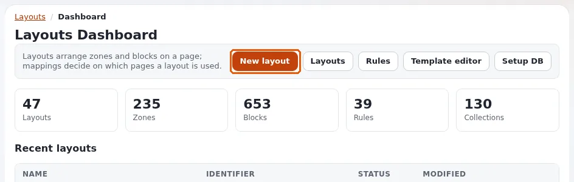
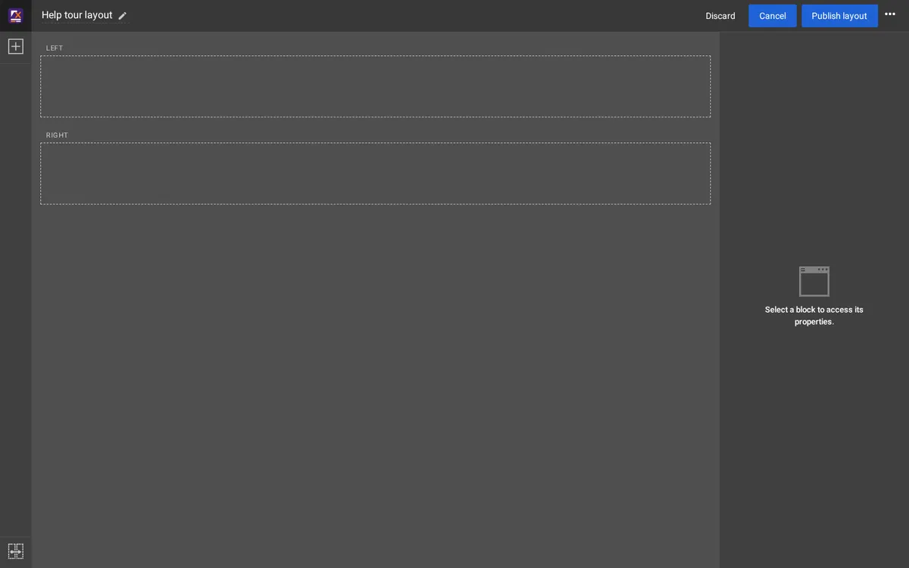
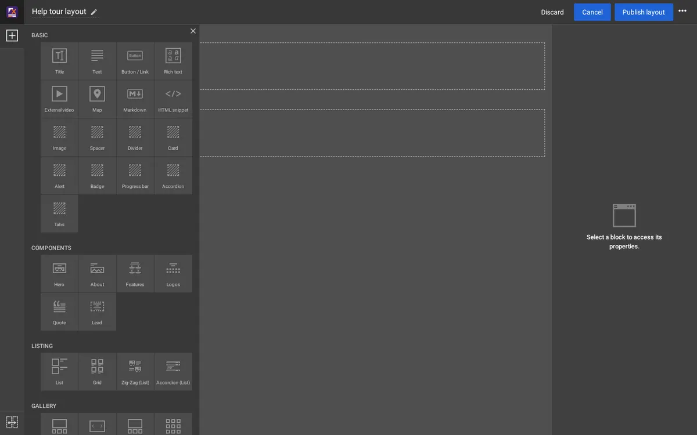
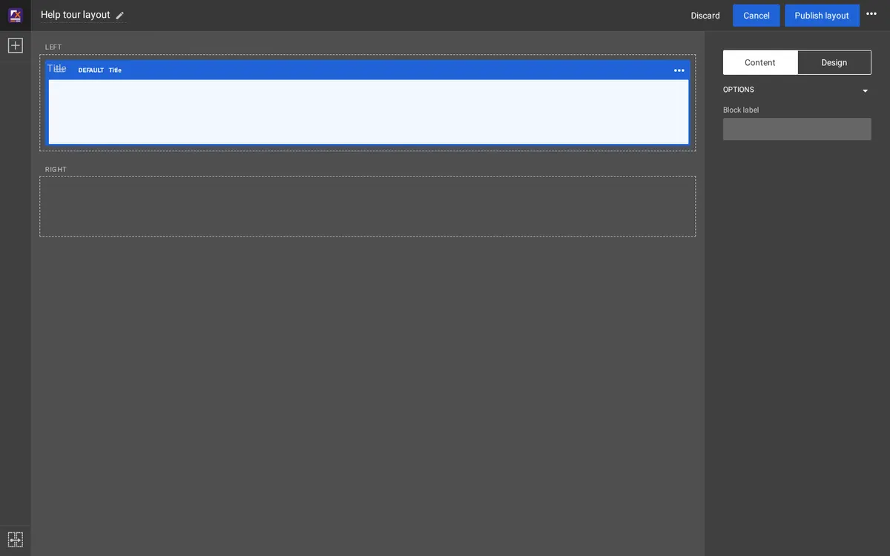

# Der Layout-Editor

Diese Seite richtet sich an Redakteure und Site-Entwickler, die Seiten mit **Exponential Layouts** gestalten. Ein Layout
legt fest, woraus eine Seite besteht und wo jeder Teil steht; die Inhaltsobjekte enthalten weiterhin die Texte und
Bilder.

Der Reiter **Layouts** wird nur Rollen angezeigt, die mit Layouts arbeiten dürfen. Wenn Sie ihn nicht sehen, wenden Sie
sich an einen Administrator.

## Layouts, Zonen und Blöcke

- Ein **Layout** ist der Plan einer Seite, zum Beispiel *Landing Page / Home*.
- Es hat **Zonen**: Bereiche wie *left* und *right* oder *header*, *main* und *footer*. Der **Layout-Typ**
  (*1 column*, *2 columns*, *Sidebar left*, *Hero + 3 columns* ...) legt fest, welche Zonen es gibt.
- Jede Zone enthält **Blöcke**, einen unter dem anderen: einen Titel, ein Stück Rich Text, ein Bild, eine Liste von
  Artikeln, eine Galerie, ein Hero-Banner und vieles mehr.
- Eine **Zuordnung** (auch Regel genannt) legt fest, auf welchen Seiten ein Layout verwendet wird, zum Beispiel *die
  Seite Fit & Healthy* oder *jedes Rezept darunter*.
- Ein **gemeinsames Layout** enthält Blöcke, die viele Seiten verwenden, etwa eine Kopf- und eine Fußzeile. Andere
  Layouts verknüpfen eine Zone damit, statt die Blöcke zu kopieren.

## Ein Layout finden

Der Reiter **Layouts** öffnet das **Layouts-Dashboard**: die Anzahl der Layouts, Zonen, Blöcke und Zuordnungen, die
zuletzt geänderten Layouts und Schaltflächen für **Neues Layout**, **Layouts** und **Regeln** (die Zuordnungen).

**Layouts** listet jedes Layout mit seinem Bezeichner, Typ, Datum und der Anzahl seiner Zuordnungen auf. Jedes hat
**Öffnen** (im Editor bearbeiten), **Vorschau** und **Löschen**. **Sortieren nach** und **Reihenfolge** ordnen die Liste.

## Ein Layout anlegen

Klicken Sie auf **Neues Layout**, wählen Sie einen **Layouttyp**, geben Sie ihm einen **Name** (**Bezeichner** und
**Beschreibung** sind optional) und klicken Sie auf **Layout anlegen**. Der Editor öffnet sich mit den leeren Zonen
dieses Typs.

## Der Editor

- **Oben**: der Name des Layouts (klicken Sie auf den Stift, um ihn umzubenennen), **Verwerfen**, **Abbrechen**,
  **Layout veröffentlichen** und das Menü mit drei Punkten: **Veröffentlichen und weiter bearbeiten** und **Entwurf speichern und schließen**.
- **Links**: Die Plus-Schaltfläche **Block hinzufügen** öffnet die Liste der Blocktypen; die Schaltfläche unten verknüpft
  eine Zone mit einer Zone eines gemeinsamen Layouts.
- **In der Mitte**: die Zonen mit ihren Namen (*LEFT*, *RIGHT* ...) und ihren Blöcken.
- **Rechts**: die Eigenschaften des ausgewählten Blocks. Zu Beginn ist nichts ausgewählt: *Wählen Sie einen Block aus, um seine
  Eigenschaften zu bearbeiten.*

Sie arbeiten immer an einem **Entwurf** des Layouts. Wenn Sie ein veröffentlichtes Layout öffnen, entsteht ein Entwurf
davon; die Site zeigt weiterhin das veröffentlichte Layout, bis Sie veröffentlichen.

## Einen Block hinzufügen

1. Klicken Sie auf **Block hinzufügen** (die Plus-Schaltfläche). Die Blocktypen erscheinen in Gruppen: **Basic** (Title,
   Text, Button / Link, Rich text, Image, Markdown ...), **Components**, **Listing**, **Gallery**, **Containers** und
   **Placeholders**.
2. Ziehen Sie einen Blocktyp in eine Zone, an die Stelle, an der er stehen soll.

## Einen Block ändern

Klicken Sie auf einen Block, um ihn auszuwählen. Rechts erscheinen seine Eigenschaften in zwei Reitern:

- **Inhalt**: was der Block zeigt, zum Beispiel den Text eines Titels oder welche Objekte eine Liste zeigt und wie
  viele.
- **Design**: wie er aussieht, zum Beispiel der Ansichtstyp und der Stil.

Änderungen werden im Block in der Mitte angezeigt. Das Menü mit drei Punkten an einem Block enthält **Duplicate block**
und **Block löschen**. Um einen Block zu verschieben, ziehen Sie ihn an seinem Griff an eine andere Stelle oder in eine
andere Zone.

## Veröffentlichen, behalten oder verwerfen

| Schaltfläche | Was sie tut |
|---|---|
| **Layout veröffentlichen** | Veröffentlicht den Entwurf und schließt den Editor. Seiten, die das Layout verwenden, zeigen es sofort. |
| **Veröffentlichen und weiter bearbeiten** | Veröffentlicht und lässt den Editor mit einem neuen Entwurf geöffnet. |
| **Entwurf speichern und schließen** | Behält den Entwurf für später und schließt den Editor; das veröffentlichte Layout bleibt unverändert. |
| **Verwerfen** | Verwirft den Entwurf nach Ihrer Bestätigung und schließt den Editor. |
| **Abbrechen** | Verlässt den Editor und kehrt dorthin zurück, woher Sie gekommen sind; der Entwurf bleibt erhalten. |

Wo eine Site ihre Caches nach dem Veröffentlichen nicht von selbst leert, fragt der Editor, ob er sie leeren soll;
wählen Sie **Caches leeren**, damit Besucher die Änderung sehen.

## Welche Seiten ein Layout verwenden

**Regeln** (auf dem Dashboard; **Layout-Zuordnungen** im Menü) listet die Zuordnungen auf: Jede nennt ihr Layout, ob sie
**Aktiviert** ist, ihre **Ziele** (ein Ort, ein Teilbaum, eine Modulseite) und ihre **Bedingungen** (zum Beispiel ein
Inhaltstyp oder ein Siteaccess). Es gewinnt die erste aktivierte Zuordnung nach Priorität, deren Ziele und Bedingungen
auf eine Seite zutreffen. **Layout bearbeiten** öffnet das Layout einer Zuordnung; **Neue Zuordnung** fügt eine hinzu.

Zuordnungen zu ändern bestimmt, wie ganze Teile der Site aussehen. Wenn Sie unsicher sind, fragen Sie einen
Site-Entwickler.

## Mehr erfahren

- [Exponential Layouts in der Administration](../../eng-us/features/6.0/admin4l.md), für die Layouts, die die Administration
  selbst anordnen.
- [Ein Rundgang durch die Administration](rundgang-durch-die-administration.md)
