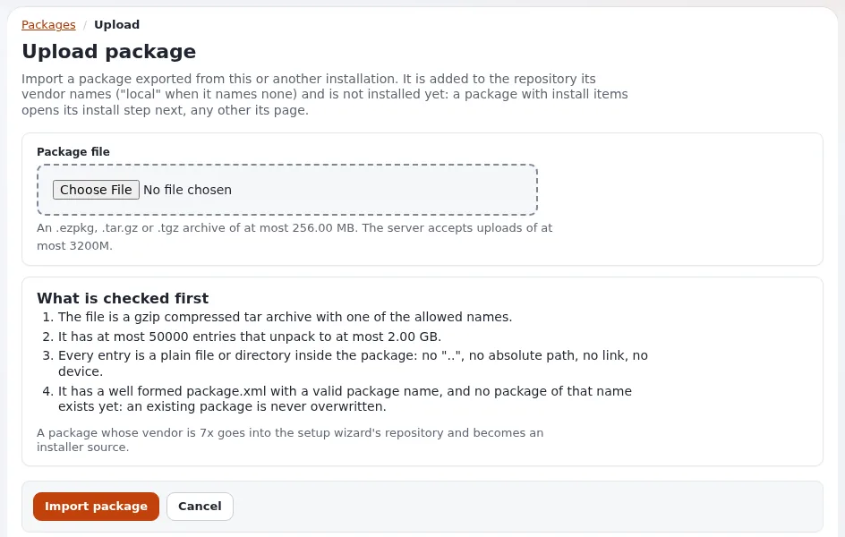

# Ein Paket importieren

Diese Seite ist für Administratoren, die ein Paketarchiv von ihrem Computer in eine Installation bringen: ein von einem Paketserver
heruntergeladenes Paket, eines, das ein Kollege geschickt hat, oder eines, das von einer anderen Website exportiert wurde. Importieren legt
das Paket ins lokale Paket-Repository; es installiert es nicht.



## Inhalt

1. [Vor dem Hochladen](#vor-dem-hochladen)
2. [Hochladen](#hochladen)
3. [Was geprüft wird](#was-geprüft-wird)
4. [Wo das Paket landet und was folgt](#wo-das-paket-landet-und-was-folgt)
5. [Die Grenzen](#die-grenzen)
6. [Wenn der Import abgewiesen wird](#wenn-der-import-abgewiesen-wird)

## Vor dem Hochladen

- Sie brauchen die Richtlinie `package/import`; ohne sie sagt die Schaltfläche „Sie dürfen keine Pakete importieren (package/import).“
- Ein **Seitenpaket** wird nicht von hier aus genutzt: Der Setup-Assistent, der Kickstarter und `exp:install` installieren Seitenpakete,
  wenn eine Website angelegt wird. Laden Sie ein Seitenpaket hier nur hoch, um es anzusehen, zu vergleichen oder für eine
  Offline-Installation aufzubewahren.
- Pakete auf einem Paketserver kann ezupdate direkt abrufen ([Pakete mit ezupdate abrufen](pakete-mit-ezupdate-abrufen.md)).

## Hochladen

1. **Setup > Pakete**, dann **Neues Paket importieren** (`/package/upload`).
2. Wählen Sie die Datei unter **Paketdatei**: „Ein .ezpkg-, .tar.gz- oder .tgz-Archiv von höchstens %size. Der Server nimmt Uploads von
   höchstens %server an.“
3. Drücken Sie **Importiere Paket**. **Abbrechen** führt zur Liste zurück.

## Was geprüft wird

Bevor irgendetwas entpackt wird, liest `eZPackageUploadInspector` das Inhaltsverzeichnis des Archivs und seine `package.xml`; die Seite
führt die Regeln unter **Was zuerst geprüft wird** auf:

| Regel | Text auf der Seite |
|---|---|
| mit gzip komprimiertes tar mit erlaubtem Namen | „Die Datei ist ein gzip-komprimiertes tar-Archiv mit einem der erlaubten Namen.“ |
| Größengrenze | „Es ist nicht zu groß.“ |
| Einträge und entpackte Größe | „Es hat höchstens %entries Einträge, die zu höchstens %size entpackt werden.“ |
| sichere Einträge | jeder Eintrag ist eine einfache Datei oder ein Verzeichnis im Paket: kein `..`, kein absoluter Pfad, kein Link, kein Gerät |
| Definition und Name | „Es hat eine wohlgeformte package.xml mit einem gültigen Paketnamen, und es gibt noch kein Paket dieses Namens: Ein vorhandenes Paket wird nie überschrieben.“ |

Dann läuft die eigene Validierung des Pakets auf einer entpackten Kopie in einem Arbeitsverzeichnis (das wieder entfernt wird): jedes
Dokument wohlgeformt und bei einem JSON-Paket das Schema und die Prüfsummen von `package.json`. Ein Paket, das scheitert, wird mit der Liste
dessen abgewiesen, was gescheitert ist (die Meldung sagt, dass es die Validierung nicht bestanden hat und nicht importiert wurde).

Dieselben Prüfungen des Archivs laufen in `eZPackage::import()`, sodass `ezpm import`, das Abrufen von ezupdate und das eigene Hochladen
im Setup-Assistenten dieselben Archive abweisen.

## Wo das Paket landet und was folgt

Das Paket wird in das Repository entpackt, das sein `<vendor>` nennt, in einen Verzeichnisnamen umgewandelt: Ein Paket von 7x geht nach
`var/storage/packages/7x/`, ein Paket ohne Hersteller nach `local/`. Dann:

| Paket | Nächste Seite |
|---|---|
| hat Installationselemente (`install_type="install"`) und Sie dürfen es installieren | die Installationsseite (`/package/install/<name>`) mit dem Ergebnis der Validierung |
| alles andere, einschließlich Seitenpaketen (`install_type="import"`) | die Seite des Pakets |

Nichts wird installiert, bis Sie dort **Paket installieren** drücken ([Installieren und Deinstallieren](installieren-und-deinstallieren.md)).

## Die Grenzen

```ini
# settings/override/package.ini.append.php (the values shown are the defaults)
[UploadSettings]
MaxArchiveSize=268435456
MaxUnpackedSize=2147483648
MaxEntries=50000
AllowedSuffixes[]
AllowedSuffixes[]=ezpkg
AllowedSuffixes[]=tar.gz
AllowedSuffixes[]=tgz
```

Das sind 256 MiB pro Archiv, 2 GiB entpackt und 50000 Einträge. `upload_max_filesize` und `post_max_size` von PHP gelten zuerst; die Seite
zeigt die Grenze des Servers. Für ein Archiv darüber kopieren Sie es auf den Server und nutzen `php ezpm.php import <file>`, das dieselben
Prüfungen ausführt.

## Wenn der Import abgewiesen wird

| Meldung | Bedeutet | Was zu tun ist |
|---|---|---|
| „Es wurde keine Datei hochgeladen, oder sie war größer, als der Server annimmt (%size).“ | die Upload-Grenze von PHP | die Grenzen von PHP erhöhen oder `ezpm import` nutzen |
| „Paket %packagename existier bereits, kann Paket nicht importieren“ | ein Paket dieses Namens liegt in irgendeinem Repository | zuerst das alte entfernen ([Die Paketliste und die Paketseite](die-paketliste-und-die-paketseite.md#pakete-entfernen)) oder stattdessen damit vergleichen |
| „Der Paketname %packagename ist ungültig, konnte das Paket nicht importieren“ | der Name enthält andere Zeichen als a-z, 0-9 und `_` | `<name>` in `package.xml` korrigieren und neu bauen |
| ein Eintrag zeigt aus dem Paket hinaus oder ist ein Link oder ein Gerät | das Archiv enthält unsichere Pfade oder Links | das Archiv aus dem Paketordner neu bauen |
| die Paketdefinition ist nicht wohlgeformt | `package.xml` ist kaputt | `xmllint --noout package.xml` |
| das Paket hat die Validierung nicht bestanden und wurde nicht importiert | ein Dokument oder eine Prüfsumme ist gescheitert | die Liste unter der Meldung nennt jedes Problem |

## Verwandte Seiten

- [Pakete in der Administration](README.md)
- [Pakete, Abschnitt 6](../../../../en/us/guides/packages.md#6-uploading-a-package)
- [Ein Paket vor der Veröffentlichung prüfen](../anforderungen/ein-paket-vor-der-veroeffentlichung-pruefen.md)
- [Ein Paket von Hand herunterladen](../paketserver/ein-paket-von-hand-herunterladen.md)
- [Importieren oder installieren](../grundlagen/importieren-oder-installieren.md)
- [Seitenpakete: hier beginnen](../README.md)
- [Freie Dokumentation](../../../../en/us/help/free-documentation.md): Diese Seite darf unter der GNU FDL 1.3 frei kopiert, übersetzt und verbessert werden.
