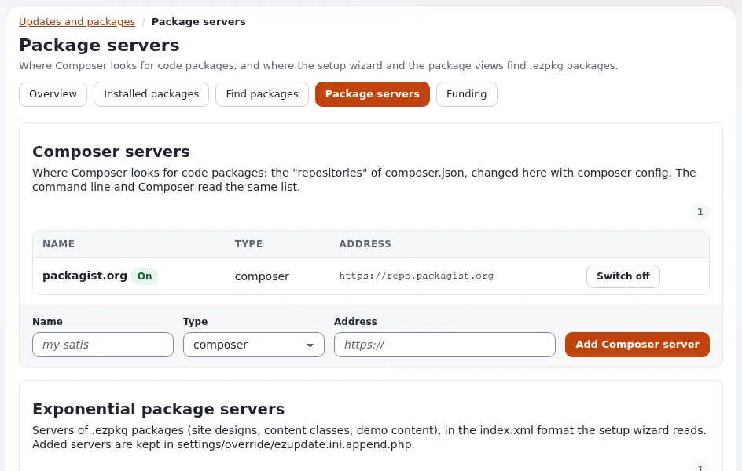

# Pakete mit ezupdate abrufen

Diese Seite ist für Administratoren, die ein Paket von einem Paketserver auf einer installierten Website haben wollen, ohne es von Hand
herunter- und hochzuladen. ezupdate liest die `index.xml` des Servers, zeigt, was er anbietet, neben dem, was Sie haben, und ruft das Archiv
direkt ins lokale Paket-Repository ab. Installiert wird es dann auf den Paketseiten des Kernels.



## Inhalt

1. [Die Pakete eines Servers öffnen](#die-pakete-eines-servers-öffnen)
2. [Die Liste](#die-liste)
3. [Ein Paket abrufen](#ein-paket-abrufen)
4. [Dann installieren](#dann-installieren)
5. [Von der Kommandozeile](#von-der-kommandozeile)
6. [Grenzen und Fehler](#grenzen-und-fehler)

## Die Pakete eines Servers öffnen

Drücken Sie unter **Setup > Updates and packages > Package servers** in der Zeile eines Servers auf **Packages**:
`/update/packages/<server>`. Ohne Servernamen wird der erste gezeigt, der eingebaute Server aus `package.ini`. Das Ansehen braucht
`update/ezupdate`; das Abrufen braucht `update/manage` (geprüft, wenn Sie die Schaltfläche drücken, nicht nur durch Ausblenden).

## Die Liste

Die Seite `Packages on %server` zeigt jedes `<package>` der `index.xml` des Servers, nach Namen sortiert:

| Spalte | Aus |
|---|---|
| Package | dem Attribut `name` (und `summary`) |
| Type | dem Attribut `type`: `site`, `contentclass`, `contentobject`, `sitestyle`, `extension` |
| Local copy | der Version des Pakets dieses Namens im lokalen Repository (`eZPackage::getVersion()`) oder keiner |
| Actions | **Fetch** oder, wenn es eine lokale Kopie gibt, **Fetch again** und **Open** (die Seite des lokalen Pakets, `/package/view/full/<name>`) |

Ein **Filter** schränkt die Liste während der Eingabe ein. Die Meldung `This server lists no packages, or its index.xml could not be read.`
bedeutet, dass der Index leer, nicht erreichbar oder kein Dokument `<packages>` war.

## Ein Paket abrufen

1. Drücken Sie in seiner Zeile **Fetch** (`Fetching...`, solange es läuft).
2. ezupdate lädt das Archiv von der `url` des Eintrags im Index herunter und importiert es mit `eZPackage::import()`, demselben Import wie
   die Seite zum Hochladen, mit denselben Prüfungen des Archivs.
3. Die Seite meldet `The package %package %version is in the local package repository now.`

**Fetch again** fragt `Replace the local copy with the one from the server?` und entfernt dann das lokale Paket, bevor es abruft. Das
Entfernen der lokalen Kopie deinstalliert nicht, was sie installiert hat.

Das Archiv wird in eine temporäre Datei im Cache-Verzeichnis geschrieben (`ezupdate/<name>.ezpkg`) und nach dem Import gelöscht. Das Paket
landet in dem Repository, das sein `<vendor>` nennt, für die Pakete von 7x `var/storage/packages/7x/`.

## Dann installieren

Abrufen importiert nur. Öffnen Sie **Setup > Pakete**, suchen Sie das Paket (es ist **Nicht installiert**, wenn es Installationselemente
hat), öffnen Sie seine Seite und drücken Sie **Installieren** ([Installieren und Deinstallieren](installieren-und-deinstallieren.md)). Ein auf
diese Weise abgerufenes Seitenpaket ist **Nur importiert**: Es wird vom Setup-Assistenten, dem Kickstarter oder `exp:install` genutzt, zum
Beispiel für eine Offline-Installation, und nicht von den Paketseiten aus installiert.

## Von der Kommandozeile

```bash
php extension/ezupdate/bin/php/ezupdate.php packages                    # the first server's packages
php extension/ezupdate/bin/php/ezupdate.php packages acme
php extension/ezupdate/bin/php/ezupdate.php fetch acme acme_site_democontent
php extension/ezupdate/bin/php/ezupdate.php fetch acme acme_site_democontent --replace
```

`fetch <server> <package> [--replace]` lädt eine `.ezpkg` ins lokale Paket-Repository herunter; `--replace` ersetzt ein dort bereits
vorhandenes Paket. Installieren Sie dann mit `php ezpm.php install <name>` oder auf der Seite des Pakets.

## Grenzen und Fehler

Aus `extension/ezupdate/classes/ezupdatepackageservers.php`:

| Prüfung | Grenze |
|---|---|
| Transport | die PHP-Erweiterung curl, nur HTTPS, auch für Umleitungen (höchstens 5) |
| `index.xml` | höchstens 1 MiB, Wurzelelement `<packages>` |
| Archiv | höchstens 256 MiB; seine `url` muss `https://` sein |
| Zeit | 15 Sekunden für den Verbindungsaufbau, insgesamt 300 Sekunden |
| Proxy | `site.ini [ProxySettings] ProxyServer`, wenn gesetzt |

| Meldung | Bedeutet |
|---|---|
| `The package is already in the local repository.` | **Fetch again** oder `--replace` nutzen |
| `The server does not offer this package.` | der Name steht nicht im Index des Servers |
| `The package address must be an https:// URL.` | die `url` des Eintrags im Index ist nicht HTTPS |
| `Could not fetch %url: %reason` | der Download ist gescheitert; der Grund kommt von curl |
| `The server did not answer with a package index.` | `index.xml` ist kein Dokument `<packages>` |
| `The file is not a valid package.` | der Import hat das Archiv abgewiesen |
| `The PHP curl extension is needed to reach a server.` | `curl` für PHP installieren oder einschalten |

## Verwandte Seiten

- [Pakete in der Administration](README.md)
- [Paketserver in ezupdate](paketserver-in-ezupdate.md)
- [Ein Paket importieren](ein-paket-importieren.md)
- [Ein Paket von Hand herunterladen](../paketserver/ein-paket-von-hand-herunterladen.md)
- [ezupdate: Updates und Pakete in der Administration](../../../../en/us/features/6.0/extensions/ezupdate.md)
- [Seitenpakete: hier beginnen](../README.md)
- [Freie Dokumentation](../../../../en/us/help/free-documentation.md): Diese Seite darf unter der GNU FDL 1.3 frei kopiert, übersetzt und verbessert werden.
