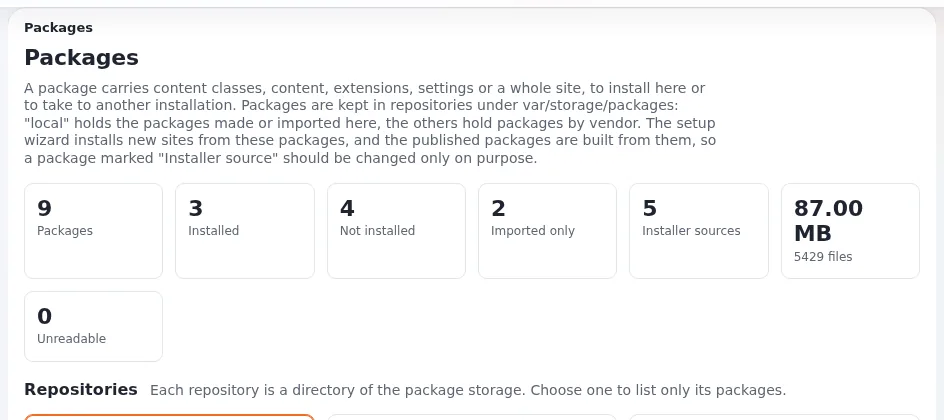

# Glossar der Seitenpakete

Diese Seite erklärt die Begriffe, die in der Hilfe zu Seitenpaketen verwendet werden. Jeder Eintrag nennt, woher der Begriff im Code oder
in den Paketen stammt, und verlinkt die Seite, die ihn vollständig erklärt.

## Inhalt

1. [Pakete und ihre Dateien](#pakete-und-ihre-dateien)
2. [Wo Pakete aufbewahrt werden](#wo-pakete-aufbewahrt-werden)
3. [Installieren](#installieren)
4. [Der Paketserver](#der-paketserver)
5. [Werkzeuge](#werkzeuge)
6. [Verwandte Seiten](#verwandte-seiten)

## Pakete und ihre Dateien

| Begriff | Bedeutung | Mehr |
|---|---|---|
| **Paket** | Ein Ordner mit einer `package.xml` und den Dateien, die sie nennt: Inhaltsklassen, Inhaltsobjekte, Erweiterungen, Einstellungsdateien, Bilder, Dokumente | [Was ein Seiteninstallationspaket ist](grundlagen/was-ein-seiteninstallationspaket-ist.md) |
| **`.ezpkg`** | Ein Paket als eine einzige Datei: ein mit gzip komprimiertes tar des Paketordners, `package.xml` oben. Das Hochladen akzeptiert auch `.tar.gz` und `.tgz` (`package.ini [UploadSettings] AllowedSuffixes[]`) | [Die Datei .ezpkg](grundlagen/die-datei-ezpkg.md) |
| **`package.xml`** | Die Definition des Pakets: Name, Zusammenfassung, Beschreibung, Hersteller, Typ, Version, Betreuer, Lizenz, Dokumente, Changelog, Dateien, Abhängigkeiten, Einstellungsdateien, Installations- und Deinstallationselemente | [Referenz zu package.xml](grundlagen/referenz-zu-package-xml.md) |
| **`package.json`** | Die Definition im JSON-Paketformat, eine Alternative zu `package.xml` mit Prüfsummen jeder Datei | [Klassische und JSON-Pakete](grundlagen/klassische-und-json-pakete.md) |
| **Pakettyp** | Das `<type value="..."/>` eines Pakets. Der Index von 6.0.15 nutzt `site`, `contentclass`, `contentobject`, `sitestyle` und `extension`; `package.ini [PackageSettings] TypeList[]` nennt die Typen, die die Administration auflistet | [Pakettypen](grundlagen/pakettypen.md) |
| **Seitenpaket** | Ein Paket vom Typ `site`: der Ausgangspunkt einer neuen Installation, vom Setup-Assistenten angeboten. Es verlangt andere Pakete und kann Installationsskripte mitbringen | [Was ein Seiteninstallationspaket ist](grundlagen/was-ein-seiteninstallationspaket-ist.md) |
| **Seitenstil** | Ein Paket vom Typ `sitestyle`: ein Design (Stylesheets und Bilder) für ein Seitenpaket, etwa `sevenx_design_blue` | [Pakettypen](grundlagen/pakettypen.md) |
| **Demo-Inhaltspaket** | Ein Paket `contentobject` mit den Beispielinhalten eines Seitenpakets, etwa `sevenx_multisite_democontent` | [Die Demo-Inhaltspakete](sevenx-multisite/die-demo-inhaltspakete.md) |
| **Clean-Paket** | Ein Seitenpaket, dessen Name auf `_clean` endet: dieselbe Website ohne die Demo-Artikel und -Bilder | [Die Clean-Variante und sevenx_site](sevenx-multisite/die-clean-variante-und-sevenx-site.md) |
| **Installationselement** | Ein Schritt von `<install>` in `package.xml`, ausgeführt von einem Pakethandler (eine Klasse, eine Objektliste, eine Erweiterung, eine SQL-Datei ...) | [Installationselemente und Handler](grundlagen/installationselemente-und-handler.md) |
| **Pakethandler** | Die Kernel-Klasse, die eine Art von Installationselement installiert, genannt in `package.ini [PackageSettings] HandlerAlias[]`, zum Beispiel `ezcontentclass` = `eZContentClassPackageHandler` | [Installationselemente und Handler](grundlagen/installationselemente-und-handler.md) |
| **Abhängigkeit** | Ein `<require type="ezpackage" name="..." min-version="..."/>` in `<dependencies><requires>`: ein Paket, das ebenfalls vorhanden sein muss | [Abhängigkeiten und die Installationsreihenfolge](grundlagen/abhaengigkeiten-und-die-installationsreihenfolge.md) |
| **Installationsskript** | Eine PHP-Datei, die ein Seitenpaket in `<settings><settings-file>` aufführt und die der Installer beim Anlegen der Website ausführt: Siteaccess-Einstellungen, Rollen, Voreinstellungen, der Multisite-Installer | [Installationsskripte in einem Seitenpaket](grundlagen/installationsskripte-in-einem-seitenpaket.md) |
| **`LICENCE`** | Der Lizenztext, den ein Paket in `documents/` mitbringt und in `<documents>` nennt; das Element ist `<licence>` (beide behalten ihre historische Schreibweise) | [Lizenz und Dokumente](anforderungen/lizenz-und-dokumente.md) |

## Wo Pakete aufbewahrt werden

| Begriff | Bedeutung | Mehr |
|---|---|---|
| **Repository** | Ein Ordner unter `var/storage/packages/`, der Pakete enthält: `local` für hier erstellte oder importierte Pakete und einer pro Hersteller | [Das lokale Paket-Repository](grundlagen/das-lokale-paket-repository.md) |
| **Hersteller** | Der `<vendor>` eines Pakets; er bestimmt den Repository-Ordner (`7x`, `ez-systems`). `package.ini [RepositorySettings] Vendor=7x` ist das Repository des Setup-Assistenten | [Das lokale Paket-Repository](grundlagen/das-lokale-paket-repository.md) |
| **Installer-Quelle** | Ein Paket, von dem der Setup-Assistent abhängt: im Repository des Assistenten, ein Seitenpaket oder von einem verlangt. In **Setup > Pakete** markiert; das Entfernen braucht eine zusätzliche Bestätigung | [Anleitung zu Paketen, 4. Installer-Quellen](../../../en/us/guides/packages.md#4-installer-sources) |
| **Quell-Repository** | Das Git-Repository mit den entpackten Ordnern, aus denen ein Paket gebaut wird, etwa `se7enxweb/sevenx-ezpackage` | [Die Quell-Repositorys](paketserver/die-quell-repositorys.md) |

## Installieren

| Begriff | Bedeutung | Mehr |
|---|---|---|
| **Importieren** | Ein Paket in ein Repository entpacken, ohne die Website zu ändern | [Importieren oder installieren](grundlagen/importieren-oder-installieren.md) |
| **Installieren** | Die Installationselemente eines Pakets ausführen, sodass seine Klassen, Inhalte und Dateien auf der Website angelegt werden | [Installieren und Deinstallieren](admin-oberflaeche/installieren-und-deinstallieren.md) |
| **Setup-Assistent** | Der Installer im Browser; seine Schritte für Seitentypen und Seitenpakete laden Pakete herunter und importieren sie | [Wie der Setup-Assistent Pakete nutzt](grundlagen/wie-der-setup-assistent-pakete-nutzt.md) |
| **Kickstarter, `exp:install`** | Die Installer ohne Browser; sie nehmen den Namen des Seitenpakets aus `kickstart.ini` oder `--package` | [Wie der Kickstarter und die Konsole Pakete nutzen](grundlagen/wie-der-kickstarter-und-die-konsole-pakete-nutzen.md) |
| **Multisite-Installer** | Das Installationsskript `sevenx-multi-site-installer.php` von `sevenx_multisite` (und sein Gegenstück `cjw-multi-site-installer.php` von `cjw_multisite`), das die Websites, Siteaccesses und Einstellungen baut | [Das Skript des Multisite-Installers](sevenx-multisite/das-skript-des-multisite-installers.md) |

## Der Paketserver

| Begriff | Bedeutung | Mehr |
|---|---|---|
| **Paketserver** | Eine statische HTTPS-Website, die `.ezpkg`-Dateien und eine `index.xml` pro Release von Exponential veröffentlicht; der Standard ist `exponential.packages.exponential.earth` | [Was der Paketserver ist](paketserver/was-der-paketserver-ist.md) |
| **`index.xml`** | Die Liste der Pakete eines Release: eine Wurzel `<packages vendor="7x">` mit einem Element `<package>` pro Paket (Name, Typ, URL; Seitenpakete auch Version, Zusammenfassung, Beschreibung, Vorschaubild) | [Das Format index.xml](paketserver/das-format-index-xml.md) |
| **`RemotePackagesIndexURL`** | `package.ini [RepositorySettings]`: der Ordner, dessen `index.xml` der Setup-Assistent liest. Wenn leer, wird `RemotePackagesIndexURLBase` plus die Version genutzt | [Einstellungen des Paketservers](paketserver/einstellungen-des-paketservers.md) |
| **Spiegel** | Eine Kopie eines Release-Ordners auf einem anderen Server oder auf der Festplatte, für Offline-Installationen oder eigene Pakete genutzt | [Offline-Installationen und Spiegel](paketserver/offline-installationen-und-spiegel.md) |

## Werkzeuge

| Begriff | Bedeutung | Mehr |
|---|---|---|
| **Setup > Pakete** | Die Paketseiten der Administration (`/package/list`) | [Pakete in der Administration](admin-oberflaeche/README.md) |
| **Paketassistent** | **Neues Paket erstellen** in **Setup > Pakete**: Pakete für Inhaltsobjekte, Inhaltsklassen, Erweiterungen und Seitenstile | [Der Paketassistent](admin-oberflaeche/der-paketassistent.md) |
| **`ezpm.php`** | Der Paketmanager auf der Kommandozeile, im Wurzelverzeichnis der Installation | [Pakete mit ezpm erstellen](eigene/pakete-mit-ezpm-erstellen.md) |
| **`build.sh`** | Das Skript in einem Quell-Repository, das jeden Paketordner in eine `.ezpkg` packt | [Mit build.sh neu bauen](eigene/mit-build-sh-neu-bauen.md) |
| **ezupdate** | Die Erweiterung hinter **Setup > Updates and packages**; ihre Seite der Paketserver listet `.ezpkg`-Server auf und fügt sie hinzu | [Paketserver in ezupdate](admin-oberflaeche/paketserver-in-ezupdate.md) |

## Verwandte Seiten

- [Seitenpakete: hier beginnen](README.md)
- [Ihr Seitenpaket beitragen](ihr-seitenpaket-beitragen.md)
- [Das Glossar von Exponential](../../../en/us/glossary.md)
- [Freie Dokumentation](../../../en/us/help/free-documentation.md): Diese Seite darf unter der GNU FDL 1.3 frei kopiert, übersetzt und verbessert werden.
