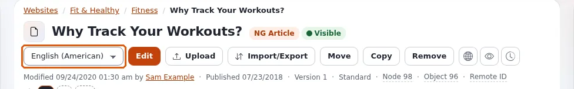
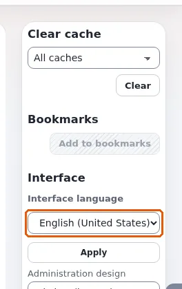
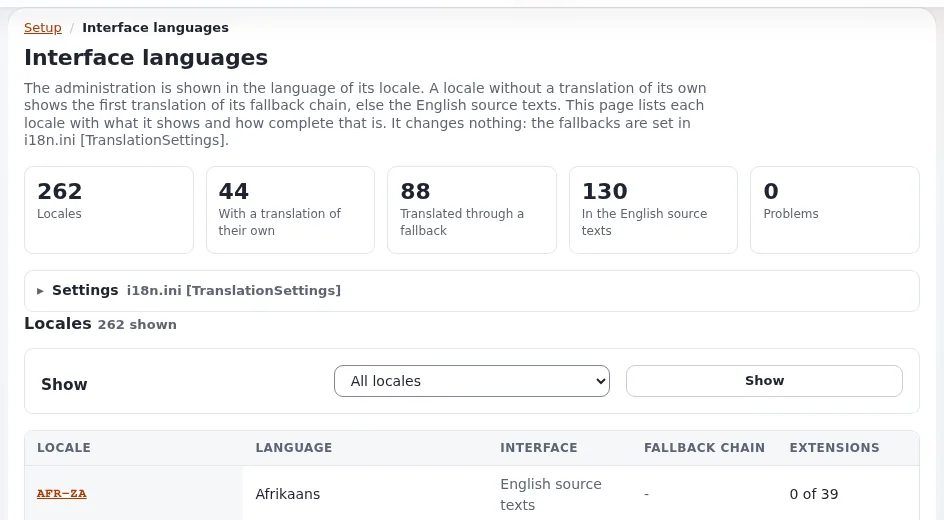

# Sprachen

In Exponential gibt es zwei verschiedene Arten von Sprache, und diese Seite erklärt beide:

- **Inhaltssprachen**: die Sprachen, in denen Ihre Objekte geschrieben sind. Ein Artikel kann auf Englisch und auf
  Deutsch vorliegen; jede Fassung ist eine **Übersetzung** desselben Objekts.
- **Die Sprache der Oberfläche**: die Sprache der Menüs, Schaltflächen und Meldungen der Administration. Sie wählen
  sie für sich selbst; am Inhalt ändert sie nichts.

## Sehen, welche Übersetzungen ein Objekt hat

Auf der Seite eines Objekts zeigt die Zeile unter den Schaltflächen ein kleines Kürzel je Sprache der Site. Ein
gefülltes Kürzel wie **EN** ist eine vorhandene Übersetzung; ein gestricheltes wie **DE** ist eine, die es noch nicht
gibt. Zeigen Sie auf ein Kürzel, um es zu lesen, zum Beispiel *English (American) – Hauptsprache* oder *In Deutsch
übersetzen*.

Die Registerkarte **Übersetzungen** des Objekts listet seine Übersetzungen vollständig auf.

## Ein Objekt übersetzen

1. Öffnen Sie das Objekt.
2. Klicken Sie auf das gestrichelte Kürzel der Sprache, oder wählen Sie **Neue Übersetzung** in der Sprachliste neben
   **Bearbeiten** und klicken Sie auf **Bearbeiten**.
3. Wenn die Seite danach fragt, wählen Sie unter **Neue Übersetzung** die Sprache und unter **Übersetzung basiert
   auf** die vorhandene Übersetzung, von der Sie ausgehen möchten (ihr Text wird in das Formular kopiert), oder
   **Keine** für leere Felder.
4. Übersetzen Sie die Felder und klicken Sie auf **Zur Veröffentlichung schicken**.

Um eine vorhandene Übersetzung zu ändern, wählen Sie diese Sprache in der Liste neben **Bearbeiten** und klicken Sie
dann auf **Bearbeiten**. Das Bearbeitungsformular nennt neben dem Titel die Sprache, die es bearbeitet.

Jede Übersetzung wird für sich veröffentlicht: Das Veröffentlichen des deutschen Textes ändert den englischen nicht.

### Die Hauptsprache

Eine Übersetzung jedes Objekts ist seine **Hauptsprache**, auf ihrem Kürzel als solche gekennzeichnet. Es ist die
Sprache, in der das Objekt erstellt wurde, und diejenige, die angezeigt wird, wo eine Übersetzung fehlt, sofern das
Objekt als immer verfügbar eingestellt ist.

### Eine Übersetzung entfernen

Die Registerkarte **Übersetzungen** listet die Übersetzungen mit je einem Kontrollkästchen auf; zum Entfernen einer
Übersetzung brauchen Sie die passende Berechtigung, und die Hauptsprache lässt sich nicht entfernen. Fragen Sie einen
Administrator, wenn Sie unsicher sind.

## Die Sprache der Administration

Die rechte Spalte enthält den Kasten **Oberfläche** mit der Liste **Sprache der Oberfläche**.

1. Öffnen Sie die Liste. Sie zeigt zuerst die meistgenutzten Sprachen in Gruppen, dann alle Sprachen von A bis Z.
   Jeder Eintrag zeigt den eigenen Namen der Sprache, ihren Namen in der aktuellen Sprache der Oberfläche und wie
   vollständig ihre Übersetzung ist, zum Beispiel *Deutsch (Deutschland) — Deutsch (Deutschland) (100%)*. Hat die
   Liste den Fokus, springen Sie durch Tippen der ersten Buchstaben eines Namens zu ihm.
2. Wählen Sie eine Sprache und klicken Sie auf **Anwenden**. Die Seite wird in dieser Sprache neu geladen.

Was sich ändert: die Menüs, Schaltflächen und Meldungen sowie das Format von Datum, Uhrzeit und Zahlen. Eine Sprache
mit dem Hinweis *noch keine Übersetzung* behält die englischen Texte, verwendet aber ihre eigenen Datums- und
Zahlenformate.

Was sich nicht ändert: der Inhalt (Sie bearbeiten weiterhin die Übersetzung, die Sie öffnen), andere Benutzer und
andere Teile der Installation. Die Auswahl gilt, bis Sie sich abmelden. Wählen Sie wieder die eigene Sprache der Site,
kehren Sie zu ihr zurück.

Der Kasten wird nicht angezeigt, während Sie ein Objekt bearbeiten, und nicht für Rollen ohne die Berechtigung. Wo es
erlaubt ist, bietet derselbe Kasten auch das **Administrationsdesign** an.

## Mehr erfahren

- [Inhaltssprachen](../anleitungen/inhaltssprachen.md), die vollständige Anleitung, einschließlich des Hinzufügens einer
  Sprache zur Site.
- [Sprache der Oberfläche und die UI-Umschaltung](../../eng-us/features/6.0/ui-switch.md)
- [Die Hilfe in Ihrer Sprache lesen](hilfe-in-anderen-sprachen-lesen.md): Die Hilfe folgt der Sprache der Oberfläche.
