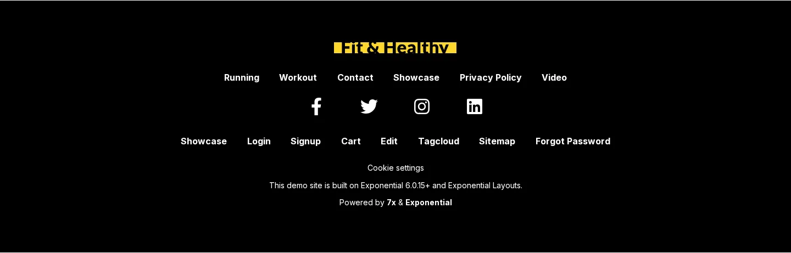
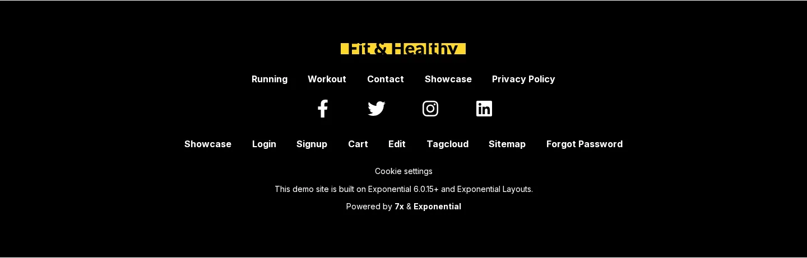

# Footer menu items

The footer of the Fit & Healthy theme has **two** lines of links, and each has its own source. Knowing which line you
want to change is half the work.


## Contents

1. [Which line is which](#which-line-is-which)
2. [Add to the first line (FooterMenuID)](#add-to-the-first-line-footermenuid)
3. [Add to the second line (Footer links)](#add-to-the-second-line-footer-links)
4. [The rest of the footer](#the-rest-of-the-footer)

## Which line is which

| Line | Source | Who changes it | Cache |
|---|---|---|---|
| First line (Running ... Privacy Policy) | `menu.ini [SiteInfo] FooterMenuID[]`, node IDs | admin: Setup > Ini settings, or `exp:ini` | Template & content after the change |
| Social icons | Fields `facebook`, `twitter`, `instagram`, `linkedin` of the site info object (remote ID from `[SiteInfo] RemoteID`) | editor: edit that object | none (publishing) |
| Second line (Login ... Forgot Password) | Children of the folder **Media > Configuration > Footer links** (class Menu item) | editor: create, edit, sort menu items | none (publishing) |

Both lines are rendered by `pagelayout/footer.tpl` of the media design, which the shared layout **Header / Footer**
includes through its footer template block ([How the footer is built](how-the-footer-is-built.md)).

## Add to the first line (FooterMenuID)

It works exactly like the header menu, with the setting `FooterMenuID[]` instead of `MainMenuID[]`.

In the administration: **Setup > Ini settings**, `menu.ini`, siteaccess `site`, **Show settings**, **Edit** on
`FooterMenuID[]`, add a line `=<node id>`, **Save**, then **Clear cache > Template & content**. The screenshots of the
same steps are on [Header menu in the administration](header-menu-in-the-admin.md).

By command line, here adding **Video** (node 164):

```text
$ ./console exp:ini add menu.ini/SiteInfo/FooterMenuID[] 164 siteaccess:site
Add to menu.ini/SiteInfo/FooterMenuID[] in siteaccess:site: settings/siteaccess/site/menu.ini.append.php
Backup: var/backup/ini/20261019-033842/settings/siteaccess/site/menu.ini.append.php
INI cache: cleared tag ini: 5 caches
Done
$ ./console exp:cache clear --tag=template,content
PASS  cleared tag template, content: 17 caches
```

The footer template is compiled with the list in it too: on the test copy, the compiled `footer-<hash>.php` held the
new ID after the clear, and Video appeared at the end of the first line.



## Add to the second line (Footer links)

This line is content: no settings, no cache clear, and editors can do it. Step by step on
[Footer links from the content tree](footer-links-from-the-content-tree.md). In short: in **Media > Configuration >
Footer links**, **Create new > Menu item**, enter a **Title** and an **Item URL**, **Send for publishing**.



## The rest of the footer

- The logo is `content/parts/site_logo.tpl`.
- "Cookie settings" is `parts/cookie_settings_link.tpl`.
- The sentence "This demo site is built on Exponential 6.0.15+ and Exponential Layouts." and the "Powered by" line are
  translatable texts in `pagelayout/footer.tpl` (context `design/media/pagelayout`); changing them is a template or
  translation change.

## Related pages

- [Footer links from the content tree](footer-links-from-the-content-tree.md)
- [How the footer is built](how-the-footer-is-built.md)
- [Add a header menu item](add-a-header-menu-item.md)
- [Free documentation](../free-documentation.md): this page is free to copy, translate and improve under the GNU FDL 1.3.
