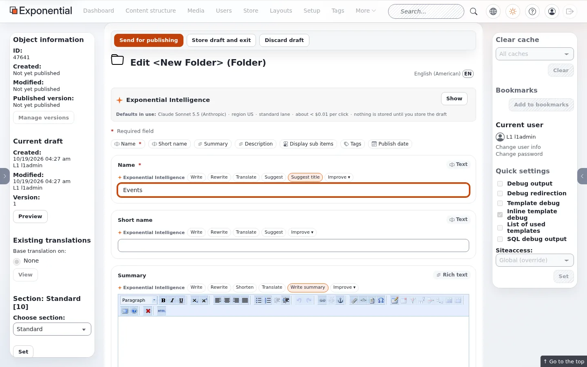

# A header menu that follows the tree

The Fit & Healthy header menu is a fixed list in `menu.ini` ([Add a header menu item](add-a-header-menu-item.md)). If
editors should add sections to the menu just by publishing them, the menu template has to fetch its items from the
tree. This page does that in a design extension, `mysite` ([Your own design extension](your-own-design-extension.md)).

## Contents

1. [The settings](#the-settings)
2. [The template](#the-template)
3. [Activate and clear](#activate-and-clear)
4. [Publish a folder, see it in the menu](#publish-a-folder-see-it-in-the-menu)
5. [Things to decide](#things-to-decide)

## The settings

`extension/mysite/settings/menu.ini.append.php`:

```ini
<?php /* #?ini charset="utf-8"?

[MySiteMenu]
# Classes of the children of the root node that become header menu items
ClassFilter[]
ClassFilter[]=ng_landing_page
ClassFilter[]=ng_category
ClassFilter[]=ng_topic
ClassFilter[]=folder
# At most this many items
Limit=12

*/ ?>
```

## The template

`extension/mysite/design/media/templates/pagelayout/header/main_menu.tpl` (same path as the theme's, so it replaces
it). It keeps the theme's markup and classes, so the theme's CSS and script still apply:

```smarty
{def $mm_root = ezini( 'NodeSettings', 'RootNode', 'content.ini' )
     $mm_root_node = fetch( 'content', 'node', hash( 'node_id', $mm_root ) )
     $mm_items = array()
     $mm_current_node = false()}
{if is_object( $mm_root_node )}
    {set $mm_items = fetch( 'content', 'list', hash( 'parent_node_id', $mm_root,
                                                      'sort_by', $mm_root_node.sort_array,
                                                      'class_filter_type', 'include',
                                                      'class_filter_array', ezini( 'MySiteMenu', 'ClassFilter', 'menu.ini' ),
                                                      'limit', ezini( 'MySiteMenu', 'Limit', 'menu.ini' ) ) )}
{/if}
{if and( is_set( $node ), is_object( $node ) )}
    {set $mm_current_node = $node}
{elseif and( is_set( $module_result.content_info.node_id ), $module_result.content_info.node_id|gt( 0 ) )}
    {set $mm_current_node = fetch( 'content', 'node', hash( 'node_id', $module_result.content_info.node_id ) )}
{/if}
<nav class="main-navigation" id="mainNavigation" role="navigation">
{if $mm_items|count|gt( 0 )}
    <ul class="nav navbar-nav">
    {foreach $mm_items as $mm_index => $mm_item}
        <li id="menu-item-main_menu-location-id-{$mm_item.node_id}"{if and( $mm_current_node, $mm_current_node.path_array|contains( $mm_item.node_id ) )} class="active"{/if} data-location-id="{$mm_item.node_id}">
            <a href={$mm_item.url_alias|ezurl}>{$mm_item.name|wash}</a>
        </li>
    {/foreach}
    </ul>
{/if}
</nav>
{undef $mm_root $mm_root_node $mm_items $mm_current_node}
```

`RootNode` of the siteaccess `site` is 89 (Fit & Healthy), so the menu lists its children. The list is sorted the way
the root node sorts its children in the administration.

## Activate and clear

`mysite` must come before `sevenx_themes_media` in `ActiveExtensions[]` (see
[Your own design extension](your-own-design-extension.md)). Then:

```text
./console exp:cache clear --tag=template,content,ini
```

On the test copy the header then showed the children of Fit & Healthy of those classes:


## Publish a folder, see it in the menu

In **Content structure**, open **Fit & Healthy**, **Create new > Folder**, name it *Events* and **Send for publishing**.



The next page view had the new item at the end, with no cache cleared by hand:


## Things to decide

- **Length.** Twelve items pushed the logo out of the header on the test copy: a menu that grows with the tree needs a
  `Limit` the design can hold, or a narrower `ClassFilter`.
- **Order.** It follows the root node's sort order; set it to priority and give the sections priorities to control it.
- **Opt-out.** Pages that should exist but stay out of the menu need a class that is not in `ClassFilter[]`, or a
  further filter in the template (for example a "show in menu" field).
- **Both.** The two ways mix: keep `MainMenuID[]` for a few fixed entries and add the fetched ones after them in the same
  template.

## Related pages

- [Add a header menu item](add-a-header-menu-item.md)
- [Header menu and the content tree](header-menu-and-the-content-tree.md)
- [Your own design extension](your-own-design-extension.md)
- [Free documentation](../free-documentation.md): this page is free to copy, translate and improve under the GNU FDL 1.3.
