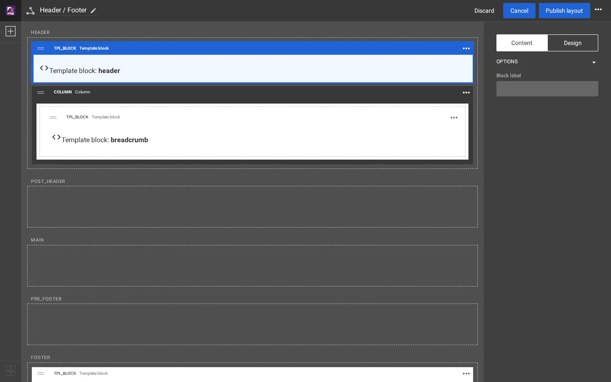

# How the header is built

The header of a Fit & Healthy page passes through two worlds: the **layout** (stored in the database, edited in the
Layouts editor) and the **templates** (files in a design extension). This page follows one request from one to the
other. File paths are relative to the installation root.

## Contents

1. [The chain at a glance](#the-chain-at-a-glance)
2. [The layout side](#the-layout-side)
3. [The template side](#the-template-side)
4. [Pages without a layout](#pages-without-a-layout)
5. [What each part lets you change](#what-each-part-lets-you-change)

## The chain at a glance

| Step | What | Where |
|---|---|---|
| 1 | The page's layout is chosen by the layout mappings (rules) | Layouts > Layout mappings |
| 2 | Its zone `header` is **linked** to zone `header` of the shared layout **Header / Footer** | Zone link, see [Shared layouts and zone linking](shared-layouts-and-zone-linking.md) |
| 3 | That zone holds a **Template block** (`tpl_block`) with the template name `header` | Layouts editor |
| 4 | The design renders the zone with `explayouts/zone.tpl` and the block with `explayouts/block/block.tpl` | `extension/sevenx_themes_media/design/media/templates/explayouts/` |
| 5 | For a template block, the operator `tpl_block_template()` names the template to include: `pagelayout/header.tpl` | `extension/sevenx_themes_media/autoloads/sevenxthemesmediaoperators.php` |
| 6 | `pagelayout/header.tpl` includes logo, menu, search, user menu and language selector | `.../templates/pagelayout/header.tpl` |
| 7 | `pagelayout/header/main_menu.tpl` loops over `menu.ini [SiteInfo] MainMenuID[]` | `.../templates/pagelayout/header/main_menu.tpl` |
| 8 | The list for the siteaccess `site` | `settings/siteaccess/site/menu.ini.append.php` |

## The layout side

**Header / Footer** is a shared layout (layout type `layout_2`) with five zones: `header`, `post_header`, `main`,
`pre_footer` and `footer`. On the Fit & Healthy site its zones hold:

| Zone | Blocks |
|---|---|
| `header` | Template block `header`; a Column (background color `primary`) holding the Template block `breadcrumb` |
| `post_header`, `main`, `pre_footer` | nothing |
| `footer` | Template block `footer` |


Selecting the header block shows its properties. The Content tab has only the block label; the **Design** tab shows
the **Template name** (`header`, the parameter `block_name`), which the block also shows on itself, "Template block:
**header**".




Eighteen other layouts of the site link their `header` and `footer` zones to this layout, which is why one header serves the whole
site. The block definition is in `extension/explayouts/settings/explayouts.ini.append.php`:

```ini
[BlockDefinition_tpl_block]
Name=Template block
Handler=expLayoutsTplBlockHandler
ViewTypes[]=tpl_block
Category=placeholders
```

Its handler, `expLayoutsTplBlockHandler`, has one parameter, `block_name` ("Template name").

## The template side

The media design renders each zone with `explayouts/zone.tpl`, which includes `explayouts/block/block.tpl` for every
top-level block. `block.tpl` wraps the block in `<div class="ngl-block ngl-<definition> ...">` and includes
`design:explayouts/block/<definition>.tpl`, here `explayouts/block/tpl_block.tpl`:

```smarty
{def $tpl_tpl = tpl_block_template($block.id)}
{if $tpl_tpl|ne('')}
{include uri=concat('design:', $tpl_tpl) module_result=$module_result}
{/if}
```

`tpl_block_template()` (method `tplBlockTemplate()` of `sevenxthemesmediaoperators.php`) answers in three steps:

1. A fixed map of the block IDs the theme ships with: block 13 is `pagelayout/header.tpl`, block 477
   `pagelayout/breadcrumbs.tpl`, block 14 `pagelayout/footer.tpl` (and some content parts).
2. Otherwise by place: a root block in zone `header` is `pagelayout/header.tpl`, a block in a column of zone `header`
   is `pagelayout/breadcrumbs.tpl`, a root block in zone `footer` is `pagelayout/footer.tpl`.
3. Otherwise by the block's own `block_name`: `explayouts/tpl_block/<block_name>.tpl`, when a design has that file.

`pagelayout/header.tpl` is the `<header class="site-header">`. It includes `content/parts/site_logo.tpl` and four
parts from `pagelayout/header/`: `main_menu.tpl`, `search_box.tpl`, `user_menu.tpl` and `language_selector.tpl`.

`main_menu.tpl` reads the list and renders one `<li>` per node that exists:

```smarty
{def $mm_ids = ezini('SiteInfo','MainMenuID','menu.ini')|unique}
...
{foreach $mm_ids as $mm_index => $mm_id}
    {set $mm_node = fetch('content','node',hash('node_id',$mm_id))}
    ...
    {if is_object($mm_node)}
    <li id="menu-item-main_menu-location-id-{$mm_display_id}" ...>
        <a href={$mm_node.url_alias|ezurl}>{$mm_node.name|wash}</a>
    </li>
    {/if}
{/foreach}
```

What follows from it:

- The item text is the node's **name**, the link its **URL alias**. Rename the page and the item follows.
- A list entry whose node cannot be fetched (deleted, for example) is **skipped**, not shown empty. The fetch does not
  check the visitor's read access: a listed page the visitor may not read is still shown as an item.
- The current page's ancestors get the class `active`.
- `NexusMainMenuID[]` gives the `id` and `data-location-id` attributes of the first items the IDs of the reference
  site the theme was ported from. It does not change what is shown; an item without a partner there uses its own
  node ID.

The compiled form of `main_menu.tpl` holds the values of `ezini()`. That is why a changed list needs the template cache
cleared ([Caches after a change](caches-after-a-change.md)).

## Pages without a layout

A page that gets no layout (or a layout without blocks) uses the plain page layout of the design: `pagelayout.tpl`
includes `pagelayout/header.tpl` directly. Same template, same menu, so the menu is identical with and without
layouts.

## What each part lets you change

| Part | Change it with | Example |
|---|---|---|
| Which pages are in the menu, their order | `menu.ini` (administration or `exp:ini`) | [Add a header menu item](add-a-header-menu-item.md) |
| Item text and link | The page itself (name, URL alias) | [Header menu and the content tree](header-menu-and-the-content-tree.md) |
| What surrounds the header on every page | The Layouts editor, shared layout Header / Footer | Add a block to zone `post_header` |
| The header's markup | A template override in your own design extension | The templates under `pagelayout/header/` |

## Related pages

- [Add a header menu item](add-a-header-menu-item.md)
- [How the footer is built](how-the-footer-is-built.md)
- [Shared layouts and zone linking](shared-layouts-and-zone-linking.md)
- [Two ways to build](two-ways-to-build.md)
- [Free documentation](../free-documentation.md): this page is free to copy, translate and improve under the GNU FDL 1.3.
