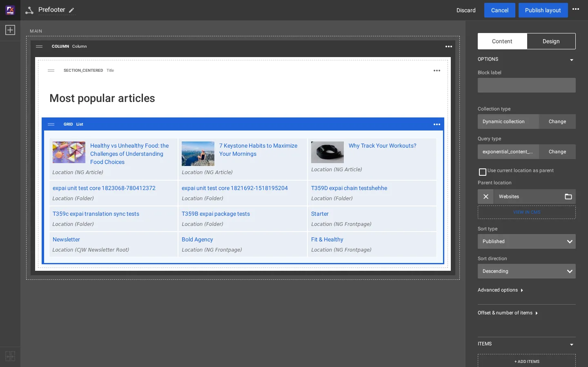

# Manual and dynamic collections

A block that lists content (List, Grid, the gallery blocks) has a **collection**. The collection is either:

| Type | Items | Typical use |
|---|---|---|
| **Manual collection** | picked by hand in the content browser, each one a node ID, in the order you set | "Most popular articles", a curated teaser row |
| **Dynamic collection** | the result of a query on the content tree, run when the page is rendered (and kept in the page caches like the rest of the page) | "The newest articles of Fitness", "everything tagged Running" |

## Contents

1. [Switch the type](#switch-the-type)
2. [The options of a dynamic collection](#the-options-of-a-dynamic-collection)
3. [The same in a template](#the-same-in-a-template)

## Switch the type

Select the block, then on the **Content** tab press **Change** next to **Collection type**. The panel warns:
*Changing the collection type will remove existing manual items.* Choose **Dynamic collection**, then the **Query
type**, and press **Apply**.


The query types offered on this installation are **Exponential** (`exponential_content_search`, a search below a parent
location) and **Topics** (`content_by_topic`, content with a tag).

## The options of a dynamic collection

For **Exponential** the panel shows:

| Option | Means |
|---|---|
| Use current location as parent | list below the page being viewed instead of a fixed parent |
| Parent location | the node below which to search; the folder button opens the content browser, **View in CMS** opens it in the administration |
| Sort type | Published, Modified, Alphabetical, Priority, Defined by parent |
| Sort direction | Descending, Ascending |
| Advanced options | filters (content types, sections, object states) |
| Offset & number of items | skip the first items, limit how many |



The middle of the editor shows the result at once. On the test copy the three hand-picked items stayed at the top of the
list after the switch, followed by the query result. The draft was then discarded with **Discard**.

## The same in a template

The template way to list the newest articles below Fitness (node 92):

```smarty
{def $latest = fetch( 'content', 'list', hash( 'parent_node_id', 92,
                                                'class_filter_type', 'include',
                                                'class_filter_array', array( 'ng_article' ),
                                                'sort_by', array( 'published', false() ),
                                                'limit', 3 ) )}
<ul>
{foreach $latest as $item}
    <li><a href={$item.url_alias|ezurl}>{$item.name|wash}</a></li>
{/foreach}
</ul>
{undef $latest}
```

| | Dynamic collection | `fetch()` in a template |
|---|---|---|
| Who changes the parent, sort, number | an editor, in the Layouts editor | a developer, in the template |
| Where it can appear | in any zone of any layout | wherever the template is included |
| Look | the block's view type and item view type | the template's own markup |

Both read the same content tree. A common split: the template defines how one item looks (an item view type), the
editor decides which items and where.

## Related pages

- [Change the prefooter in the Layouts editor](prefooter-in-the-layouts-editor.md)
- [How a block maps to its templates](block-to-template-map.md)
- [Free documentation](../free-documentation.md): this page is free to copy, translate and improve under the GNU FDL 1.3.
