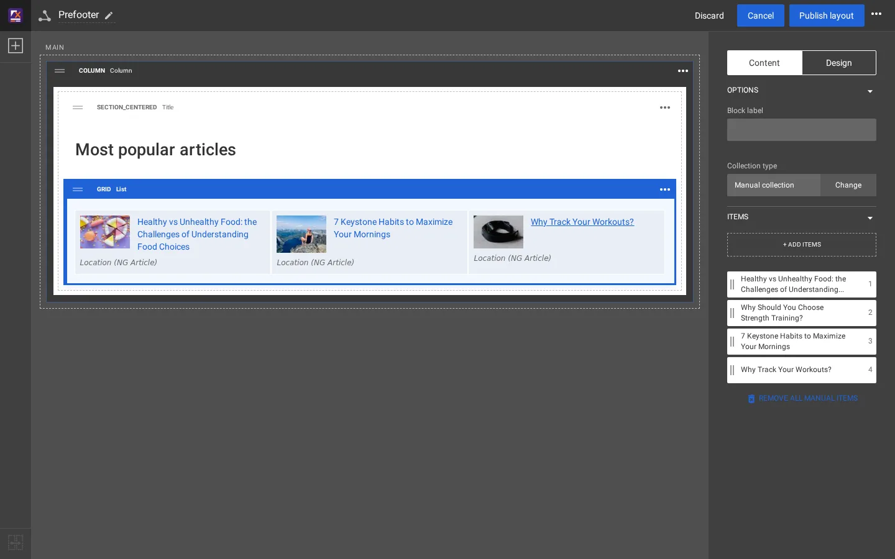
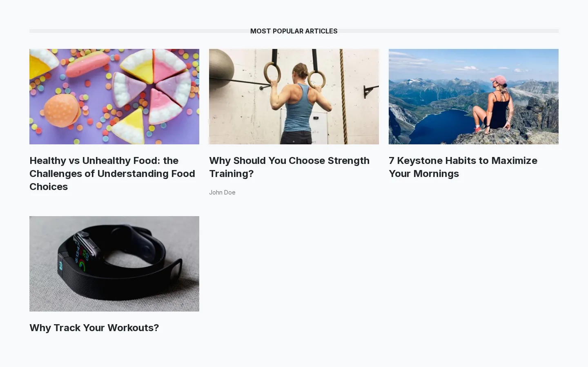

# Change the prefooter in the Layouts editor

The block band above the footer of article and recipe pages ("Most popular articles") is the shared layout
**Prefooter**. Unlike the header menu it is made of real Layouts blocks, so it is changed in the editor. This page adds
a fourth article to it.

## Contents

1. [Open the shared layout](#1-open-the-shared-layout)
2. [Select the list](#2-select-the-list)
3. [Add an item](#3-add-an-item)
4. [Order the items](#4-order-the-items)
5. [Publish and check](#5-publish-and-check)
6. [What else can be changed here](#what-else-can-be-changed-here)

## 1. Open the shared layout

**Layouts > Shared layouts**, then the name **Prefooter** (it shows "2 references": Full / Article and Full / Recipe
link their `pre_footer` zone to it). The editor opens the layout in a draft.

Its zone `main` holds a **Column** (background color `secondary`), and in it a **Title** (view `section_centered`,
"Most popular articles") and a **List** (view `grid`, 3 columns).

## 2. Select the list

Click the list. The properties panel on the right shows, on the **Content** tab, the **Collection type** (Manual
collection) and the **Items** in their order.

## 3. Add an item

Press **+ Add items**. The **Add content to collection** window lists the top of the content tree. **Open** a branch to
go down (here Fit & Healthy, then Fitness), tick the article (here *Why Should You Choose Strength Training?*) and press
**Add selected**.

On the test copy the window's search field returned "No content found." for the word tried; browsing the tree
always works.

## 4. Order the items

The new item appears in the list of items with its number. Drag the items by their handle to change the order. The
middle of the editor shows the block as the site will.

## 5. Publish and check

Press **Publish layout**. On the test copy the next request of an article showed the response header `X-Exp-Cache: MISS (purged)` and the new list, with no cache cleared by hand.

To throw the draft away instead, press **Discard**.

## What else can be changed here

| Change | Where |
|---|---|
| The heading text or its tag | Select the Title, Content tab |
| Grid or list, number of columns, item look | Select the List, **Design** tab: View type, Item view type, Number of columns |
| Background, spacing, CSS class, container | Design tab of the Column or the List |
| A list that fills itself | Collection type **Change** > Dynamic collection ([Manual and dynamic collections](manual-and-dynamic-collections.md)) |
| Show the band on other page types | Link their layouts' `pre_footer` zone to Prefooter ([Shared layouts and zone linking](shared-layouts-and-zone-linking.md)) |

## Related pages

- [Shared layouts and zone linking](shared-layouts-and-zone-linking.md)
- [Manual and dynamic collections](manual-and-dynamic-collections.md)
- [The Layouts editor, a tour](layouts-editor-tour.md)
- [Free documentation](../free-documentation.md): this page is free to copy, translate and improve under the GNU FDL 1.3.
