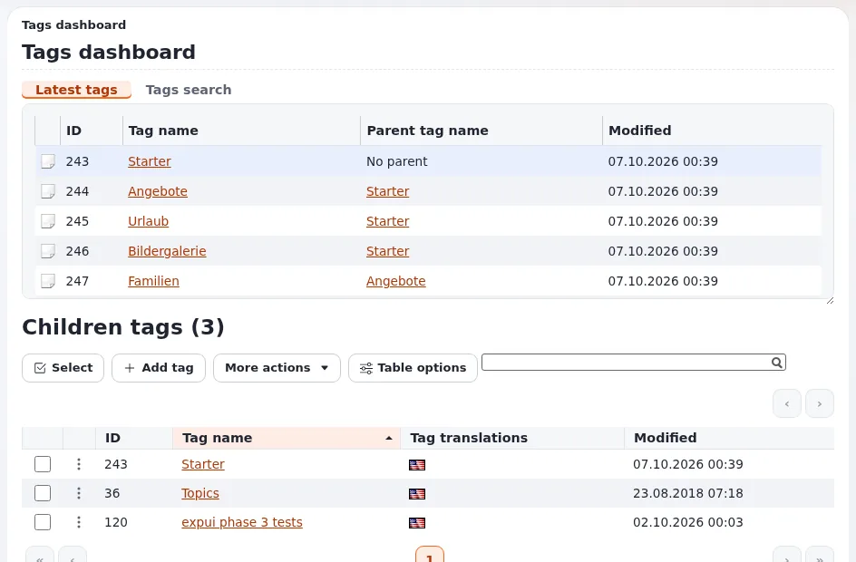

# Tagging and subject headings

This page is for the person who owns a library's or archive's vocabulary and for the catalogers who apply it. It shows
how the `eztags` extension, which ships with Exponential, gives you controlled subject headings: a hierarchy of terms,
synonyms, a page per subject and lists of records by subject. The setup steps are in
[Tagging content with eztags](../../creators/website-creators/tagging-with-eztags.md).

## Contents

1. [What eztags gives a catalog](#what-eztags-gives-a-catalog)
2. [Mapping a vocabulary onto the tag tree](#mapping-a-vocabulary-onto-the-tag-tree)
3. [Closed and open vocabularies](#closed-and-open-vocabularies)
4. [Applying headings to records](#applying-headings-to-records)
5. [Subject pages and lists by subject](#subject-pages-and-lists-by-subject)
6. [Headings in search](#headings-in-search)
7. [Several languages](#several-languages)
8. [Who may change the vocabulary](#who-may-change-the-vocabulary)
9. [Maintaining the vocabulary](#maintaining-the-vocabulary)

## What eztags gives a catalog

From the [eztags feature page](../../../features/6.0/extensions/eztags.md), in catalog terms:

| eztags feature | Catalog meaning |
|---|---|
| A tree hierarchy of tags | Broader and narrower terms |
| Synonyms | Non-preferred terms that lead to the preferred heading |
| Add, edit, move, merge and delete in the admin (**Tags**, `/tags/dashboard`) | Vocabulary maintenance in one place |
| Autocomplete in the edit form, edit views Default, Select or Tree | Catalogers pick headings instead of typing them |
| A tag view (`/tags/view/...`) | A public page per subject |
| An extended attribute filter for `content/list` and `content/tree` fetches | Lists of records by subject anywhere on the site |
| Closed (predefined) and open classification, switchable later | A controlled list, free keywords, or both |

`se7enxweb/eztags` is in the `require` block of `composer.json`, so it is part of a standard installation.

## Mapping a vocabulary onto the tag tree

| Thesaurus concept | In the tag tree |
|---|---|
| Top term | A top-level tag |
| Narrower term | A child tag |
| Use / used for | A synonym of the preferred tag |
| Related term | Not a built-in relation between tags; describe it in the subject page's introduction or link it there |

The last row is a limit to know: the feature page lists hierarchy and synonyms, not related-term links between tags.
If your thesaurus depends on related terms, ask your developer how to represent them before you import.

The website creator's advice applies to catalogs too: "Keep the tree shallow; three levels are plenty for most sites",
and "Merge duplicates and use synonyms rather than near-identical tags"
([Good tagging practice](../../creators/website-creators/tagging-with-eztags.md#good-tagging-practice)). A
library classification with many levels is often better kept in the library system, with only the levels readers
browse brought into the tag tree.

## Closed and open vocabularies

- **Closed**: catalogers can only choose existing headings. Use it for subject headings.
- **Open**: anybody with the right may add tags while editing. Use it for free keywords, if at all.
- **Both**: a closed subjects field and an open keywords field in the same class.

The choice can be changed later ([eztags](../../../features/6.0/extensions/eztags.md)). For a catalog, start closed:
an open vocabulary grows near-duplicates quickly.

## Applying headings to records

1. Add a tags attribute to each record class (**Setup > Classes**), named for example "Subjects".
2. Choose the edit view: **Select** or **Tree** suit a closed vocabulary; **Default** with autocomplete suits typing.
3. Catalogers type or pick headings; autocomplete matches the start of a tag by default (`AutoCompleteType=start`)
   and shows up to 24 results (`MaxResults`).

Source: [Tagging with eztags, Set it up](../../creators/website-creators/tagging-with-eztags.md#set-it-up).

## Subject pages and lists by subject

- **Subject page**: `/tags/view/<tag>` lists everything tagged with it. Its template can be overridden in your design
  like any other, so it can show an introduction, narrower terms and the records.
- **Lists by subject**: the extended attribute filter lets a folder or block show, for example, "the latest five
  items tagged X" ([Showing tags on a site](../../creators/website-creators/tagging-with-eztags.md#showing-tags-on-a-site)).
- **Layouts**: a dynamic collection of a layouts block can list content by query, for example "everything tagged
  with" a tag ([Layouts reference](../../../bc/6.0/LAYOUTS.md)); the tags collection query handler `explayouts_tags_query` (package `se7enxweb/explayouts-tags-query` in `composer.json`) is there for
  this.
- **Tag cloud**: built from Solr when it is available (`TagCloudOverSolr=enabled`).

> **Tip**
> "Give each tag page an introduction, so it is a useful landing page for search engines" (same page). For a library,
> a short scope note per subject also helps readers.

## Headings in search

`eztags.ini [SearchSettings]` decides what goes into the search index: `IndexSynonyms` is enabled and
`IndexParentTags` is disabled by default ([eztags, Settings](../../../features/6.0/extensions/eztags.md#settings)).
With synonyms indexed, a reader who types a non-preferred term still finds records under the preferred heading.
Enabling `IndexParentTags` makes a search for a broader term find records tagged with narrower ones; discuss it with
your catalogers, because it also widens every result list. See [Catalog search](catalog-search.md).

## Several languages

Tags can be translated; translating tags is on the website creator's practice list. `DefaultAlwaysAvailable` (default
`false`) decides whether new tags are available in every language. Tag reads follow the translation rules described with the 2.3.4 database fix:
main language when asked, else an explicit locale, else the site's language priority
([eztags](../../../features/6.0/extensions/eztags.md#works-on-every-database)).

## Who may change the vocabulary

The `tags` module has its own policies: `read`, `dashboard`, `view`, `add` (limited by tag), `addsynonym`, `edit`,
`editsynonym`, `delete`, `deletesynonym` and more. Give visitors `tags/read` and `tags/view` so subject pages work for
them; give catalogers `add` only below the tags they curate
([Tagging with eztags, Permissions](../../creators/website-creators/tagging-with-eztags.md#permissions)). Keep `edit`,
`delete` and merging with the vocabulary owner.

## Maintaining the vocabulary

- [ ] One named vocabulary owner; changes requested through them.
- [ ] New headings added before records need them, not during cataloging.
- [ ] Duplicates merged; synonyms added for spelling variants and former terms.
- [ ] Subject pages have a scope note.
- [ ] A yearly review of headings with no records and of headings with very many.

## Related pages

- [Libraries and catalogs](README.md)
- [Modeling catalog records](modeling-catalog-records.md)
- [Catalog search](catalog-search.md)
- [Tagging content with eztags](../../creators/website-creators/tagging-with-eztags.md)
- [Free documentation](../../free-documentation.md): this page is free to copy, translate and improve under the GNU FDL 1.3.
