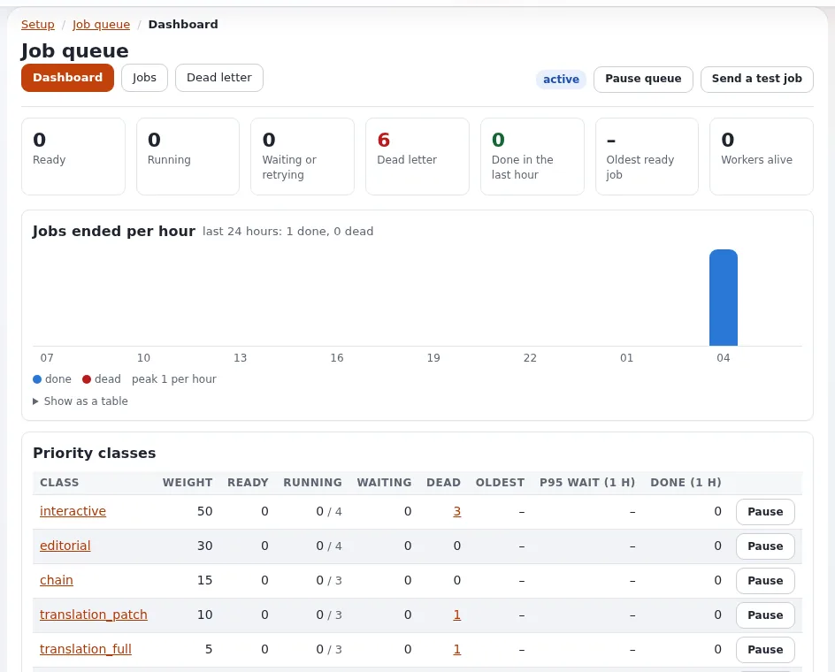

# Background work: queues, cronjobs and content jobs

This page is for application creators who decide where work runs. A web request should answer fast; anything slow,
periodic or large belongs elsewhere. Exponential offers four places.

## Contents

1. [The four places](#the-four-places)
2. [Decision table](#decision-table)
3. [Patterns](#patterns)
4. [Common mistakes](#common-mistakes)

## The four places

| Place | Runs | Read |
|---|---|---|
| Cronjob part | on a schedule, as a batch | [Cronjobs for applications](cronjobs-for-applications.md) |
| expqueue job | as soon as a worker is free, per job, with retries | [Queues with expqueue](queues-with-expqueue.md) |
| Content job | large kernel content operations (remove, copy, move ...) in batches | [Content jobs](content-jobs.md) |
| Workflow event deferred to cron | a step of a content operation that must wait | [Workflows, triggers and events](workflows-and-events.md) |

## Decision table

| The work | Place |
|---|---|
| Import a feed every hour | cronjob part |
| Call an external service after each publish | workflow or event listener enqueues an expqueue job |
| Hold publishing until someone approves | workflow event deferred to cron |
| Remove or move a subtree of 50 000 nodes | content job |
| Send a reminder mail tomorrow at 9 | expqueue job with `not_before` |
| Rebuild a report nightly | cronjob part |
| Generate alt texts for a whole subtree | expqueue jobs in a group (as expai does) |

## Patterns

- **Event to queue**: a listener or workflow event enqueues a job with an idempotency key (`"archive:<object>:<version>"`)
  and returns at once; the handler does the slow call.
- **Cron to queue**: a cron part finds what is due and enqueues one job per item; workers run them in parallel with
  retries.
- **Batch with checkpoint**: a long job saves progress, so a retry continues instead of starting over.
- **Fan-out with a group**: many jobs in one group, with progress and cancel for the whole.

## Common mistakes

- Slow HTTP calls inside the publish request: editors wait, and a failure breaks publishing.
- A cron part that runs longer than its interval.
- Secrets in job payloads.
- Work that is not idempotent and runs twice after a retry.

## Related pages

- [Queues with expqueue](queues-with-expqueue.md)
- [Cronjobs for applications](cronjobs-for-applications.md)
- [Scaling applications](scaling-applications.md)
- [Free documentation](../../free-documentation.md): this page is free to copy, translate and improve under the GNU FDL 1.3.
