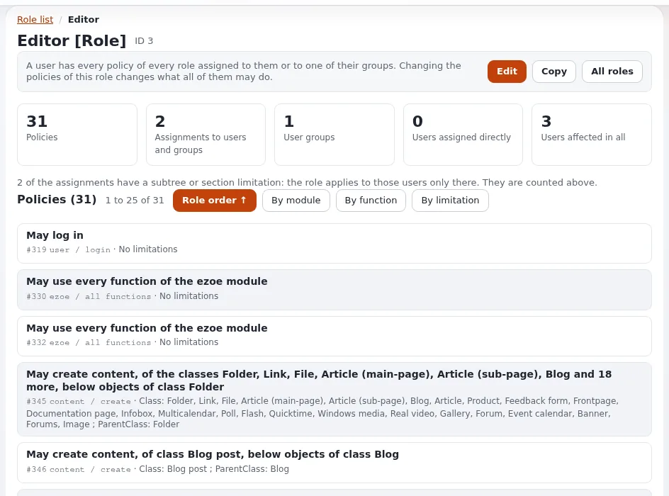

# Policy functions and limitations

This page is for application creators who decide who may do what in their application. Exponential's permissions are
roles made of policies: a module, a function, and optional limitations. Your module declares its functions; the role
editor then offers them; your code checks them.

## Contents

1. [Declaring functions](#declaring-functions)
2. [What the kernel checks for you](#what-the-kernel-checks-for-you)
3. [Checking in code](#checking-in-code)
4. [Content permissions](#content-permissions)
5. [Checking in templates](#checking-in-templates)
6. [Design rules](#design-rules)

## Declaring functions

In `module.php`, `$FunctionList` names the functions and their limitations
([module.php reference](module-definition-reference.md#functionlist-and-limitations)):

```php
$FunctionList['read'] = array();
$FunctionList['manage'] = array( 'Section' => $SectionLimitation );
```

## What the kernel checks for you

A view's `'functions' => array( 'read' )` is checked before the view runs: without the function the user gets "access
denied", and an anonymous user the login page. That check does not evaluate limitations for your own data: it only
knows the user has the function, possibly limited.

## Checking in code

```php
$user = eZUser::currentUser();
$access = $user->hasAccessTo( 'expdemo', 'manage' );
switch ( $access['accessWord'] )
{
    case 'yes':     // unlimited
        break;
    case 'limited': // $access['policies'] holds the limitations, e.g. allowed section ids
        $allowedSections = array();
        foreach ( $access['policies'] as $policy )
            if ( isset( $policy['Section'] ) )
                $allowedSections = array_merge( $allowedSections, $policy['Section'] );
        break;
    default:        // 'no'
        return $Params['Module']->handleError( eZError::KERNEL_ACCESS_DENIED, 'kernel' );
}
```

`hasAccessTo()` returns `accessWord` (`yes`, `no`, `limited`), `policies` and `accessList`
(`kernel/classes/datatypes/ezuser/ezuser.php`).

## Content permissions

For content, ask the object or node; they apply every content limitation (class, section, owner, subtree, state,
language):



```php
if ( !$node->canRead() ) { /* deny */ }
if ( !$object->canEdit() ) { /* deny */ }
$object->checkAccess( 'remove' );   // returns 1 when allowed
```

Fetches such as `eZContentObjectTreeNode::subTreeByNodeID()` and the template `fetch( 'content', ... )` functions return
only what the user may read.

## Checking in templates

```text
{if fetch( 'user', 'has_access_to', hash( 'module', 'expdemo', 'function', 'manage' ) )}
  <a href={'expdemo/manage'|ezurl}>{'Manage'|i18n( 'extension/expdemo' )}</a>
{/if}
```

Hiding a link is convenience, not security: the view must check again.

## Design rules

- One function per kind of action (`read`, `create`, `manage`), not per screen.
- Limitations only where a real customer needs them; each must be applied in code.
- Never grant a new function to Anonymous by default; document what to grant.
- Log refusals that matter in the audit trail ([Access control in code](access-control-in-code.md)).

## Related pages

- [Roles and policies](../../../guides/roles-and-policies.md)
- [Role and policy template operators](../../../features/6.0/role-and-policy-template-operators.md)
- [Security standard](../../../standards/security.md)
- [Free documentation](../../free-documentation.md): this page is free to copy, translate and improve under the GNU FDL 1.3.
