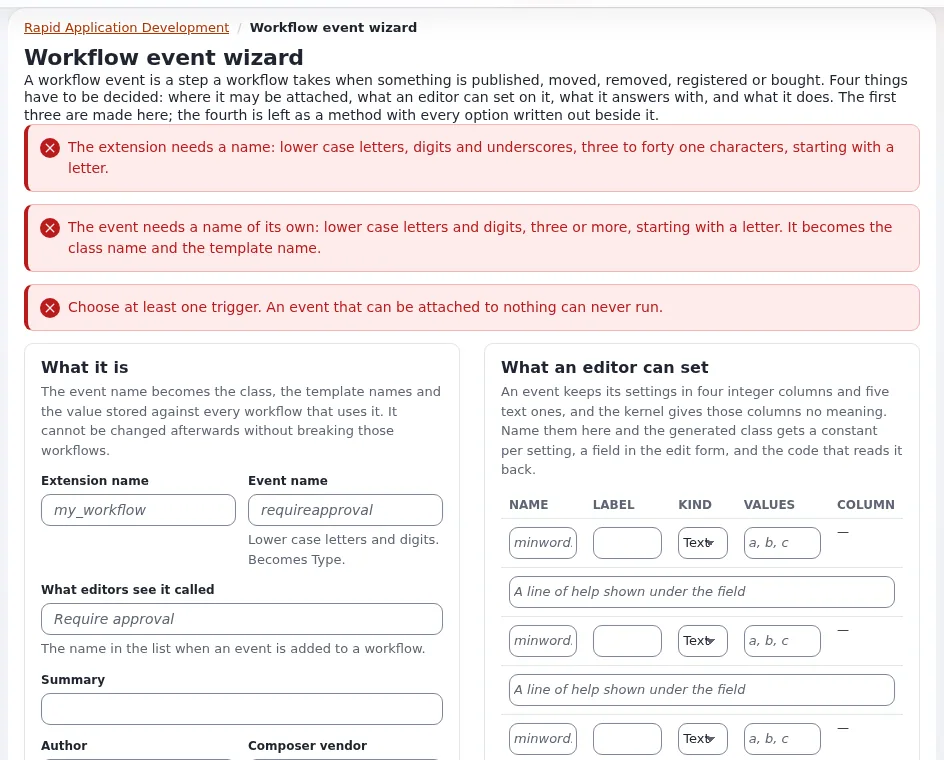

# Writing a workflow event type

This page is for application creators who add a step administrators can put into workflows: notify an external system
on publish, check a field before publishing, wait for an outside approval. **Setup > RAD > Workflow event extension**
(`/setup/workflowevent`) writes a working skeleton ([RAD tools](rad-tools.md)).



## Contents

1. [Files and registration](#files-and-registration)
2. [The class](#the-class)
3. [Statuses](#statuses)
4. [Settings per event](#settings-per-event)
5. [Testing](#testing)

## Files and registration

```text
extension/expdemo/eventtypes/event/expnotify/expnotifytype.php
extension/expdemo/settings/workflow.ini.append.php
```

```ini
<?php /* #?ini charset="utf-8"?
[EventSettings]
ExtensionDirectories[]=expdemo
AvailableEventTypes[]=event_expnotify
*/ ?>
```

Entries in `AvailableEventTypes[]` are the group and the type string joined by `_`, as the shipped
`event_ezapprove`, `event_ezwaituntildate` in `settings/workflow.ini`.

## The class

```php
<?php
class expNotifyType extends eZWorkflowEventType
{
    const WORKFLOW_TYPE_STRING = 'expnotify';

    public function __construct()
    {
        parent::__construct( self::WORKFLOW_TYPE_STRING, ezpI18n::tr( 'extension/expdemo', 'Notify the archive' ) );
        $this->setTriggerTypes( array( 'content' => array( 'publish' => array( 'after' ) ) ) );
    }

    function execute( $process, $event )
    {
        $parameters = $process->attribute( 'parameter_list' );
        $object = eZContentObject::fetch( (int)$parameters['object_id'] );
        if ( !$object )
            return eZWorkflowType::STATUS_WORKFLOW_CANCELLED;

        // Do not call slow services here: queue the work instead
        expDemoArchiveQueue::add( $object->attribute( 'id' ), (int)$parameters['version'] );
        return eZWorkflowType::STATUS_ACCEPTED;
    }
}

eZWorkflowEventType::registerEventType( expNotifyType::WORKFLOW_TYPE_STRING, 'expNotifyType' );
```

This follows the shipped `eZWaitUntilDateType` (`kernel/classes/workflowtypes/event/ezwaituntildate/`).
`setTriggerTypes()` limits which triggers the event may be used with.

## Statuses

`eZWorkflowType` (`kernel/classes/ezworkflowtype.php`) defines the answers of `execute()`:

| Status | Effect |
|---|---|
| `STATUS_ACCEPTED` | the step is done; the next one runs |
| `STATUS_REJECTED` | the operation is refused |
| `STATUS_DEFERRED_TO_CRON`, `STATUS_DEFERRED_TO_CRON_REPEAT` | wait; the workflow cronjob runs the step again |
| `STATUS_FETCH_TEMPLATE`, `STATUS_FETCH_TEMPLATE_REPEAT` | show a template to the user (a choice, a form) |
| `STATUS_REDIRECT`, `STATUS_REDIRECT_REPEAT` | send the user elsewhere (a payment provider) |
| `STATUS_WORKFLOW_CANCELLED` | stop the workflow |
| `STATUS_RUN_SUB_EVENT`, `STATUS_WORKFLOW_RESET`, `STATUS_WORKFLOW_DONE` | special flows (multiplexer, reset) |

Keep `execute()` fast: it runs inside the editor's publish. Slow work goes to a queue
([Background work](background-work-patterns.md)).

## Settings per event

Settings an administrator gives the event in the workflow editor are stored in the event's columns (`data_int1`,
`data_text1` ...). Override `fetchHTTPInput()` and `validateHTTPInput()` to read them, and ship edit and view templates
`workflow/eventtype/edit/event_expnotify.tpl` and `workflow/eventtype/view/event_expnotify.tpl` in your design, like the
kernel's `event_ezapprove.tpl`.

## Testing

1. Regenerate autoloads; clear the INI cache.
2. **Setup > Workflows**: create a workflow with the event; **Setup > Triggers**: connect it to `content/publish/after`.
3. Publish an object; check the effect.
4. For deferring events: run `php runcronjobs.php frequent` and watch **Setup > Workflow processes**.
5. Unit-test the decision logic in a separate class without the workflow.

## Related pages

- [Workflows, triggers and events](workflows-and-events.md)
- [Extension points: workflow event type](../../../bc/6.0/rad-extension-points.md#workflow-event-type)
- [Workflows](../../../guides/workflows.md)
- [Free documentation](../../free-documentation.md): this page is free to copy, translate and improve under the GNU FDL 1.3.
