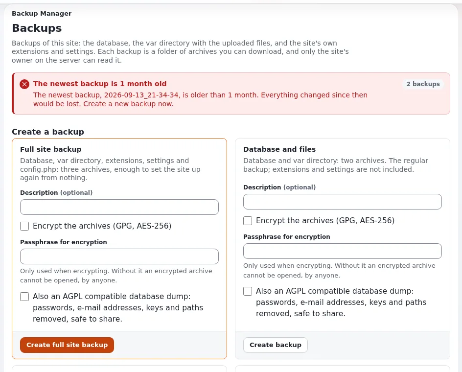

# Backups and restores

This page is for website creators responsible for a site's data. A backup is the database and the files, taken at the
same moment; a backup that was never restored is a hope, not a backup
([10.9 Backups and restore](../../../install/10-after-installing.md#109-backups-and-restore)).

## Contents

1. [What to back up](#what-to-back-up)
2. [Taking a backup](#taking-a-backup)
3. [Restoring](#restoring)
4. [The restore test](#the-restore-test)
5. [Retention](#retention)

## What to back up

| Path | Why |
|---|---|
| the database | all content, users, settings stored in the database |
| `var/storage`, `var/<site>/storage` | uploaded images and files |
| `settings/override`, `settings/siteaccess` | the installation's settings (they contain passwords: keep backups private) |
| your own extensions and designs | if they are not in a Git repository |

Caches are regenerated and need no backup.

## Taking a backup

1. Maintenance mode on, so database and files agree:



   ```bash
   php bin/php/maintenance.php on --message="Back soon" --until=30m --allow-admin --allow-root-user
   ```

2. The database:

   | Engine | Backup |
   |---|---|
   | SQLite | `sqlite3 var/storage/sqlite3/exponential.db ".backup '/backup/db.sqlite'"` |
   | MySQL, MariaDB | `mysqldump --single-transaction -u USER -p DATABASE > /backup/db.sql` |
   | PostgreSQL | `pg_dump -U USER -Fc DATABASE > /backup/db.dump` |
   | MongoDB | `mongodump --uri="mongodb://USER@HOST/DATABASE" --out=/backup/mongo` |

3. The files:

   ```bash
   tar czf /backup/files-$(date +%F).tar.gz var/storage settings/override settings/siteaccess
   ```

4. Maintenance off: `php bin/php/maintenance.php off --allow-root-user`.

On SQLite (online backup) and MySQL with InnoDB the database backup alone is consistent without maintenance mode.

## Restoring

1. Maintenance on; under Velocity stop the server.
2. Restore the database with the engine's tool and unpack the files; fix owner and mode.
3. Clear every cache and regenerate autoloads:

   ```bash
   php bin/php/ezcache.php --clear-all --allow-root-user
   php bin/php/ezpgenerateautoloads.php -e
   ```

4. Start Velocity, clear its response cache, maintenance off, open the front page and the administration.

## The restore test

At least once, and after every major upgrade, restore a backup on another machine and check: the front page, a deep
page, an image, a download, a login, a form. Write down how long it took; that is your recovery time.

## Retention

Store backups away from the server, keep several generations (for example daily for a week, weekly for a month), and
remember they contain personal data and passwords.

## Related pages

- [Maintenance mode during changes](maintenance-mode.md)
- [Operating a site: back up and restore](../../../guides/operating-a-site.md#6-back-up-and-restore)
- [Databases](../../../install/09-databases.md)
- [Free documentation](../../free-documentation.md): this page is free to copy, translate and improve under the GNU FDL 1.3.
