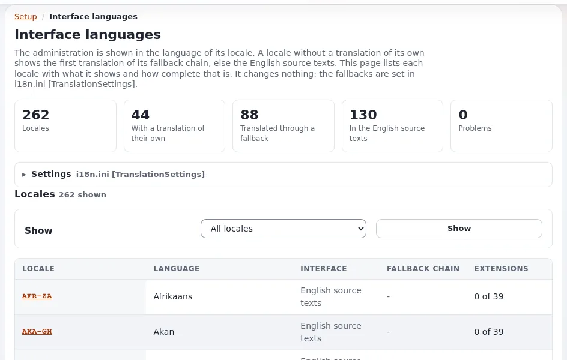

# Language switchers and addresses per language

This page is for website creators who give each language of a site its own address and a switcher between them. It
covers the choice of addresses, the automatic redirect from the start page to the visitor's language, and the
switcher template.

## Contents

1. [Addresses per language](#addresses-per-language)
2. [Redirecting the start page to the visitor's language](#redirecting-the-start-page-to-the-visitors-language)
3. [The language switcher](#the-language-switcher)
4. [Telling search engines](#telling-search-engines)
5. [Checklist](#checklist)

## Addresses per language

| Shape | Example | Set up with |
|---|---|---|
| Path per language | `example.com/de/` | `MatchOrder=uri`, `URIMatchType=element`, siteaccess named `de` (or a map) |
| Host per language | `example.de`, `de.example.com` | `MatchOrder=host`, `HostMatchMapItems[]=example.de;site_de` |
| Host and path | `example.com/de` on one host, other hosts elsewhere | `host_uri` with `HostUriMatchMapItems[]` |



Paths are simplest (one certificate, one host); hosts suit country domains. The settings are in
`site.ini [SiteAccessSettings]` ([10.2](../../../install/10-after-installing.md#102-siteaccesses-and-site-addresses)).

## Redirecting the start page to the visitor's language

With `DefaultHostUriMatchMapItems[]` an address without a language segment (`example.com/`) redirects once to the
visitor's language, chosen by host and by the browser's `Accept-Language`, with one address per language and no cookie
([Siteaccess by host prefix, and the redirect to the language](../../../features/6.0/siteaccess-host-and-language-matching.md)):

```ini
# settings/override/site.ini.append.php
[SiteAccessSettings]
DefaultHostUriMatchMapItems[]=www.example.com;ger;site_de;strict;de
DefaultHostUriMatchMapItems[]=www.example.com;eng;site_en
```

The format is `host;uri;siteaccess[;method[;language]]`: a German browser goes to `/ger`, every other browser to
`/eng` (the entry without a language). `DefaultHostUriRedirect=disabled` shows the page at the address itself instead
of redirecting.

## The language switcher

1. Name the siteaccesses of the switcher, in each public siteaccess (or once in `settings/override/`):

   ```ini
   [RegionalSettings]
   TranslationSA[]
   TranslationSA[site_en]=English
   TranslationSA[site_de]=Deutsch
   ```

   Every siteaccess in it must also be in `[SiteAccessSettings] RelatedSiteAccessList[]`. `LanguageSA[]` maps a
   language to a siteaccess when the names do not follow the convention (`settings/site.ini` explains both).
2. Print the switcher in the pagelayout with the kernel operator `language_switcher`
   (`kernel/private/eztemplate/ezplanguageswitcheroperator.php`). The ezwebin design's
   `page_header_languages.tpl` does it like this:

   ```text
   {def $avail_translation = language_switcher( $site.uri.original_uri )}
   <ul class="languages">
   {foreach $avail_translation as $siteaccess => $lang}
     <li><a href={$lang.url|ezurl}{if $siteaccess|eq( $access_type.name )} aria-current="true"{/if}
            lang="{$siteaccess|wash}">{$lang.text|wash}</a></li>
   {/foreach}
   </ul>
   {undef $avail_translation}
   ```

   Each link goes through the module `switchlanguage/to`, which finds the same page in the other siteaccess
   (`LanguageSwitcherClass=ezpLanguageSwitcher` in `site.ini`). Give the `lang` attribute the language code your
   design uses (for example `de`) rather than the siteaccess name.
3. Clear the INI and template caches.

## Telling search engines

Search engines understand `hreflang` alternates between the language versions of a page. Exponential does not print
them by itself; build them in the pagelayout from the same `language_switcher` result
(`<link rel="alternate" hreflang="de" href="...">`), with full addresses
([SEO basics for Exponential sites](seo-basics.md)).

## Checklist

- [ ] Each language has one address scheme, used everywhere.
- [ ] `TranslationSA[]` and `RelatedSiteAccessList[]` list every language siteaccess.
- [ ] The switcher links to the same page in the other language, not to the start page.
- [ ] The current language is marked for screen readers.
- [ ] Cached pages differ per language (they do: each siteaccess has its own cache).

## Related pages

- [Building a multilingual site](multilingual-sites.md)
- [Right-to-left sites](right-to-left-sites.md)
- [Translations and languages](../../../features/6.0/translations-and-languages.md)
- [Free documentation](../../free-documentation.md): this page is free to copy, translate and improve under the GNU FDL 1.3.
