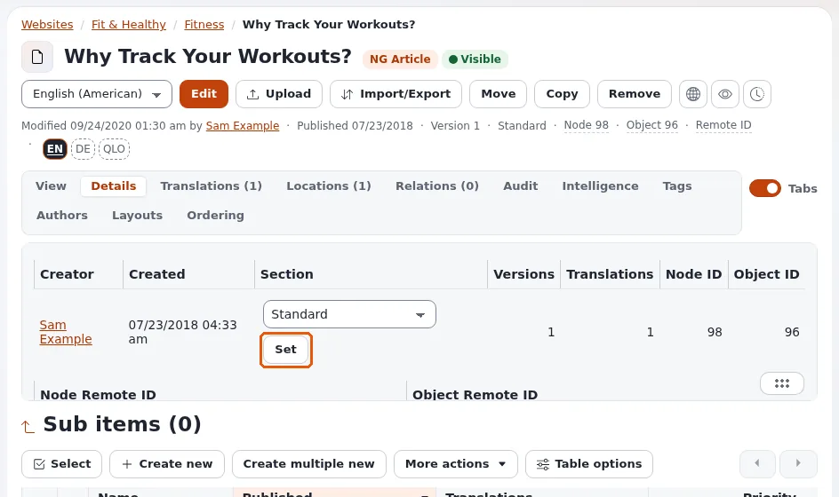
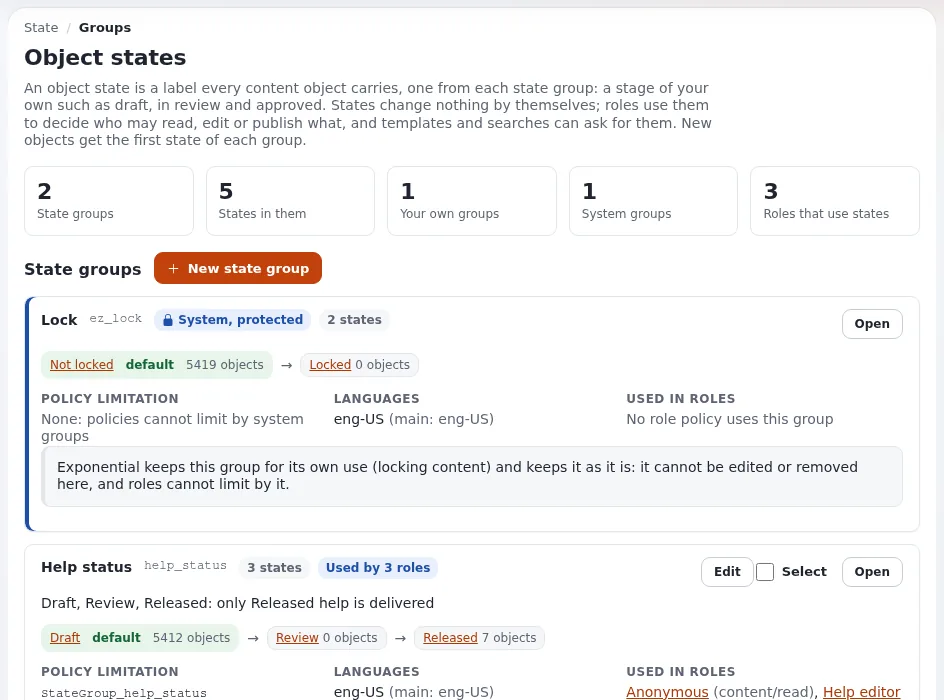

# Sections and object states for site builders

This page is for website creators who need parts of a site to behave differently: a members area, pages that wait
before they go public, departments that edit only their own pages, a review step. Exponential has two tools for this,
**sections** and **object states**. Both are labels on content; roles and policies give them meaning.

## Contents

1. [Sections and states compared](#sections-and-states-compared)
2. [The sections of a new installation](#the-sections-of-a-new-installation)
3. [Recipe: a members area](#recipe-a-members-area)
4. [Recipe: staging before publishing](#recipe-staging-before-publishing)
5. [Recipe: a review stage with object states](#recipe-a-review-stage-with-object-states)
6. [Templates per section or state](#templates-per-section-or-state)

## Sections and states compared

| | Section | Object state |
|---|---|---|
| Each object has | exactly one section | one state from each state group |
| Managed in | **Setup > Sections** ([Sections](../../../guides/sections.md)) | **Setup > States** ([Object states](../../../guides/object-states.md)) |
| Typical use | areas of the site: members, intranet, staging | stages: draft, in review, approved |
| Set by | assigning a subtree, or when the object is created | the node's Details tab, a subtree, or a workflow |
| Policies limit by | `Section` | `StateGroup_<group identifier>` |
| Override match | `Match[section_identifier]` | `Match[state_identifier]` |



Neither is a place in the tree or a siteaccess: an area of the tree is assigned to a section, and objects keep the
section when moved, unless reassigned.

## The sections of a new installation

| ID | Name | Identifier | Holds |
|---|---|---|---|
| 1 | Standard | `standard` | the content tree |
| 2 | Users | `users` | user accounts |
| 3 | Media | `media` | the media library |
| 4 | Setup | `setup` | setup objects |
| 5 | Design | `design` | design objects |


The Anonymous role reads Section Standard only. That one limitation keeps everything else away from visitors
([2. The sections of a new installation](../../../guides/sections.md#2-the-sections-of-a-new-installation)).

## Recipe: a members area

From [13.1 A members area](../../../guides/sections.md#131-a-members-area):

1. Create a section `Members area`, identifier `members_area`.
2. Create a folder `Members` with its pages.
3. On the section's card, **Assign content** and choose the folder.
4. Logged out, the folder is gone from menus and gives "access denied".
5. Give the members' role `content/read` limited to Section( Members area ).

Visitors who are not logged in and open a members page see the login page; after login they return to the page.
Registration is on [Member registration and members-only areas](member-registration-and-areas.md).

## Recipe: staging before publishing

From [13.3 Staging content](../../../guides/sections.md#133-staging-content-before-it-goes-public): a section `Staging`
that Anonymous may not read; editors build pages in their final place and assign them to Staging; releasing them is
one **Assign content** to Standard.

## Recipe: a review stage with object states

1. **Setup > States**: create a group `review` with the states Draft, In review, Approved (the first is the default)
   ([4. Creating a group and its states](../../../guides/object-states.md#4-creating-a-group-and-its-states)).
2. Give Anonymous `content/read` limited to Section( Standard ) **and** `StateGroup_review` ( Approved ).
3. Give authors `state/assign` with `NewState` ( In review ); give reviewers `state/assign` with `NewState` ( Approved ).
4. Authors publish and set In review; reviewers check and set Approved; only then visitors see the page.



The full worked example is [9. A worked example: a review workflow](../../../guides/object-states.md#9-a-worked-example-a-review-workflow).
For an approval step before publishing (not after), see the approve event of workflows
([Workflows](../../../guides/workflows.md)).

## Templates per section or state

```ini
# settings/siteaccess/<site>/override.ini.append.php
[full_members]
Source=node/view/full.tpl
MatchFile=full/members.tpl
Subdir=templates
Match[section_identifier]=members_area
```

A members design, a "draft" banner on unapproved pages, a different layout for staging: all are one rule each
([Template overrides for site builders](template-overrides.md)).

> **Tip**
> Identifiers are what templates and overrides use. Give every section and state group an identifier; the section
> list marks sections without one as needing attention.

## Related pages

- [Visitor permissions: the Anonymous role](visitor-permissions.md)
- [Roles and policies](../../../guides/roles-and-policies.md)
- [Structuring the content tree](structuring-the-content-tree.md)
- [Free documentation](../../free-documentation.md): this page is free to copy, translate and improve under the GNU FDL 1.3.
