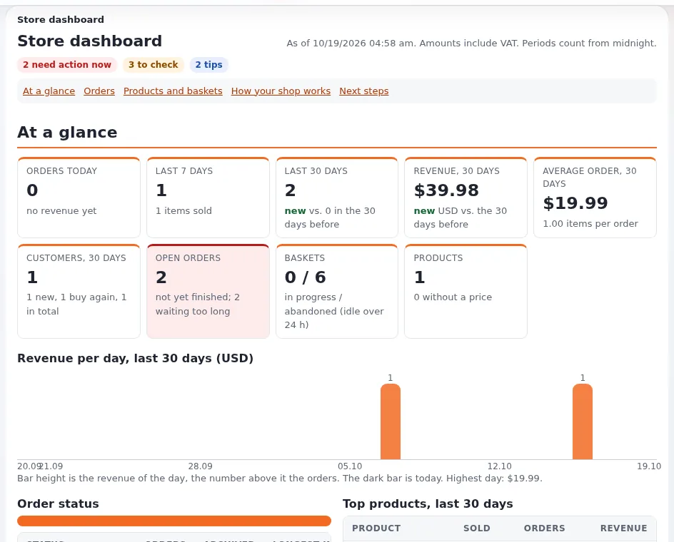

# Running a shop: overview

This page is for website creators who sell on an Exponential site. The kernel includes a shop: products are content
with a price field, visitors put them in a basket, check out, confirm, pay through a payment gateway, and orders are
managed in the **Store** tab of the administration, which opens the Store dashboard
([Store dashboard and order statuses](../../../features/6.0/store-dashboard.md)).

## Contents

1. [The parts](#the-parts)
2. [The visitor's path](#the-visitors-path)
3. [Setting up a shop, in order](#setting-up-a-shop-in-order)
4. [Permissions](#permissions)
5. [What the shop does not do](#what-the-shop-does-not-do)

## The parts

| Part | Where |
|---|---|
| Products | content of a class with an `ezprice` or `ezmultiprice` field (the shipped `product` class) ([Products, prices and VAT](products-prices-and-vat.md)) |
| Basket | `shop/basket` (its view name is `[BasketSettings] BasketViewName` in `shop.ini`) |
| Checkout | `shop/register` (customer data), `shop/confirmorder`, `shop/checkout` |
| Payment | a workflow on the checkout trigger with a gateway event ([Payment gateways](payment-gateways.md)) |
| Orders | `shop/orderlist`, `shop/orderview`, statuses, archive, customers, statistics |
| VAT | `shop/vattype`, `shop/vatrules` |
| Currencies | `shop/currencylist`, exchange rates (`[ExchangeRatesSettings]`) |
| Discounts | `shop/discountgroup` |
| Dashboard | `shop/dashboard` |

The shop's module and views are defined in `kernel/shop/module.php`; its settings in `settings/shop.ini`.

## The visitor's path

1. A product page has an **Add to basket** button (`shop/add`).
2. The basket (`shop/basket`) lists items, quantities and totals.
3. Checkout asks for the customer's data (`shop/register`, or `shop/userregister`).
4. The confirmation page (`shop/confirmorder`) shows shipping and VAT.
5. Payment: the checkout workflow sends the visitor to the gateway.
6. The order is placed; a confirmation mail goes out and the visitor sees the order (or a permanent receipt,
   [Order receipts](../../../features/6.0/order-receipts.md)).

Details: [Basket, checkout and orders](basket-checkout-and-orders.md).

## Setting up a shop, in order

1. Product class with a price field; product folder; a few products.
2. VAT types and, for several countries, VAT rules.
3. Currency (`[CurrencySettings] PreferredCurrency`) and rounding (`[MathSettings]`).
4. Templates: product full view with the add-to-basket form, basket, checkout pages (the ezwebin and simple themes
   ship them).
5. Payment gateway and the checkout workflow.
6. Shipping, when needed (a shipping handler or the simple shipping workflow in `workflow.ini`).
7. Order confirmation mail and, if wanted, permanent receipts.
8. A full test order, then the Store dashboard's "How your shop works" section to check the configuration.

## Permissions

The shop module's functions are `buy`, `administrate`, `setup`, `edit_status` and `setstatus`. Visitors need
`shop/buy`; the shop staff need `shop/administrate` (orders, dashboard, statistics) and `shop/setup` for VAT and
currencies ([Roles and policies](../../../guides/roles-and-policies.md)).

## What the shop does not do

Plan these as extensions or integrations: stock management, invoices in an accounting system, shipping labels,
marketplaces. The Store dashboard's "Next steps" section suggests what is missing in your configuration.

## Related pages

- [Products, prices and VAT](products-prices-and-vat.md)
- [Basket, checkout and orders](basket-checkout-and-orders.md)
- [Payment gateways](payment-gateways.md)
- [Shop basket view name](../../../bc/6.0/shop-basket-view-name.md)
- [Free documentation](../../free-documentation.md): this page is free to copy, translate and improve under the GNU FDL 1.3.
