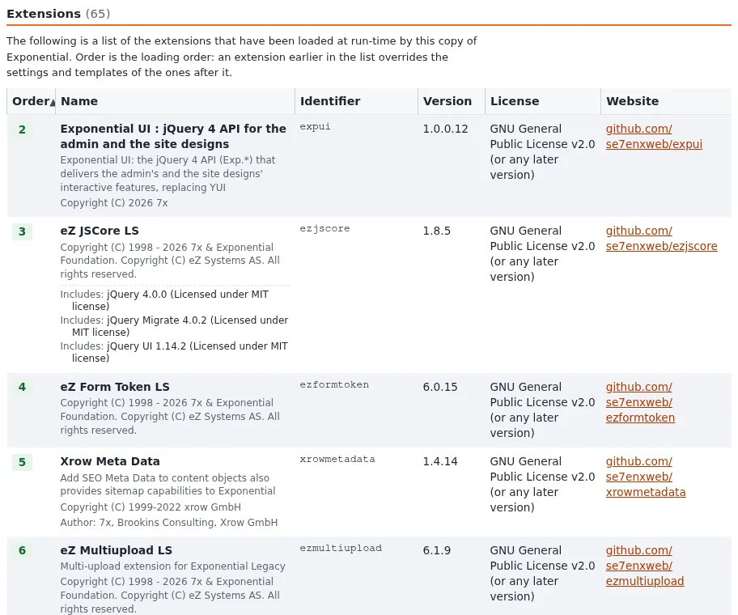

# Site packages and the themes that ship

This page is for website creators who want to know what they get from the installer before they choose. A **site
package** is the starting point of a new installation: content classes, a design, content, roles and settings in one
package. A **theme** is the design part, an extension you can keep using after the install.

## Contents

1. [What a site package contains](#what-a-site-package-contains)
2. [The site packages of this version](#the-site-packages-of-this-version)
3. [Where packages come from](#where-packages-come-from)
4. [Full or clean](#full-or-clean)
5. [The themes behind the packages](#the-themes-behind-the-packages)
6. [Packages after the install](#packages-after-the-install)

## What a site package contains

A site package is an Exponential package of type `site` (`package.xml` with `<type>site</type>`) plus the packages it
requires ([4.3 Site packages](../../../install/04-choosing-an-install-method.md#43-site-packages-what-is-installed)).
The default, `sevenx_multisite`, requires `sevenx_classes` (the content classes) and `sevenx_multisite_democontent`
(the demo content). A package can also carry install scripts that set up siteaccess settings, roles and preferences:
`sevenx_multisite` lists `ini-site.php`, `ini-admin.php`, `ini-common.php`, `sevenx-multi-site-installer.php`,
`install-scripts.php`, `roles.php` and `preferences.php`.

| Part | Where it ends up |
|---|---|
| Content classes | Setup > Classes |
| Content (demo or empty structure) | the content tree and the media library |
| Roles and policies | Users > Roles |
| Settings for the public, admin and editor siteaccesses | `settings/siteaccess/<name>/` and `settings/override/` |
| The design | an extension activated in the settings |

## The site packages of this version

The package index of this version offers eleven site packages. The ones you will meet
([4.3](../../../install/04-choosing-an-install-method.md#43-site-packages-what-is-installed)):

| Package | Summary in the index |
|---|---|
| `sevenx_multisite` | 7x MultiSite Default Installation (the default) |
| `sevenx_multisite_clean` | the same, without demo content |
| `sevenx_site`, `sevenx_site_clean` | 7x Simple Website Interface |
| `ezwebin_site`, `ezflow_site`, `ezdemo_site` (each also `_clean`), `plain_site` | the older packages, kept for sites built on them |

## Where packages come from

- **The remote package index**, `[RepositorySettings] RemotePackagesIndexURL` in `settings/package.ini`. A listed
  package that is not yet imported is downloaded and imported with the packages it requires.
- **The local repository** below `var/storage/packages/` (vendor directory `7x`, from `[RepositorySettings] Vendor`).
  When the index cannot be downloaded, the installer looks for an `index.xml` there: that is how an offline install
  works.
- **An upload**: the setup wizard's site package page has an **Upload package** field for an `.ezpkg` file.

Packages are also managed after the install in **Setup > Packages** ([Packages](../../../guides/packages.md)).

## Full or clean

| | Full package | `_clean` package |
|---|---|---|
| Classes, design, roles | yes | yes |
| Demo articles and images | yes | no |
| Good for | learning, demos, seeing every template in use | the real site you fill yourself |

> **Tip**
> Install both once, on two databases: the full one shows you how each class is meant to look, the clean one is the
> start of your site.

## The themes behind the packages

| Theme (extension) | Design | Used by |
|---|---|---|
| `sevenx_themes_simple` | `simple` | the default installation ([sevenx_themes_simple](../../../features/6.0/extensions/sevenx_themes_simple.md)) |
| `ezwebin` | `ezwebin` | `ezwebin_site` ([ezwebin](../../../features/6.0/extensions/ezwebin.md)) |
| `ezdemo` | `ezdemo` | `ezdemo_site` ([ezdemo](../../../features/6.0/extensions/ezdemo.md)) |
| `ezflow` | `ezflow` | `ezflow_site` ([ezflow](../../../features/6.0/extensions/ezflow.md)) |

Each theme is a Composer package; check the version you have with `grep Version extension/<theme>/ezinfo.php` or on
the about page (`/ezinfo/about`).

## Packages after the install

- A package is a snapshot: changing a class in the administration does not change the package.
- To move classes or content between installations, export a package in **Setup > Packages** and import it on the
  other side ([Content packages (.ezpkg)](../app-creators/packages-and-ezpkg.md)).
- Reinstalling replaces the database. Never reinstall a site that holds real content; see
  [4.4 What an installation writes](../../../install/04-choosing-an-install-method.md#44-what-an-installation-writes).

## Related pages

- [Choosing an install method for a new site](choosing-an-install-method.md)
- [Choosing a design or theme](choosing-a-design-or-theme.md)
- [Default extension distribution](../../../features/6.0/default-extension-distribution.md)
- [Free documentation](../../free-documentation.md): this page is free to copy, translate and improve under the GNU FDL 1.3.
