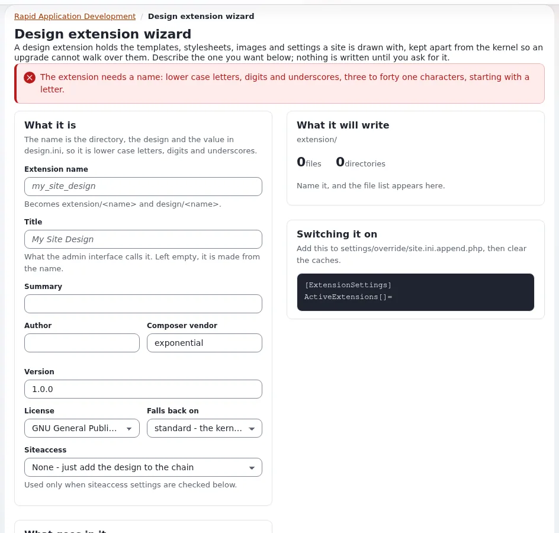

# The design extension wizard (Setup > RAD)

This page is for designers who want a working theme extension skeleton without typing it. The wizard writes the
folder, the design, the settings, the metadata, a README, a LICENSE and a `.gitignore`, and shows every file before
it writes anything.

## Before you start

- An administrator account with the `setup/setup` policy (the view's function).
- A development installation, not a live site: the wizard writes into `extension/`.
- A name for the theme ([Naming your theme extension](naming-your-theme-extension.md)).

## Step by step

1. Open **Setup > RAD** (`/setup/rad`) and choose the design extension tool, or go directly to
   `/setup/designextension`.
2. Under **What it is** fill:



   | Field | What to enter |
   |---|---|
   | **Extension name** | Lower case letters, digits and underscores, three to forty-one characters, starting with a letter. It "becomes extension/<name> and design/<name>". |
   | **Title** | What the admin interface calls it; left empty, it is made from the name |
   | **Summary** | One sentence for the README and `composer.json` |
   | **Author**, **Composer vendor**, **Version** | Your name or organization, your Packagist vendor, the first version |
   | **License** | One of the licenses configured in `package.ini [LicenseSettings]` |
   | **Falls back on** | The base design: `standard`, or a design present on the installation (`admin3`, `admin2`, `admin`, `base`, `ezwebin`) |
   | **Siteaccess** | Used only when the siteaccess settings part is ticked |

3. Under **What goes in it** tick the parts you want ([The design wizard's parts](design-wizard-parts-reference.md)).
   **Tick all** and **Tick none** help.
4. Press **Refresh preview**. **Every file, before it is written** lists each path with its size; click a heading
   to read the file. **Open all** and **Close all** expand or fold them.
5. Choose:
   - **Create in extension/** writes the files to `extension/<name>`. The wizard never writes over an extension that
     exists and writes nothing outside `extension/<name>`.
   - **Download as zip** gives you the same files as `<name>.zip` without writing anything
     ([Downloading the wizard's result as a zip](design-wizard-download-as-zip.md)).
6. After **Create**, the page says "Written to extension/<name>. Switch it on with the lines below, then clear the
   caches." The lines are:

   ```ini
   [ExtensionSettings]
   ActiveExtensions[]=<name>
   ```

7. Activate the theme ([Activating a theme](activating-a-theme-extension.md)), regenerate the autoloads, clear the
   caches, and set `SiteDesign=<name>` for a test siteaccess.

## What to check afterwards

- `php -l extension/<name>/ezinfo.php` and `xmllint --noout extension/<name>/extension.xml` pass.
- From Exponential 6.0.15 on, the wizard writes `extra.ezpublish-legacy-extension-name` in `composer.json`, a
  working `page_head.tpl` and `pagelayout.tpl`, the Frontend stylesheet and script lists, and, with
  **Template operators**, `autoloads/eztemplateautoload.php`. For a theme generated by an older wizard:
  - `composer.json`: add `"ezpublish-legacy-extension-name": "<name>"` under `extra`
    ([The Composer installer and the folder name](composer-installer-and-extension-name.md)).
  - The generated `page_head.tpl` and `pagelayout.tpl`: fix the title, print the stylesheets and scripts and write a
    plain character set
    ([Three edits the generated head and layout need](design-wizard-parts-reference.md#three-edits-the-generated-head-and-layout-need)).
  - If you ticked **Template operators**, add `autoloads/eztemplateautoload.php`
    ([Template operators in a theme](template-operators-in-a-theme.md)).

## Related pages

- [From the wizard's output to the first commit](from-wizard-output-to-first-commit.md)
- [RAD tools](../../../features/6.0/rad-tools.md), [RAD security](../../../bc/6.0/rad-security.md)
- [Tutorial: create a theme extension](../theme-design/tutorial-create-a-theme-extension.md)
- [Free documentation](../../free-documentation.md): this page is free to copy, translate and improve under the GNU FDL 1.3.
