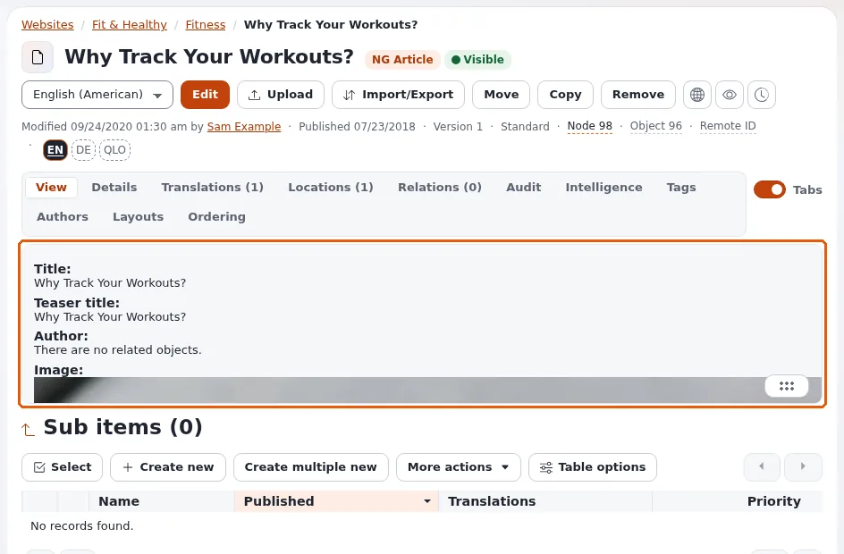

# View modes

This page is for designers who plan the templates of a design. The same article appears as a whole page, as an item in
a list, as a teaser in a block, as an embed in another text. Each of these is a **view mode**, and each has its own
template.

## Contents

1. [The common view modes](#the-common-view-modes)
2. [How a view mode is chosen](#how-a-view-mode-is-chosen)
3. [Templates behind a view mode](#templates-behind-a-view-mode)
4. [Caching](#caching)
5. [Planning the view modes of a design](#planning-the-view-modes-of-a-design)

## The common view modes

| Mode | Used for | Template |
|---|---|---|
| `full` | the page of the content itself | `node/view/full.tpl` ([Full view](full-view.md)) |
| `line` | an item in a list | `node/view/line.tpl` ([Line view](line-view.md)) |
| `embed` | content embedded as a block in rich text | `content/view/embed.tpl`, `node/view/embed.tpl` ([Embed view](embed-view.md)) |
| `embed-inline` | content embedded inside a line of text | `embed-inline.tpl` ([Embed inline view](embed-inline-view.md)) |
| `text_linked`, `text`, `tiny`, `plain` | short forms in lists, relations and the administration | `node/view/` and `content/view/` |
| `listitem`, `thumb`, `sitemap`, `print`, `pdf` | other shipped modes in `design/standard/templates/node/view/` | |

Designs add their own (the media design has `card`-like modes and `payload`; see [Custom view modes](custom-view-modes.md)).

## How a view mode is chosen

- **The URL**: `/content/view/<mode>/<node id>`; a URL alias opens the `full` mode.
- **Templates**: `{node_view_gui content_node=$child view='line'}` and `{content_view_gui ... view='embed'}`.
- **Rich text embeds**: the editor's choice of view (`embed`, `embed-inline`), limited by
  `content.ini [embed] AvailableViewModes[]` for the online editor.
- **Layout blocks**: block templates choose a view mode for their items.

## Templates behind a view mode

`node/view/<mode>.tpl` is the default for all classes; overrides give classes their own template for a mode, matched on
`Source=node/view/<mode>.tpl` ([Node templates by class](node-templates-by-class.md)). A mode without a
`node/view/<mode>.tpl` anywhere in the cascade fails: ship a default template for every custom mode.

## Caching

`site.ini [ContentSettings] CachedViewModes=full;sitemap;pdf`: these modes, opened as pages, are stored in the view
cache. Modes drawn inside other templates (line, embed) are part of the page that draws them and cached with it.

## Planning the view modes of a design

1. List the places content appears: page, list, card grid, search result, related items, embed, layout blocks.
2. Map each to a view mode; reuse `line` and `embed` before inventing new ones.
3. For each content class that needs a special look in a mode, plan an override.
4. Write the default template of every mode first, then the class overrides.

## Related pages

- [Full view](full-view.md)
- [Line view](line-view.md)
- [Custom view modes](custom-view-modes.md)
- [Free documentation](../../free-documentation.md): this page is free to copy, translate and improve under the GNU FDL 1.3.
