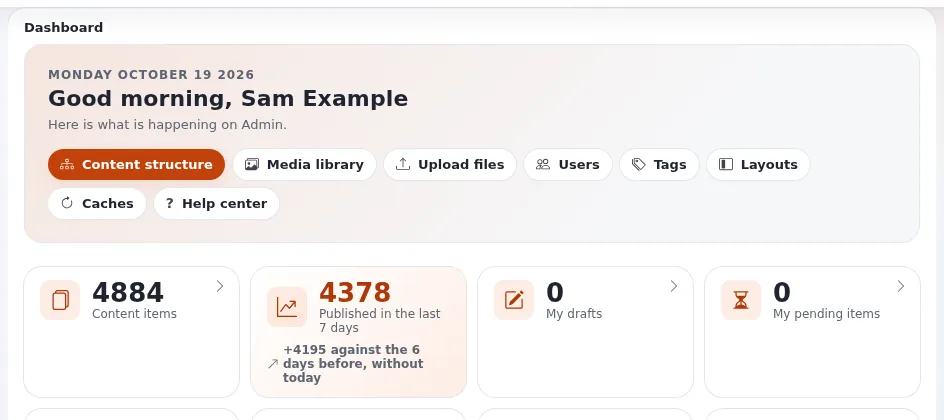
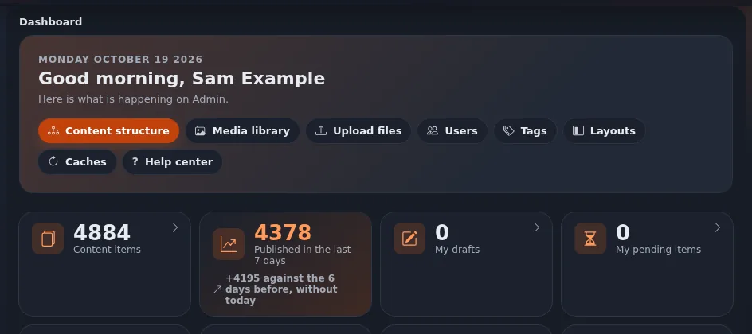

# admin4 tokens

This page is for designers who style an administration page or an extension's admin view. Every color, size and
spacing value in the admin comes from a CSS custom property `--a4-*`, defined in
`design/admin4/stylesheets/components.css` (an identical copy lives in `design/admin`). The full table is in the admin
styling guide, [Admin styling](../../../bc/6.0/admin4-styling.md), section "Tokens"; this page is the designer's
summary.

## Contents

1. [The groups](#the-groups)
2. [Light and dark](#light-and-dark)
3. [Using them](#using-them)
4. [Adding one](#adding-one)

## The groups

| Group | Examples | Same in dark? |
|---|---|---|
| Accent | `--a4-accent` (`#f26a21`), `--a4-accent-strong` (filled controls with white text), `--a4-accent-text` (accent as text), `--a4-accent-soft`, `--a4-ring` (focus ring) | no |
| Neutral | `--a4-ink`, `--a4-muted`, `--a4-line`, `--a4-soft`, `--a4-card`, `--a4-surface`, `--a4-zebra`, `--a4-field`, `--a4-field-line` | no |
| States | `--a4-ok`, `--a4-warn`, `--a4-bad`, `--a4-info`, each with `-bg` and `-line` | no |
| Charts | `--a4-chart-1` to `--a4-chart-8` | no |
| Depth | `--a4-shadow-s`, `--a4-shadow-m`, `--a4-shadow-up` | no |
| Radius | `--a4-radius-s` (9 px), the one component radius; `--a4-radius` (18 px) only for the frame's columns | yes |
| Spacing | `--a4-space-1` to `--a4-space-7` (4, 8, 12, 16, 24, 32, 48 px) | yes |
| Controls, layout | `--a4-control-h` (32 px), `--a4-content-max` (1680 px), `--a4-gutter` | yes |
| Type | `--a4-font`, `--a4-mono`, `--a4-text-xs` to `--a4-text-3xl`, `--a4-text-body`, `--a4-leading` | yes |
| Stacking | `--a4-z-raised` ... `--a4-z-skip-link` | yes |

## Light and dark

Light values are on `:root`. Dark values are in one block:





```css
html[data-a4-theme="dark"]:not(:where([data-a4-modes="light"])) {
  color-scheme: dark;
  --a4-ink: #e8ebf0;
  --a4-card: #1b212c;
  --a4-accent-text: #ff9a5c;
  /* ... */
}
```

A frame that is light only (the classic design) sets `data-a4-modes="light"` and keeps the light values.

## Using them

```css
.a4-mymodule-summary {
  padding: var(--a4-space-3) var(--a4-space-4);
  border: 1px solid var(--a4-line);
  border-radius: var(--a4-radius-s);
  background: var(--a4-card);
  color: var(--a4-ink);
  font-size: var(--a4-text-s);
}
```

A length between two spacing steps takes the nearer step (the guide lists the mapping). `z-index` is always a
`--a4-z-*` token; the test fails on any other number (0, 1 and -1 inside one component excepted).

## Adding one

Rarely needed: try the existing tokens first. If a new color token is necessary:

1. add it to `:root` **and** to the dark block, in the same change, with a contrast note;
2. add it to both copies of `components.css` (`design/admin4` and `design/admin`, which must stay identical);
3. run the [admin styling rules test](admin-styling-rules-test.md).

Never add a local alias (`--mymodule-bg: var(--a4-card)`) or a second accent.

## Related pages

- [admin4 components](admin4-components.md)
- [Design tokens](design-tokens.md)
- [Color contrast](color-contrast.md)
- [Free documentation](../../free-documentation.md): this page is free to copy, translate and improve under the GNU FDL 1.3.
