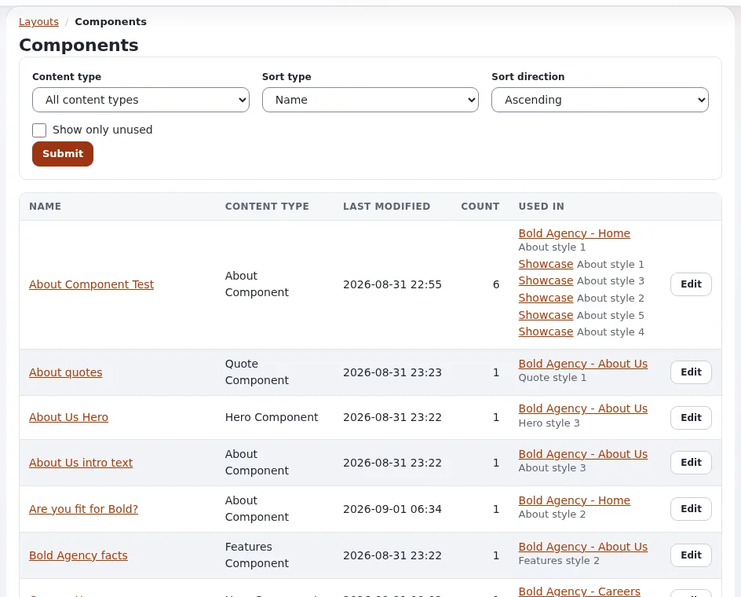

# Block definitions

This page is for designers who want to know which blocks editors can place and how to add looks to them. Every block
type is a `[BlockDefinition_<identifier>]` section of `extension/explayouts/settings/explayouts.ini.append.php`.

## Contents

1. [Anatomy of a definition](#anatomy-of-a-definition)
2. [The shipped blocks](#the-shipped-blocks)
3. [Adding a view type: no PHP](#adding-a-view-type-no-php)
4. [Adding a block type](#adding-a-block-type)

## Anatomy of a definition

```ini
[BlockDefinition_list]
Name=List
Handler=expLayoutsListBlockHandler
ViewTypes[]=list
ViewTypes[]=grid
ViewTypes[]=list_numbered
ViewTypes[]=list_zigzag
ViewTypes[]=list_accordion
ViewTypes[]=grid_featured
HasCollection=1
Category=listing
```

| Key | Meaning |
|---|---|
| `Name` | the label editors see |
| `Handler` | the PHP class that defines the block's parameters and data |
| `ViewTypes[]` | the shapes the block can render in; editors pick one |
| `IsContainer=1` + `Placeholders[]` | the block holds other blocks in named places (`two_columns` has `left` and `right`) |
| `HasCollection=1` | the block shows content from a collection (picked items or a query) |
| `Category` | the group in the editor's block list: `basic`, `containers`, `listing`, `gallery`, `components`, `placeholders` |

`[BlockSettings] AvailableBlocks[]` lists the blocks editors may add.

## The shipped blocks

| Category | Blocks |
|---|---|
| basic | title, text, html, rich_text, image, button, spacer, divider, markdown, video, map, alert, badge, progress ... |
| containers | column, two_columns, three_columns, four_columns |
| listing | list, grid, list_zigzag, list_accordion, single (and others) |
| gallery | gallery, slider, thumb_gallery, grid_gallery, carousel, sushi_bar |
| components | hero, about, features, logos, quote, lead and the `exp_component_*` blocks |
| placeholders | tpl_block (a template part of the page), full_view (the page's own content) |



The exact list and categories are in the INI file; `doc/bc/6.0/LAYOUTS.md` has a block catalogue with parameters.

## Adding a view type: no PHP

The cheapest way to give editors a new look: add a view type to an existing block and write its template. In your
design extension's `settings/explayouts.ini.append.php`:

```ini
[BlockDefinition_list]
ViewTypes[]=mytheme_cards
```

then let the block template draw it. The shipped `block/list.tpl` has one markup; the media design's `block/list.tpl`
dispatches by view type to `block/list/<view_type>.tpl`, which is the pattern to follow:

```tpl
{* design/mytheme/templates/explayouts/block/list.tpl *}
{def $vt = first_set( $block.view_type, 'list' )}
{include uri=concat( 'design:explayouts/block/list/', $vt, '.tpl' ) block=$block}
{undef $vt}
```

and `design/mytheme/templates/explayouts/block/list/mytheme_cards.tpl`. See [Block view templates](block-view-templates.md).

## Adding a block type

A new block type needs a handler class (PHP), so it is a developer's task: register it with `Name`, `Handler`,
`ViewTypes[]` (and `HasCollection=1` for content), add a template per view type under `block/`, regenerate autoloads and
clear caches (`doc/bc/6.0/LAYOUTS.md`, "Extending the system"). A container rarely needs its own handler:
`expLayoutsContainerBlockHandler` with `IsContainer=1` and `Placeholders[]` is enough.

## Related pages

- [Block view templates](block-view-templates.md)
- [Styling layout blocks](styling-layout-blocks.md)
- [Layouts for designers](layouts-for-designers.md)
- [Free documentation](../../free-documentation.md): this page is free to copy, translate and improve under the GNU FDL 1.3.
