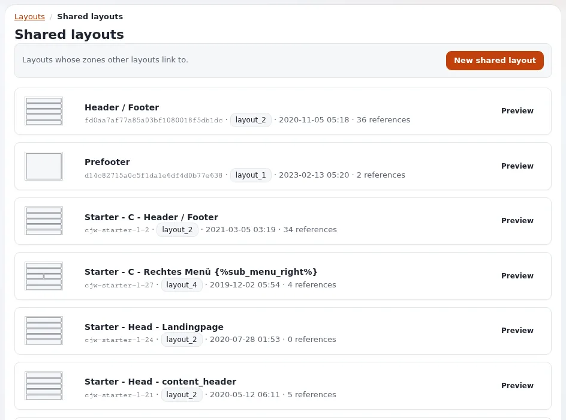

# Shared layouts and linked zones

This page is for designers who plan a site where header, footer or other regions are the same on every page and editors
change them in one place. The layouts editor does this with **shared layouts**.

## Contents

1. [How it works](#how-it-works)
2. [What the designer plans](#what-the-designer-plans)
3. [How a linked zone renders](#how-a-linked-zone-renders)
4. [Rules worth knowing](#rules-worth-knowing)

## How it works

- A layout marked **shared** is not mapped to pages by a rule; it exists to be borrowed.
- Any zone of another layout can be **linked** to a zone of a shared layout. It then shows the shared layout's blocks
  in place of its own.
- Edit the shared layout, publish, and every page that links to it follows.

On the demonstration installation the "Header / Footer" and "Prefooter" layouts are shared and linked from the other
layouts (layout type `layout_2`, with zones `header`, `post_header`, `main`, `pre_footer`, `footer`).

## What the designer plans

- **Layout types with stable zone names.** A `header` and a `footer` zone in every layout type of your design make
  linking straightforward.
- **Block templates that work in any zone.** A block from the shared footer is drawn inside the linking layout's zone
  markup; it must not assume its original surroundings.
- **One stylesheet** for header and footer blocks: they appear on every page.

## How a linked zone renders

The zone template draws the blocks of the shared layout's published zone instead of its own; for templates nothing
changes, the blocks arrive in `$zone.blocks` as usual (`doc/eng-us/bc/6.0/LAYOUTS.md`, "How rendering actually works": "or,
for a linked zone, the shared layout's blocks").

## Rules worth knowing

- Only published shared layouts can be linked: a zone never shows someone's unfinished draft.
- A linked zone ignores its own blocks while the link exists; removing the link restores them.
- Blocks of a published shared layout cannot be edited through a linking layout: open the shared layout and draft it.
- The legacy admin's "Shared layouts" screen counts the zones linking to each shared layout; check it before changing
  or deleting one.

## Related pages

- [Layout types and zones](layout-types-and-zones.md)
- [Layouts for designers](layouts-for-designers.md)
- [The layouts editor](../../layouts-editor.md)
- [Free documentation](../../free-documentation.md): this page is free to copy, translate and improve under the GNU FDL 1.3.
