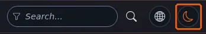

# The theme toggle and the pre-paint guard

This page is for designers who add a light/dark/system switch to a design. The difficulty is not the switch; it is
avoiding a page that paints light and then turns dark. The page answers: where the guard runs, how to keep it
compatible with a Content Security Policy, and how admin4 does it.

## Contents

1. [Why a guard](#why-a-guard)
2. [The guard as a file, not inline](#the-guard-as-a-file-not-inline)
3. [The guard script](#the-guard-script)
4. [The switch](#the-switch)
5. [admin4's implementation](#admin4s-implementation)

## Why a guard

Stylesheets read the theme from an attribute on `<html>`. If a script at the end of the body sets it, the browser has
already drawn the page in the default theme: a white flash on every page for dark-mode users. The attribute must be
set by a script in the `<head>`, before the stylesheets, which blocks rendering for the few microseconds it runs.

## The guard as a file, not inline

The usual trick is an inline `<script>` in the head. Exponential designs avoid inline scripts, because a Content Security
Policy with `script-src 'self'` blocks them. Load the guard as a tiny file, without `defer` or `async`, before the
stylesheets:

```tpl
<head>
    <meta charset="utf-8">
    {ezscript( array( 'theme-guard.js' ) )}
    {ezcss_load( array( 'tokens.css', 'mytheme.css' ) )}
```

admin4 does exactly this: `page_head_style.tpl` prints `{ezscript( array( 'a4_head.js' ) )}` before its stylesheets,
and the file's comment explains it is "a file of its own, not an inline script, so it runs under a Content Security
Policy without 'unsafe-inline'".

## The guard script

```js
/* design/mytheme/javascript/theme-guard.js */
(function () {
  var root = document.documentElement, KEY = 'mytheme-theme', choice = 'system';
  try { choice = window.localStorage.getItem(KEY) || 'system'; } catch (e) { /* blocked storage */ }
  var mq = window.matchMedia ? window.matchMedia('(prefers-color-scheme: dark)') : null;
  function apply(c) {
    var dark = c === 'dark' || (c === 'system' && mq && mq.matches);
    root.setAttribute('data-theme', dark ? 'dark' : 'light');
    root.setAttribute('data-theme-choice', c);
  }
  apply(choice);
  if (mq && mq.addEventListener) mq.addEventListener('change', function () {
    if (root.getAttribute('data-theme-choice') === 'system') apply('system');
  });
  window.mythemeTheme = { apply: apply, save: function (c) { try { localStorage.setItem(KEY, c); } catch (e) {} apply(c); } };
})();
```

Storage can be blocked (private windows, policies); the `try` keeps the page working, it only forgets the choice.

## The switch

A real button, its state in text, the handler in your main script file:




```tpl
<button type="button" id="theme-toggle" class="theme-toggle">
    <span class="theme-toggle-label">{'Color mode'|i18n( 'design/mytheme' )}</span>
</button>
<span id="theme-status" class="sr-only" role="status"></span>
```

```js
/* in mytheme.js */
document.getElementById('theme-toggle').addEventListener('click', function () {
  var order = { light: 'dark', dark: 'system', system: 'light' };
  var next = order[document.documentElement.getAttribute('data-theme-choice')] || 'light';
  window.mythemeTheme.save(next);
  document.getElementById('theme-status').textContent = next;  /* translate in real code */
});
```

Translate the labels with `i18n` and put them in `data-` attributes the script reads.

## admin4's implementation

`design/admin4/javascript/a4_head.js`:

- reads the choice from the user preference `admin_color_mode` (through `window.a4Pref`), or `localStorage` key
  `exp-admin4-theme` on pages without a signed-in user;
- sets `data-a4-theme` and `data-a4-theme-choice` on `<html>`;
- follows the system while the choice is `system`;
- steps light, dark, system on `#a4-theme-toggle`, and announces the new mode in `#a4-theme-status`;
- follows changes made in other tabs (the `storage` event);
- prints in light mode (`beforeprint` and `afterprint`).

## Related pages

- [Dark mode overview](dark-mode-overview.md)
- [No inline JavaScript](no-inline-javascript.md)
- [Tutorial: add dark mode](tutorial-add-dark-mode.md)
- [Free documentation](../../free-documentation.md): this page is free to copy, translate and improve under the GNU FDL 1.3.
