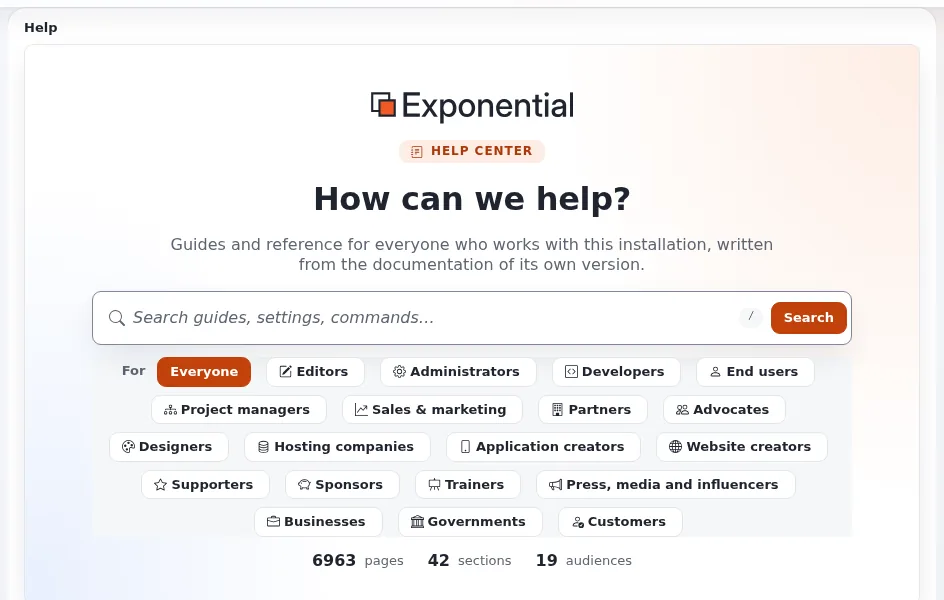
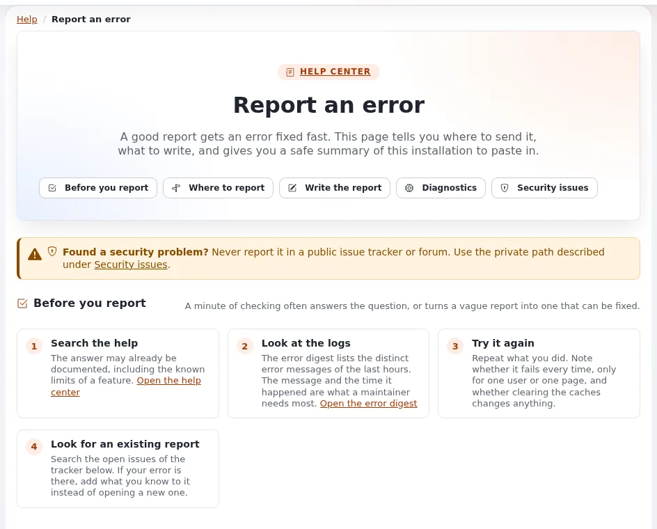

# FAQ: support

This page answers the support questions public bodies ask about Exponential. The answers come from
[Getting support](../../project/getting-support.md), [Support levels and response times](../../partners/support-levels-and-response-times.md)
and `SECURITY.md`.

## Contents

1. [Who supports Exponential?](#who-supports-exponential)
2. [Is there free support?](#is-there-free-support)
3. [Is there an SLA?](#is-there-an-sla)
4. [Can we buy support from someone other than 7x?](#can-we-buy-support-from-someone-other-than-7x)
5. [What about security problems?](#what-about-security-problems)
6. [How do we ask for help well?](#how-do-we-ask-for-help-well)
7. [Can we support it ourselves?](#can-we-support-it-ourselves)

## Who supports Exponential?

7x, the company that maintains, develops, supports and hosts Exponential ([Who is 7x?](../../who-is-7x.md)), with the
Exponential Foundation behind the open source project ([Who is the Exponential Foundation?](../../who-is-the-exponential-foundation.md)),
partners, and the community.

## Is there free support?

Yes, from the community: the documentation, the forums on Share Exponential, and chats on Telegram, Discord and
Slack. The project's support page says its developers are not obliged to give free support; nobody promises an answer
time there ([Getting support](../../project/getting-support.md)).

## Is there an SLA?

Not from the project. The project publishes no SLA; the only response commitment in its files is the first answer to
a private security report "within one business day" ([SLA options for Exponential hosting](../../hosting/business/sla-options.md)).
Service levels come from your contract with 7x, a partner or a host. Partners have published response times by level
toward the project, which they can build on ([Support levels and response times](../../partners/support-levels-and-response-times.md)).

## Can we buy support from someone other than 7x?

Yes. The software is GPL, so any company with the skills can support it. The partner program lists implementation,
hosting and training partners ([Partners: start here](../../partners/partners-start-here.md)). Evaluate a support
partner on its staff and processes, not only its level.

## What about security problems?

Never in public. Report vulnerabilities privately to the address in `SECURITY.md`; leave out passwords, secrets and
personal data ([When something goes wrong](../../when-something-goes-wrong.md#security-problems)). Fixes arrive with
the next 6.0.x release ([Security updates and patching cadence](../procurement/lifecycle/security-updates-and-patching-cadence.md)).

## How do we ask for help well?

Say what you run (version, PHP, engine, database) using the summary from **Setup > System information**, which leaves
out passwords and keys; say what you did, expected and saw; never post credentials or personal data
([Getting support](../../project/getting-support.md#how-to-ask-so-you-get-an-answer)). Bugs go to the issue tracker; the
help's **Report an error** page prepares the issue ([When something goes wrong](../../when-something-goes-wrong.md)).

## Can we support it ourselves?

Yes, with trained staff: the Site administration and Hosting and operations courses in this help cover the routine
([Course catalogue](../../trainers/course-catalogue.md)). Many public bodies combine in-house first-line support with
a supplier for development and emergencies.

## Related pages

- [Government FAQ](README.md)
- [Getting support](../../project/getting-support.md)
- [Community channels](../../project/community-channels.md)
- [Free documentation](../../free-documentation.md): this page is free to copy, translate and improve under the GNU FDL 1.3.
