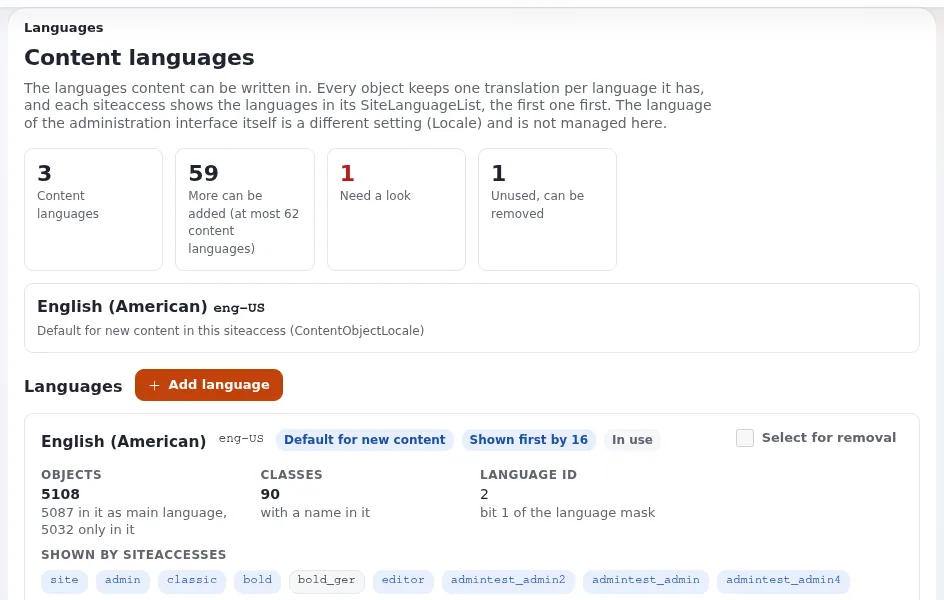

# Adding a content language

This page is for administrators who add a language editors can write content in, for example a second official
language. The steps and messages come from [Content languages, section 4](../../../guides/content-languages.md#4-adding-a-language).

## Contents

1. [Before you start](#before-you-start)
2. [Add the language](#add-the-language)
3. [A language that is not in the list](#a-language-that-is-not-in-the-list)
4. [What adding does not do](#what-adding-does-not-do)
5. [Next steps](#next-steps)

## Before you start

- You need the policy `content/translations` (administrators have it).
- Decide the locale code: three letters for the language, a dash, two for the country, such as `fre-CA`, `esl-MX` (Spanish is `esl` in Exponential's codes)
  or `cym-GB`. The full list with native
  names is in [Languages in Exponential](../../../languages.md#3-every-locale).

## Add the language

1. Open **Setup > Languages** (`/content/translations`) and press **Add language**.
2. Under **Language and country**, type part of the name, the code or the country into **Find a language**; the list
   narrows as you type. Without JavaScript the list is a plain list box sorted by name.
3. Choose the entry, for example *German (Austria) · Deutsch (Österreich) · ger-AT*, and press **Add language**.

The overview shows the message that the language was added, and a new card that says it is not used yet and in no
`SiteLanguageList`. The language gets the next free bit; the content view cache is cleared.

## A language that is not in the list

Choose **Custom** at the top of the list and fill in **Name of custom translation** and **Locale for custom
translation** (`xxx-YY`). A file `share/locale/<code>.ini` must exist for that code, because the locale also decides
how dates and numbers are written; copy the nearest locale file to the new name and adjust it first (see "Custom
locales for unlisted languages").

## What adding does not do

It translates nothing and changes no siteaccess: no visitor sees anything new yet.

## Next steps

1. Give the language a siteaccess, or add it to an existing one's `SiteLanguageList[]` (see "A siteaccess per
   language").
2. Give translators a role limited to the language (see "Translator roles and permissions").
3. Translate the front page and the main menu first (see "Translating an item step by step").
4. Mark shared items always available (see "Always available content").

## Related pages

- [Content languages](../../../guides/content-languages.md)
- [Building a multilingual site](../../creators/website-creators/multilingual-sites.md)
- [Languages in Exponential](../../../languages.md)
- [Free documentation](../../free-documentation.md): this page is free to copy, translate and improve under the GNU FDL 1.3.
