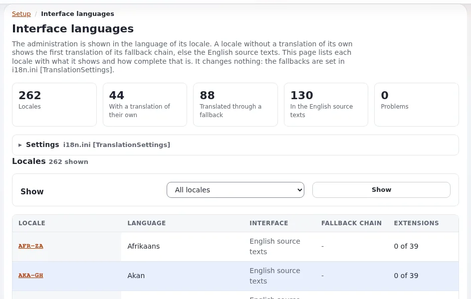

# Administration interface languages

This page is for administrators and managers who must offer the administration in the languages their staff work in.
The interface texts are in translation files, `share/translations/<locale>/translation.ts`, and each extension's
`translations/` directory ([Translations and languages](../../../features/6.0/translations-and-languages.md)).



## Contents

1. [What ships](#what-ships)
2. [Support levels](#support-levels)
3. [Machine-assisted translations](#machine-assisted-translations)
4. [How staff choose](#how-staff-choose)
5. [Checking and completing a translation](#checking-and-completing-a-translation)

## What ships

`share/translations/` holds a directory per translation (and `untranslated`, the template). The completeness of each
one, measured against the strings the kernel and its designs use today, is in a table in
[Languages in Exponential, section 4](../../../languages.md#4-every-administration-translation). Do not plan on a
figure from memory: check that table for the current release.

## Support levels

From [Languages in Exponential, section 2](../../../languages.md#2-support-levels):

| Level | Meaning |
|---|---|
| Full: interface and content | the administration speaks the language almost completely; content, dates, numbers follow the locale |
| Partial interface, full content | an older translation covering part of today's strings; the rest shows in English |
| Content only | no administration translation; the interface stays English, content and formats work |

A country without a translation of its own falls back to its language's main translation (for example the
German-speaking countries to `ger-DE`), see "Interface translation fallbacks".

## Machine-assisted translations

The project states that several translations are machine-assisted, at least in part, and asks for review by native
speakers before a site relies on them. Extensions release their own catalogues; some extensions show English texts
in languages they do not cover yet. A public body with language services can review its official languages and give
the corrections back.

## How staff choose

Each person chooses in the box **Interface** of the right toolbar, list **Interface language**, then **Apply**. The
list shows the most used languages first and then all from A to Z, with each language's completeness. The choice
changes menus, buttons, messages and date formats, nothing in the content, and lasts until sign-out
([Languages (for editors)](../../languages.md)). A siteaccess can also have a default interface language through its
`Locale`.

## Checking and completing a translation

```bash
php bin/php/ezchecktranslation.php fre-FR    # statistics of one translation
./console exp:i18n fallbacks --locale=fre-CA # which translation a locale really shows
```

**Setup > Interface languages** (`/setup/languages`) shows every locale with the translation it shows and its
coverage. Translations are edited with Qt Linguist or any XML editor; the steps are in
[Languages in Exponential, section 8](../../../languages.md#8-adding-or-completing-an-administration-translation).

## Related pages

- [Right-to-left in the administration](right-to-left-in-the-administration.md)
- [Interface language list](../../../features/6.0/ui-switch-languages.md)
- [Languages in Exponential](../../../languages.md)
- [Free documentation](../../free-documentation.md): this page is free to copy, translate and improve under the GNU FDL 1.3.
