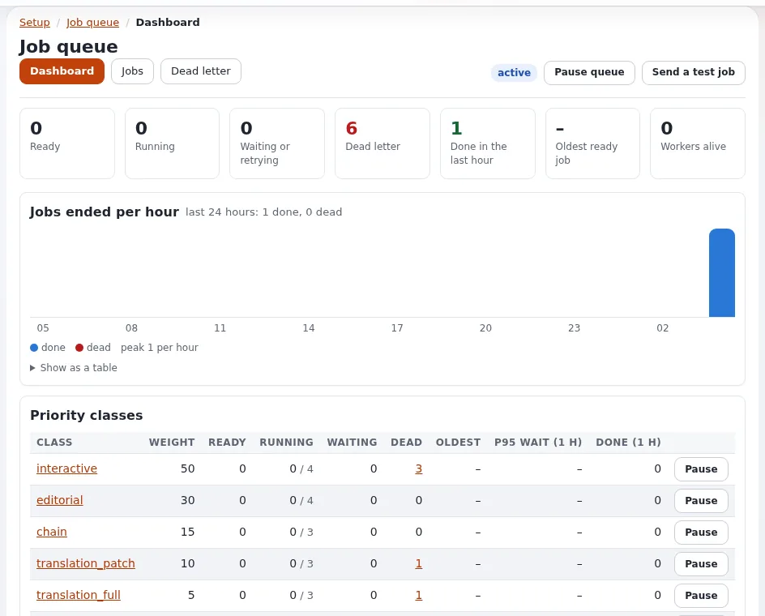

# Monitoring overview

This page is for system administrators who build monitoring for Exponential sites, and for support staff who need to
know where to look first. It answers: which signals Exponential gives, which of them a monitoring system can read
(exit codes, JSON, HTTP endpoints), and which belong to a human looking at a page once a week.



"There is no single health URL; combine a check from outside with the status commands inside"
([10.11 Monitoring and health checks](../../../install/10-after-installing.md#1011-monitoring-and-health-checks)). The
external checks are on [Health checks and uptime](health-checks-and-uptime.md).

## Contents

1. [Four layers of monitoring](#four-layers-of-monitoring)
2. [Status commands for a monitoring system](#status-commands-for-a-monitoring-system)
3. [Pages for a human](#pages-for-a-human)
4. [Velocity's own endpoints](#velocitys-own-endpoints)
5. [Alerts the site sends itself](#alerts-the-site-sends-itself)
6. [Monitoring many customer sites](#monitoring-many-customer-sites)
7. [Checklist](#checklist)

## Four layers of monitoring

| Layer | Question | Exponential's tools |
|---|---|---|
| Reachability | Does the site answer, fast enough? | an HTTP check from outside; Velocity's `/Q/health` |
| Platform | Is PHP, OPcache, the database, the disk, cron in order? | `exp:systeminfo`, `exp:cache status`, `crontab:list` |
| Application | Are there new errors, attacks, failed jobs, mail problems? | the logs, the error digest, `exp:mail:status`, `exp:notificationstatus` |
| Integrity | Has anyone changed what they should not? | the audit trail and `exp:audit verify` |

## Status commands for a monitoring system

All of these run from the installation root as the site's user. Most have `--json` for a machine and end with a
recognizable status or an exit code.

| Check | Command | Healthy |
|---|---|---|
| Health checks of the platform | `./console exp:systeminfo --json` | exit status 0; it "exits 1 when a check fails" |
| Caches | `php bin/php/cache.php status --json --allow-root-user` | ends in `PASS` |
| Velocity | `php bin/php/console exp:velocity status --json --allow-root-user` | running, workers as configured |
| Notifications | `php bin/php/console exp:notificationstatus` | no events waiting without a recent run |
| Audit trail | `php bin/php/audit.php verify --allow-root-user` | exit status 0 (1 means a chain is broken) |
| E-mail preferences | `./console exp:mail:status` | five tables `ok`, no problems listed |
| Cron | `php bin/php/console crontab:list` and the dates of the cron logs | entries present, logs recent |
| Disk | `df -h /path/to/installation` | room for caches, logs and a backup |
| Performance | `php bin/php/console exp:benchmark --baseline=var/benchmark/base.json` | exit status 0 (no regression) |
| Database | SQLite: [Monitoring a SQLite site](../../../install/09-databases.md#monitoring-a-sqlite-site); Oracle: `ext:ezoracle:health` | |

Sources: [10.11](../../../install/10-after-installing.md#1011-monitoring-and-health-checks),
[System information](../../../guides/system-information.md),
[E-mail preferences](../../../guides/mail-preferences-administrator.md#3-the-status-page),
[Benchmark](../../../features/6.0/benchmark.md).

"A small script in the site user's crontab that runs these and mails on a non-zero exit status is enough for a single
server." For many servers, run the same commands from your monitoring agent and collect the exit codes.

> **Note**
> `exp:systeminfo` on the command line reports the command-line PHP, not the PHP-FPM pool or Velocity that serves the
> site. The administration page **Setup > System information** shows the server that answered the request; open it
> through each server you run ([System information, which server answered](../../../guides/system-information.md#2-which-server-answered)).

## Pages for a human

| Page | What it shows | Who may open it |
|---|---|---|
| **Setup > System information** (`/setup/info`) | which server answered, health checks with what to do, versions, OPcache, database, storage, cron, mail | `setup/system_info` |
| **Setup > Log files > Log health** (`/setup/logshealth`) | disk used by logs against a budget, fastest growing logs, files the web server cannot write, newest error of each log | `setup/logs` |
| **Setup > Log files > Error digest** (`/setup/logsdigest`) | the distinct errors and warnings of the last 24 hours, grouped and counted | `setup/logs` |
| **Audit** tab (`/audit/dashboard`) | the chain state of each channel, recent events, alerts | `audit/read` |
| **Setup > Cronjobs** | parts, schedules, last runs, parts that need attention | `setup/managecronjobs` |
| **Setup > E-mail preferences** | mail gate state, problems, numbers | `mailpreferences/administrate` |

Log health warns from 80 % of `logviewer.ini [HealthSettings] DiskBudget` (shipped 256 MB) and flags logs with mixed
owners, which stop rotation ([Log health](../../../features/6.0/log-viewer.md#log-health)). See
[Log viewer and rotation](log-viewer-and-rotation.md).

> **Tip**
> A weekly look at the error digest and `security.log` is in the project's own checklist: "a sudden rise of one rule
> is worth a look" ([Security hardening](../../security-hardening.md#watching-logs-the-request-classifier-and-the-audit-trail)).

## Velocity's own endpoints

When a site is served by Exponential Velocity, the server has views of its own
([Velocity control panel](../../../features/6.0/velocity-control-panel.md)):

| Endpoint | Format | Use |
|---|---|---|
| `/Q/health` | JSON, for monitors | answers anyone with `{"status":"ok"}`; figures only for an admin |
| `/Q/metrics` | Prometheus text | scraping into a metrics system |
| `/Q/stats` | JSON, the full payload | dashboards such as Grafana |
| `/Q/dashboard` | HTML | a human view of workers, memory and traffic |

Who may open them is set in `settings/velocity.ini [DashboardSettings]`: by default only from the same machine;
`Token=` sets a secret that opens them remotely (`?token=...` or an `Authorization: Bearer` header); `Remote=enabled`
opens them without a token, "only for a port that a firewall already restricts to trusted addresses".

The Velocity **watchdog** (`exp:velocity watchdog install`, a systemd timer) starts the default engine again when it is
down and nobody meant it to be, and logs what it did to `var/log/velocity-watchdog.log`
([The watchdog](../../../bc/6.0/velocity-engines.md#the-watchdog-expvelocity-watchdog)). It never touches a server that
runs; a server that runs but does not answer is for your monitoring to catch.

## Alerts the site sends itself

The audit trail evaluates alert rules in the `audit` cronjob part (part of `frequent`): brute-force sign-ins, an
administrator role being granted, settings written out of hours, mass deletes, the audit being switched off and a
broken chain ([The audit trail](../../../features/6.0/audit-trail.md)). Alerts go to a rule's recipients, else the
configured ones, else the site's `AdminEmail`:

```bash
./console exp:audit alerts recipients --allow-root-user
```

On a hosted site, decide whether alerts go to the customer, to your support team, or both, and make sure the
`frequent` part runs ([Cron jobs](cron-jobs.md)). Sinks forward the trail to syslog or a webhook for a central system
([Security log](security-log.md)).

## Monitoring many customer sites

- **Same commands everywhere.** Every installation has the commands above; run them per installation directory, as
  that installation's user.
- **Exit codes, not text.** Parse the exit status and the JSON; the human text can change between releases.
- **One external check per site address**, plus one per node or engine port where you run several (Apache and
  Velocity on different ports show different figures).
- **Keep thresholds per plan.** Response time and disk use differ by customer; record a baseline per site
  (`exp:benchmark --save`) after go-live and compare against it.

## Checklist

- [ ] An external HTTP check covers the site and the administration login page.
- [ ] `exp:systeminfo`, cache status, audit verify and the disk are checked on a schedule by exit code.
- [ ] Cron logs are recent and `crontab:list` shows the expected lines.
- [ ] Velocity's dashboard views are local-only or protected by a token.
- [ ] Audit alert recipients are agreed with the customer.
- [ ] Someone reads the error digest and `security.log` weekly.

## Related pages

- [Health checks and uptime](health-checks-and-uptime.md)
- [Log viewer and rotation](log-viewer-and-rotation.md)
- [Request logs](request-logs.md), [Security log](security-log.md)
- [Benchmarking a hosted site](../performance/benchmarking-a-hosted-site.md)
- [Slow site](../runbooks/slow-site.md), [Site down](../runbooks/site-down.md) (runbooks)
- [Free documentation](../../free-documentation.md): this page is free to copy, translate and improve under the GNU FDL 1.3.
