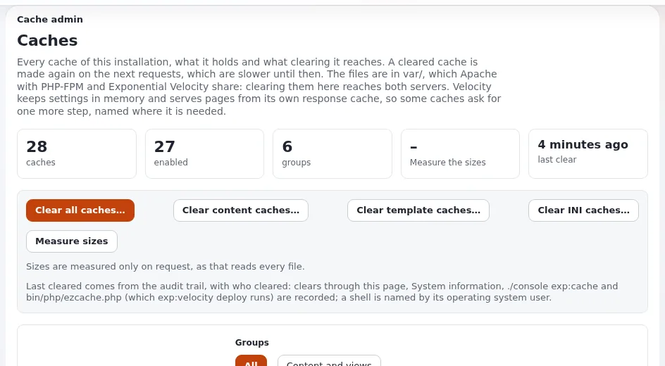

# Cron and shell access

This page is for support staff and administrators at hosting companies who help customers schedule Exponential's
jobs through a panel's cron page, and who decide how much shell access a plan includes. It answers which jobs must run
and how often, which PHP binary a cron line must use, what the administration's own Cronjobs page needs, and what a
customer can do without a shell.



## Contents

1. [Why Exponential needs cron](#why-exponential-needs-cron)
2. [The cron lines](#the-cron-lines)
3. [The right PHP binary](#the-right-php-binary)
4. [The right user](#the-right-user)
5. [The Cronjobs page in the administration](#the-cronjobs-page-in-the-administration)
6. [With and without shell access](#with-and-without-shell-access)
7. [Troubleshooting](#troubleshooting)
8. [Checklist](#checklist)

## Why Exponential needs cron

"Cronjobs do the work no visitor waits for: they publish and hide content on schedule, send notifications, resume
content jobs, run the audit trail's maintenance, import feeds, index content and clean up. Without them a site works,
but scheduled content never appears, notifications never go out and caches and drafts pile up on disk."
([10.3 Cronjobs](../../../install/10-after-installing.md#103-cronjobs))

`runcronjobs.php` runs **parts**, named lists of scripts in `settings/cronjob.ini`; without a part name it runs the
global part. `php runcronjobs.php --list` shows every part and its scripts.

## The cron lines

The crontab Chapter 10 gives for a site, to be installed in the crontab of the site user:

```text
# m   h  dom mon dow  command
*/5   *  *   *   *    cd /path/to/installation && php runcronjobs.php -q -s site frequent >> var/log/cron-frequent.log 2>&1
*/15  *  *   *   *    cd /path/to/installation && php runcronjobs.php -q -s site >> var/log/cron-default.log 2>&1
17    *  *   *   *    cd /path/to/installation && php runcronjobs.php -q -s site infrequent >> var/log/cron-infrequent.log 2>&1
40    3  *   *   *    cd /path/to/installation && php runcronjobs.php -q -s site cache_cleanup >> var/log/cron-cleanup.log 2>&1
50    3  *   *   *    cd /path/to/installation && php runcronjobs.php -q -s site --script=session_gc.php >> var/log/cron-cleanup.log 2>&1
```

- `-s` chooses the siteaccess whose settings the scripts read; "use the public siteaccess unless a part says
  otherwise". `-q` suppresses output except errors.
- "`frequent` every few minutes is what notifications and content jobs expect; `infrequent` hourly or daily."
- Rotate the `cron-*.log` files with the system's logrotate.

When a panel's cron page has one field per line, enter each line's schedule and command separately; the command is
everything after the five time fields.

> **Note**
> The Cronjobs page recognizes a line of this installation only when it contains `runcronjobs.php` and the
> installation's **real** root path; a symlinked path shows the part as *Not scheduled*. "Use `cd <real root> &&` in
> the line" ([Cronjobs, Troubleshooting](../../../guides/cronjobs.md#17-troubleshooting)).

## The right PHP binary

"Use the same PHP binary the web server uses (`/opt/.../php` on hosts with several PHP versions); `php -v` in the
cron environment may differ from your shell's." On Plesk that is, for example, `/opt/plesk/php/8.5/bin/php`:

```text
*/5 * * * * cd /var/www/vhosts/<domain>/<docroot> && /opt/plesk/php/8.5/bin/php runcronjobs.php -q -s site frequent >/dev/null 2>&1
```

When the panel changes the site's PHP version, update the cron lines too
([PHP selection and FPM pools](php-selection-and-fpm-pools.md)).

## The right user

Install the lines "in the crontab of the site user (the one the web server runs as, so the files the jobs write
belong to it)": `crontab -e -u <site user>`, or `php bin/php/console crontab:edit` as that user
([Cronjobs, Scheduling](../../../guides/cronjobs.md#12-scheduling-with-the-crontab)). A panel's per-account cron page
usually runs jobs as the account's user, which is what Exponential needs; check your panel's documentation.

> **Warning**
> Cron lines in root's crontab write cache and log files as root, which "cannot be replaced by the site user
> afterwards, and the site breaks in odd places" ([8.7.2](../../../install/08-serving-the-site.md#872-one-user-or-one-group)).
> As root, every script needs `--allow-root-user`; better, do not run them as root.

## The Cronjobs page in the administration

**Setup > Cronjobs** runs any part or script, follows its output, counts issues, pauses parts and proposes crontab
lines for the parts not yet scheduled ([Cronjobs guide](../../../guides/cronjobs.md)). What it needs from the server:

| Need | Why | If missing |
|---|---|---|
| A PHP command line binary: `cronjob.ini [AdminSettings] PhpCliPath`, else `PHP_BINDIR/php`, `/usr/bin/php`, `/usr/local/bin/php` | jobs are separate processes; "it never uses the binary that answers the web request" | red message, every Run disabled |
| `proc_open` | to start a job | the page says so |
| `exec` | to read the crontab (`crontab -l`) | the page says so |
| `posix_kill` | **Stop running job** | the page says so |
| Policy `setup/managecronjobs` | access | *Access denied* |

Set `PhpCliPath` on servers with several PHP versions:

```bash
php bin/php/console exp:ini set cronjob.ini/AdminSettings/PhpCliPath /opt/plesk/php/8.5/bin/php global
php bin/php/ezcache.php --clear-tag=ini --allow-root-user
```

The page reads only "the crontab of the user the web server runs as". For customers without a shell, its
**Suggested entries** are the lines to paste into the panel's cron page.

Parts can be paused from the page without touching the crontab; "a paused part is left out by `runcronjobs.php`,
whoever starts it" ([Pausing cronjob parts](../../../features/6.0/cronjob-pause.md)). That is useful during a
migration or a restore.

## With and without shell access

| Task | With shell | Without shell |
|---|---|---|
| Get the code and `vendor/` | `git clone`, `composer install` | upload a tree prepared elsewhere, or a host-provided installer |
| Install | `exp:install`, the kickstarter or the wizard | the setup wizard ("it needs only a browser and FTP access") |
| Updates | Composer, or ezupdate | ezupdate in the administration, if Composer is reachable and updates are allowed |
| Clear caches | `php bin/php/ezcache.php --clear-all` | **Setup > Caches** (`/setup/cache`) in the administration |
| Run a cron part once | `php runcronjobs.php -s site frequent` or `php bin/php/console cron:frequent` | **Setup > Cronjobs**, if `proc_open` is allowed |
| Maintenance mode | `php bin/php/maintenance.php on` | **Setup > Maintenance** |
| Read logs | `tail var/log/error.log` | **Setup > Log files** |
| Velocity | possible, if long-running processes are allowed | not possible |

Sources: [Chapter 4](../../../install/04-choosing-an-install-method.md#45-which-method-for-which-situation),
[Maintenance mode](../../../guides/maintenance-mode.md), [Log viewer](../../../features/6.0/log-viewer.md),
[ezupdate](../../../features/6.0/extensions/ezupdate.md).

Shell access as the site's own user (not root) is the safest form to offer: everything the customer runs then writes
files the site can still change.

## Troubleshooting

| Symptom | Cause | Fix |
|---|---|---|
| Scheduled content never appears | no cron line, or the line uses a PHP without the site's extensions | add the lines; use the site's PHP binary |
| Files written by cron cannot be changed by the site | cron runs as another user | move the lines to the site user's crontab |
| *Cronjob part locked by other process* | the same script runs already | expected: "the lock ... working" |
| A new part does not appear on the page | INI cache | `php bin/php/ezcache.php --clear-tag=ini --allow-root-user` |

More in [Cronjobs, Troubleshooting](../../../guides/cronjobs.md#17-troubleshooting) and
[Cron jobs for hosts](../operations/cron-jobs.md).

## Checklist

- [ ] `frequent`, the global part and `infrequent` scheduled; clean-up parts nightly.
- [ ] Lines use the site's PHP binary and the installation's real path.
- [ ] Lines in the site user's crontab, not root's.
- [ ] `PhpCliPath` set on servers with several PHP versions.
- [ ] `proc_open`, `exec`, `posix_kill` decision documented for the Cronjobs page.
- [ ] Shell access policy per plan written down.

**Cron on a public demo.** The demo's cron jobs need the same `EXP_DEMO_MODE=1` as its web requests: one line at the top of the crontab (or the panel's cron environment), as in [`crontab-demo`](../../../examples/demo-mode/crontab-demo). [Demo mode for hosts](../security/demo-mode-for-hosts.md).

## Related pages

- [Control panels: overview](README.md)
- [Cron jobs](../operations/cron-jobs.md), [Cronjob console](../operations/cronjob-console.md)
- [Cronjobs guide](../../../guides/cronjobs.md)
- [Free documentation](../../free-documentation.md): this page is free to copy, translate and improve under the GNU FDL 1.3.
