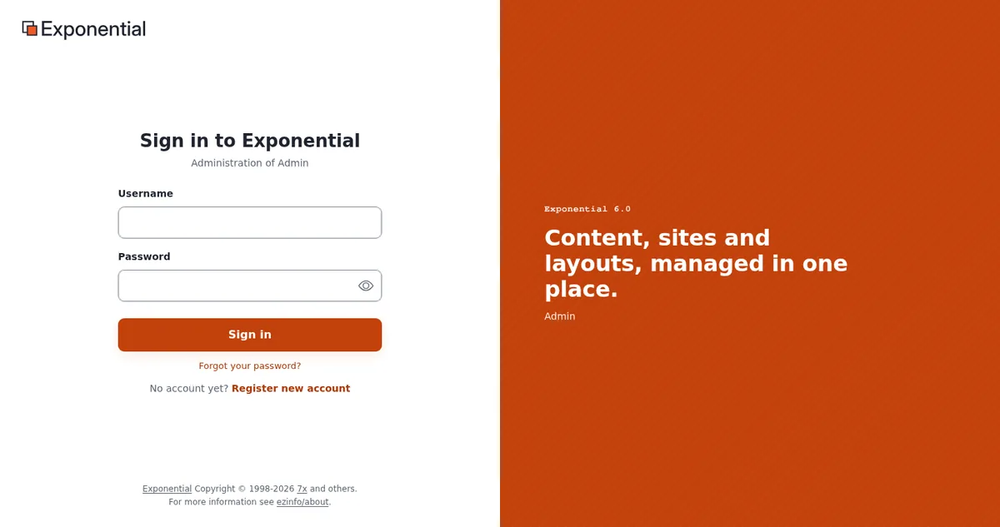

# First sign-in and default passwords

This page is for the people at a host who provision Exponential sites and hand them over to customers: system
administrators, the automation team and support staff. Every installation starts with one administrator account,
login `admin`. What its password is depends on how the site was installed. This page tells you what each installer
leaves, and how to hand the first sign-in to a customer safely.




> **Warning**
> This page never prints a password. The historical default password of the shipped database seed, and every rule
> about generated passwords, are documented on [The default administrator password](../../default-administrator-password.md).
> Do not copy any fixed password into scripts, tickets, welcome mails or customer documentation.

## Contents

1. [What each installer leaves](#what-each-installer-leaves)
2. [Provisioning without a known password](#provisioning-without-a-known-password)
3. [Handing over to the customer](#handing-over-to-the-customer)
4. [After the first sign-in](#after-the-first-sign-in)
5. [Migrated and imported sites](#migrated-and-imported-sites)
6. [When nobody can sign in](#when-nobody-can-sign-in)
7. [Checklist](#checklist)

## What each installer leaves

From [The default administrator password](../../default-administrator-password.md#in-short):

| How the site was installed | Password after the installation |
|---|---|
| Setup wizard in the browser | the one typed in the wizard; there is no default; short and well-known passwords are refused |
| Kickstarter with `kickstart.ini` | `[site_admin] Password=`; when empty, shorter than `MinPasswordLength` or well-known, a random 20-character password, printed once and written to `var/log/initial-admin-password` |
| Console install (`exp:install`) | `--password=` when long enough and not well-known; otherwise a random 24-character password, printed in the summary and written to `var/log/initial-admin-password` |
| The shipped database seed loaded by hand, without an installer | the historical default, known to everyone; see the page linked above |
| Site packages | no change: packages carry no accounts |

No installer of Exponential 6 leaves the historical default in place. It survives only where a database was created
from the seed without an installer, where the wizard was told to keep such a database, or on a migrated old site.

`var/log/initial-admin-password` is written with mode `0600`, owner-only. The run's logs (`var/log/kickstart.log`,
`var/log/exp-install-<date>.ini`) mask passwords.

## Provisioning without a known password

For automated provisioning the console installer is the usual tool
([exp:install for hosts](../provisioning/exp-install.md), [Kickstarter](../provisioning/kickstarter.md)):

- Let the installer generate the password, or pass one from your secret store
  (`--password="${ADMIN_PASSWORD}"`). Never write a password into a script, an image or a template.
- Do not give every customer the same password, and do not derive it from the domain or the customer number.
- Collect a generated password from the summary or from `var/log/initial-admin-password`, put it into your secret
  store or the customer's handover channel, and delete the file.
- If you keep `kickstart.ini` files, create them with mode `0600`, never commit them, and remove them after the run.
- Add your own words to the well-known list (the company's name, the product name) so customers cannot choose them
  later:

```ini
# settings/override/site.ini.append.php
[UserSettings]
WeakPasswordList[]=<your company name>
WeakPasswordFile=settings/weak-passwords.txt
```

The installers always check the list; `WeakPasswordCheck` controls the forms.

## Handing over to the customer

A host chooses how the customer receives the first sign-in. Options that keep the password out of ordinary mail:

- a one-time link of your secret store or customer portal;
- a password set to a random value and a **Forgot your password?** mail to the customer's real address, which works
  once and for one hour (`ForgotPasswordKeyLifetime=3600`);
- a personal administrator account for the customer's lead, created during provisioning, with `admin` kept as the
  host's break-glass account (see below).

Whichever you choose, give the account a real, monitored e-mail address: **Forgot your password?** and the "your
password was changed" mail (`ChangeNotificationMail=enabled`) go there.

## After the first sign-in

From [After the first sign-in](../../default-administrator-password.md#after-the-first-sign-in):

1. Change the password ([Change the administrator password](../../change-the-admin-password.md)).
2. Give the account a real e-mail address.
3. Delete `var/log/initial-admin-password`.
4. Remove `kickstart.ini` if one was used.
5. Create one personal administrator account per person and retire `admin` as a sign-in
   ([Account hygiene](../../change-the-admin-password.md#account-hygiene)).
6. Turn on two-step sign-in for administrators ([Two-step sign-in](two-factor-sign-in.md)).

## Migrated and imported sites

A site migrated from an old line, or a database restored from an old dump, may still carry the historical default.
Set a new random password at once:

```bash
./console exp:resetuserpassword --allow-root-user -u admin -g -l 24
```

The command sets the password through the same code as the user edit form, so the same rules and hash type apply.
`--allow-root-user` is refused unless you really are the operating system's `root`. Packages from third parties can
carry user accounts with their own password hashes; review them before installing.

## When nobody can sign in

The supported ways, in order ([Locked out](../../change-the-admin-password.md#locked-out-when-no-administrator-can-sign-in)):

1. another administrator of the site changes the password or resets the failed sign-ins;
2. **Forgot your password?**, if the account's mail works;
3. the command line as the operating system's root user, as above (`-u <login>` for a personal account);
4. a lockout from `MaxNumberOfFailedLogin`: sign in from an address in `TrustedIPList[]`, or lift the setting for the
   moment;
5. two-step sign-in with a lost phone: an administrator sets the user's *Two-step sign-in* field to e-mail codes or
   disabled.

Afterwards check the audit trail (`./console exp:audit tail --channel=access --lines=50`): a lockout nobody caused can
be an attack. Keep this procedure next to the restore procedure, and test it.

## Checklist

- [ ] Provisioning never sets a fixed or shared password; passwords come from the installer or the secret store.
- [ ] `var/log/initial-admin-password` and `kickstart.ini` removed after every provisioning run.
- [ ] The first sign-in reaches the customer through a channel other than plain mail.
- [ ] The administrator account has a real, monitored e-mail address.
- [ ] Personal accounts per person; `admin` retired or kept only as the documented break-glass account.
- [ ] Migrated sites: administrator password replaced with `exp:resetuserpassword`.
- [ ] Break-glass procedure written down and tested.

**Public demos.** A demo that publishes its sign-in runs with `EXP_DEMO_MODE=1`: the installers keep the published password (`publish`, `publishing`) as given, and nobody can change or reset an administrator password while the variable is set. This is the one case where a known administrator password is intended. [Demo mode for hosts](demo-mode-for-hosts.md).

## Related pages

- [Security for hosts: overview](README.md)
- [The default administrator password](../../default-administrator-password.md)
- [Change the administrator password](../../change-the-admin-password.md)
- [Provisioning: overview](../provisioning/README.md)
- [Restricting the administration](restricting-the-administration.md)
- [Free documentation](../../free-documentation.md): this page is free to copy, translate and improve under the GNU FDL 1.3.
