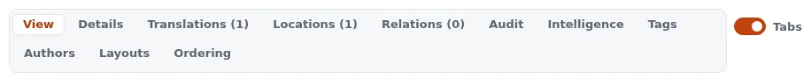
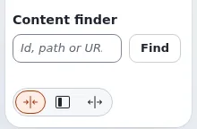
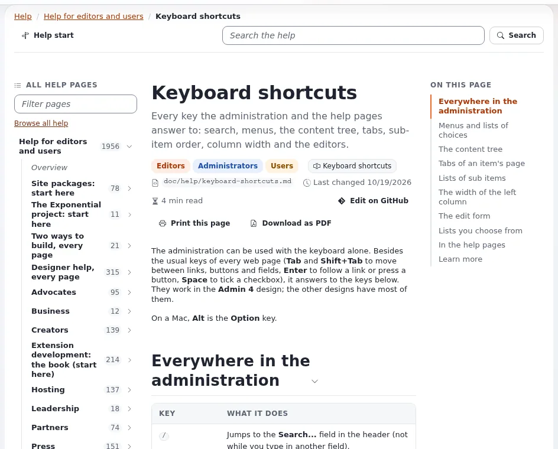

# Keyboard shortcuts

The administration can be used with the keyboard alone. Besides the usual keys of every web page (**Tab** and
**Shift+Tab** to move between links, buttons and fields, **Enter** to follow a link or press a button, **Space** to
tick a checkbox), it answers to the keys below. They work in the **Admin 4** design; the other designs have most of
them.

On a Mac, **Alt** is the **Option** key.

## Everywhere in the administration

| Key | What it does |
|---|---|
| `/` | Jumps to the **Search...** field in the header (not while you type in another field). |
| `Esc` | Closes the open menu, list or pop-up, and returns the focus to its button. |
| `Tab` (first press on a page) | Shows **Skip to main content**; press `Enter` to jump past the header and the left column. |

## Menus and lists of choices

This covers the tab menus of the header, the user menu, the **More** list, the search scope, and the menu of an
item.

| Key | What it does |
|---|---|
| `↓` on the button | Opens the menu and moves to its first entry. |
| `↓` / `↑` | Next / previous entry. |
| `Home` / `End` | First / last entry. |
| `Enter` or `Space` | Chooses the entry. |
| `Esc` | Closes the menu. |

## The content tree

Move into the tree with `Tab`; then:

| Key | What it does |
|---|---|
| `↓` / `↑` | Next / previous item. |
| `→` | Opens a closed folder; on an open one, moves to its first item. |
| `←` | Closes an open folder; on a closed one or an item, moves to its parent. |
| `Home` / `End` | First / last item of the tree. |
| Letters | Jump to the next item whose name starts with what you type. |
| `Enter` | Opens the item. |
| `Shift+F10` or the menu key | Opens the item's menu (edit, copy, move, create here ...). The same works on a row of a **Sub items** list. |

## Tabs of an item's page

With the focus on a tab (**View**, **Details**, **Translations** ...):

| Key | What it does |
|---|---|
| `→` / `←` | Opens the next / previous tab. |
| `Home` / `End` | Opens the first / last tab. |

## Lists of sub items

When a **Sub items** list is sorted by priority, the grip at the start of each row changes the order:

| Key on the grip | What it does |
|---|---|
| `Space` or `Enter` | Picks the row up. |
| `↑` / `↓` | Moves the picked-up row. |
| `Home` / `End` | Moves it to the top / bottom of the page. |
| `Space` or `Enter` | Drops it there; the new order is saved. |
| `Esc` | Puts it back where it was. |
| `Alt+↑` / `Alt+↓` | Moves the row by one place at once, without picking it up. |

## The width of the left column

Focus the handle with three dots on the edge of the left column:

| Key | What it does |
|---|---|
| `→` or `↑` | Wider (in a right-to-left language: `←` or `↑`). |
| `←` or `↓` | Narrower. |
| `Shift` with an arrow | A bigger step. |
| `Home` / `End` | Narrowest / widest. |

## The edit form

| Key | What it does |
|---|---|
| `Enter` in a one-line field | Same as **Send for publishing**. |
| Keys of the rich text editor | The usual ones: `Ctrl+B` bold, `Ctrl+I` italic, `Ctrl+Z` undo and more (`Cmd` on a Mac). The **Help** button of TinyMCE lists them all. |

## Lists you choose from

In a list box, such as **Interface language**, type the first letters of an entry to jump to it; the arrow keys,
`Home`, `End`, `Page Up` and `Page Down` move through it. Nothing changes until you press **Apply**.

## In the help pages

| Key | What it does |
|---|---|
| `/` | Jumps to the help's search field. |
| `↓` / `↑` | Moves through the search results as you type. |
| `Enter` | Opens the chosen result. |
| `Esc` | Clears the results; a second `Esc` leaves the field. |
| `j` / `k` | Next / previous heading of the page you read. |
| `]` / `[` | Next / previous help page. |

These keys are ignored while you type in a field.

## Learn more

- [A tour of the administration](admin-tour.md)
- [Searching](searching.md)
