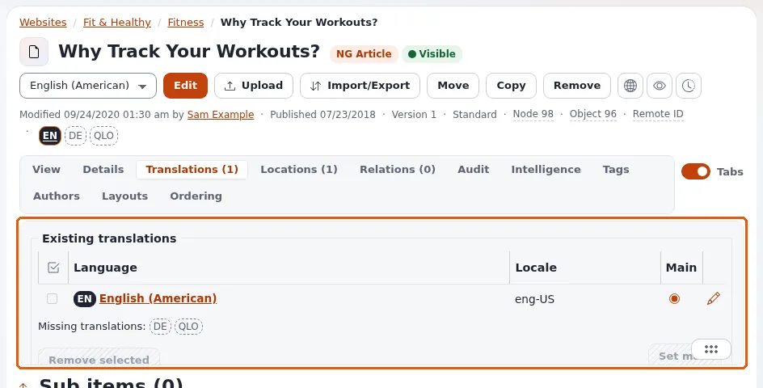

# Languages

There are two different kinds of language in Exponential, and this page explains both:

- **Content languages**: the languages your items are written in. An article can exist in English and in German; each
  is a **translation** of the same item.
- **The interface language**: the language of the administration's menus, buttons and messages. You choose it for
  yourself; it changes nothing in the content.

## See which translations an item has

On an item's page, the line under the buttons shows a small badge per language of the site. A filled badge, such as
**EN**, is a translation that exists; a dashed badge, such as **DE**, is one that does not exist yet. Point at a
badge to read it, for example *English (American) – main language* or *Translate into German*.

The **Translations** tab of the item lists its translations in full.

## Translate an item

1. Open the item.
2. Click the dashed badge of the language, or choose **New translation** in the language list next to **Edit** and
   press **Edit**.
3. If the page asks, choose the language under **New translation** and, under **Translate based on**, the existing
   translation to start from (its text is copied into the form), or **None** for empty fields.
4. Translate the fields and press **Send for publishing**.

To change an existing translation, choose that language in the list next to **Edit**, then press **Edit**. The edit
form names the language it is editing next to the title.

Each translation is published on its own: publishing the German text does not change the English one.

### The main language

One translation of each item is its **main language**, marked as such on its badge. It is the language the item was
created in, and the one shown where a translation is missing, if the item is set to be always available.

### Remove a translation

The **Translations** tab lists the translations with a checkbox each; removing one needs the right permission and
cannot remove the main language. Ask an administrator if you are not sure.

## The language of the administration

The right column has the box **Interface** with the list **Interface language**.

1. Open the list. It shows the most used languages first, in groups, then every language from A to Z. Each entry
   shows the language's own name, its name in the current interface language, and how complete its translation is,
   for example *Deutsch (Deutschland) — German (Germany) (100%)*. With the list focused, typing the first letters of
   a name jumps to it.
2. Choose a language and press **Apply**. The page loads again in that language.

What changes: the menus, buttons and messages, and the format of dates, times and numbers. A language marked
*no translation yet* keeps English texts but uses its own date and number formats.

What does not change: the content (you still edit the translation you open), other users, and other parts of the
installation. The choice lasts until you sign out. Choosing the site's own language again returns to it.

The box is not shown while you edit an item, and not to roles without the permission. When allowed, the same box
also offers the **Administration design**.

## Learn more

- [Content languages](../guides/content-languages.md), the full guide, including adding a language to the site.
- [Interface language and the UI switch](../features/6.0/ui-switch.md)
