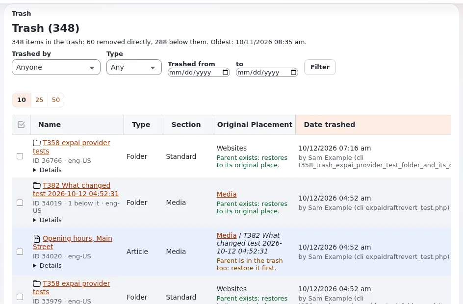

# How do I empty the trash or remove single items from it?

Removed objects go to the trash first. From there you can put them back, or delete them for good.

## Who can do this

Every user sees the items they may read. Removing for good needs `content/cleantrash`; restoring needs
`content/restore`. Administrators have both.

## Steps

1. Click **Trash** at the bottom of the left column (in **Content structure** or **Media**).
   The page **Trash** opens with the number of items. Each row shows who trashed it, when, and where it was.
2. Narrow the list with the filter and click **Filter**.
3. To put an item back, click **Restore** in its row and choose where it goes.
4. To delete some items for good, tick them and click **Remove selected**. Confirm.
5. To delete everything, click **Empty trash** and confirm.

## What can go wrong

- **Attention: removing from the trash cannot be undone.** The object, its versions and its files are deleted. Check
  the list before you confirm.
- **Restore asks for a place.** The old place no longer exists. Choose another one.
- **Links to the item break.** Other content that links to it shows a broken link. The content check lists them:
  see [What does the content check find?](what-does-the-content-check-find.md)

## Related pages

- [The trash shows who trashed an item and where it was](../../features/6.0/trash-who-and-where.md)
- [Archiving and the trash](../customers/day-to-day/archiving-and-the-trash.md)
- [Removing and hiding: the check of reverse relations](../../features/6.0/reverse-relation-check.md)
- [User manual](README.md)
