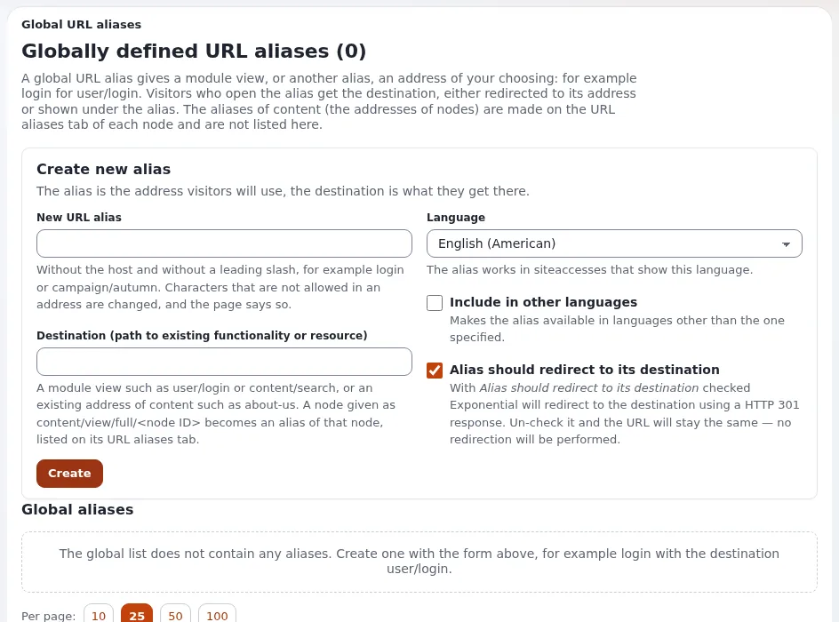

# How do I give a page an extra address (URL alias)?

Every page has an address made from its name. An alias adds another one, for example a short address for print
(`/summer`) or the old address of a moved page.

## Who can do this

Users whose role has `content/urltranslator`, or `content/edit` on the page for its own aliases.

## Steps

1. In **Content structure**, open the page's context menu and choose **Manage URL aliases**.
   The page **URL aliases for** *name* lists the **Generated aliases** and your own.
2. Under **Create new alias**, enter the address, for example `summer`.
3. Choose the **Language**. Tick **Place alias on the site root** to make it `/summer` rather than below the page's
   parent.
4. Tick **Alias should redirect to its destination** to send visitors on to the real address (best for search
   engines); leave it off to show the page at the alias.
5. Click **Create**.
6. For an alias that points to something other than a page (a module view, for example `content/search`), use
   **Setup** > **URL translator**: under **Create new alias**, enter the **New URL alias** and the **Destination**, and
   click **Create**.

## What can go wrong

- **"The URL alias ... already exists".** Another page or alias uses the address. Choose another one, or remove the old
  alias first.
- **Characters change.** Spaces and special characters are replaced by valid ones, as the page says.
- **Many old addresses need to go somewhere.** Use a wildcard: see
  [How do I redirect a group of old addresses?](how-do-i-redirect-old-addresses.md)

## Related pages

- [URLs and aliases](../../guides/urls-and-aliases.md)
- [URL aliases and nice URLs](../creators/website-creators/url-aliases-and-nice-urls.md)
- [URLs, redirects and moved pages](../customers/day-to-day/urls-redirects-and-moved-pages.md)
- [User manual](README.md)
