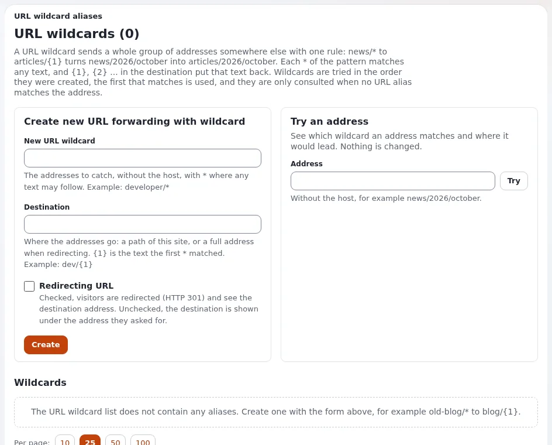

# How do I redirect a group of old addresses (URL wildcards)?

A wildcard sends every address that matches a pattern to another one, for example all of `old-blog/...` to `blog/...`
after a move or a relaunch.

## Who can do this

Users whose role has `content/urltranslator`.

## Steps

1. Open **Setup** > **URL wildcards**.
2. Under **Create new URL forwarding with wildcard**, enter the pattern, for example `old-blog/*`.
3. Enter the destination. `{1}` stands for what the `*` matched, for example `blog/{1}`. It can also be an address on
   another site.
4. Choose **Redirecting** (visitors and search engines see the new address) or **Direct** (the page is shown at the
   old address).
5. Click **Create**.
6. Under **Try an address**, enter an old address and click **Try**: the page says what it **Becomes**.

## What can go wrong

- **Addresses loop or go to the wrong page.** A destination that matches another wildcard causes a loop. Try the address
  first, and keep patterns specific.
- **The wildcard has no effect.** A real page or alias with that address comes first. Wildcards only catch addresses
  that do not exist.

## Related pages

- [How do I give a page an extra address?](how-do-i-give-a-page-an-extra-address.md)
- [URL wildcards](../creators/website-creators/url-wildcards.md)
- [Redirects and moved content](../creators/website-creators/redirects-and-moved-content.md)
- [User manual](README.md)
