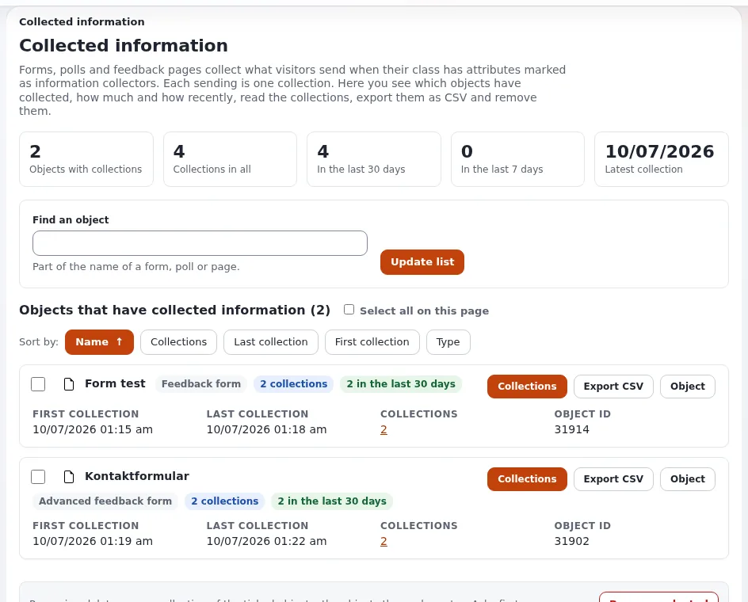

# How do I see and export form submissions?

What visitors send through a form (a contact form, a poll, a feedback form) is kept as collected information of the
form's object.

## Who can do this

Users whose role has `infocollector/read`. Removing submissions needs the remove policy of the module as well.

## Steps

1. Open **Setup** > **Collected information**.
   **Objects that have collected information** lists the forms with submissions and how many.
2. Click **Collections** next to a form to read its submissions, newest first. Click one to see all fields.
3. Click **Export CSV** to download the submissions of the form for a spreadsheet.
4. To remove submissions you no longer need, tick them and click **Remove selected**.

## What can go wrong

- **A form is missing from the list.** It has had no submissions yet: look under **Objects that can collect but have
  nothing yet**.
- **Personal data.** Submissions often contain names and e-mail addresses. Keep them only as long as needed, store the
  CSV safely and delete it when done.
- **Submissions full of spam.** Ask an administrator to add a captcha to the form.

## Related pages

- [Collected information](../../guides/collected-information.md)
- [Forms and collected information](../customers/growth/forms-and-collected-information.md)
- [Form submissions](../creators/website-creators/form-submissions.md)
- [Spam protection for forms](../creators/website-creators/spam-protection-for-forms.md)
- [User manual](README.md)
