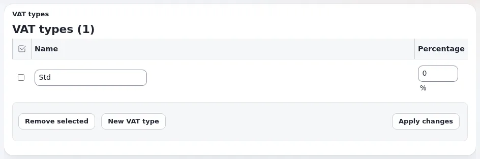

# How do I set up VAT for my products?

A VAT type is a name and a percentage, and a product's price field names its VAT type. VAT charging rules choose the
type by the customer's country and the product category where the rate differs.

## Who can do this

Users whose role has `shop/administrate`. Decide the rates with your accountant first.

## Steps

1. Click **Store**, then **VAT types**.
2. Click **New VAT type**.
   An empty row is added.
3. Enter the **Name** (for example "Standard rate") and the **Percentage**.
4. Click **Apply changes**.
5. If the rate depends on the country or the kind of product, click **VAT rules** in the left menu, then **New rule**.
6. Choose the **Country/region**, the **Product categories** (or **Any**) and the **VAT type**, then click **Create**.
7. Edit a product, choose the VAT type in its price field and publish it.

## What can go wrong

- **Prices show 0 % VAT.** The products use a VAT type with the percentage 0, often the one a new installation
  ships. The store dashboard lists this under **Next steps**.
- **"Wrong or missing rules" on the VAT rules page.** A country or product category has no rule, and there is no
  rule for **Any**. Add a rule for **Any** as the fallback.
- **You cannot remove a VAT type.** Products still use it. Change those products first.

## Related pages

- [VAT types and rules](../customers/commerce/vat-types-and-rules.md)
- [VAT checklist](../customers/commerce/vat-checklist.md)
- [Adding a product](../customers/commerce/adding-a-product.md)
- [User manual](README.md)
