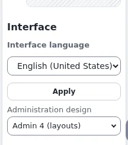

# How do I switch between Admin 4 and the classic administration?

You can work in another administration design, for example the classic design, without changing anything for other
users. The choice lasts until you sign out.

## Who can do this

Users whose role has the policy `uiswitch/design`. The choice appears only when at least two designs are offered.

## Steps

1. Find the **Interface** box in the right toolbar.
   It shows **Interface language** and, below it, **Administration design**.
2. Under **Administration design**, choose the design, for example **Classic**.
   The page reloads in that design, on the same page.
3. To go back, choose the first design in the list: the design the siteaccess normally uses.

## What can go wrong

- **The Interface box or the design list is missing.** Your role lacks `uiswitch/design`, or only one design is
  offered. Ask an administrator.
- **The right toolbar is closed.** Open it with the arrow at the right edge of the window.
- **A page looks different after switching back.** Reload the page. Each design keeps its own caches; nothing was
  changed for other users.
- **The interface language changed too.** It did not: language and design are separate choices in the same box. Choose
  the language again and click **Apply**.

## Related pages

- [Choosing the administration design for your session](../../features/6.0/ui-switch-design.md)
- [Interface language and the UI switch](../../features/6.0/ui-switch.md)
- [The administration design switch: settings, designs and roles](../../guides/ui-switch-design.md)
- [User manual](README.md)
