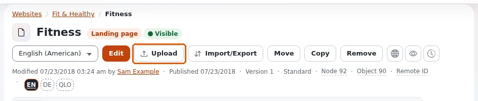

# Images, media and uploads

This page is for editors who put images, documents and other files on the site. Every file you upload becomes a
content item of its own: an image becomes an *Image* item, most other files a *File* item (your site decides which
type each kind of file becomes). You can then use it in articles, galleries and pages, like any other item.

## The media library

The **Media** tab opens the media library, a part of the content tree kept for files. On most sites it has folders
such as **Images**, **Files** and **Multimedia**. It works like **Content structure**: open folders in the tree on the
left, open an item to see it, and use **Edit**, **Move** and **Remove** on it.

Files do not have to live in the media library. You can upload into any folder that accepts them, for example next to
the article that uses them.

## Upload files

The upload page takes one file or hundreds, by button, by dragging, or by pasting an image. Open it from:

- **Upload files** in the quick actions of the dashboard (it opens at the media library's images, or at Media);
- **Upload** on the page of a folder (it uploads into that folder);
- **Upload multiple files** in the menu of an item in the tree.

1. **Target location**: where the files go. The path is shown with *Uploads allowed* when files can be uploaded
   there. Click one of the **Quick locations** (such as **Media**, **Images** or **Files**) or press
   **Change location...** to pick another place. The page remembers the last place you chose.
2. **Add files**: press **Choose files...** or **Choose a folder...**, drag files or whole folders onto the dashed
   area, or paste an image you copied. The page shows the largest file it accepts, for example *At most 64 MB per
   file*.
3. **The queue** lists every file before anything is sent: its name, size and type, a preview of an image, the
   type of item it becomes, where it goes and a **title** you can change (the file name by default). For an image,
   fill in the **alternative text** where the site asks for it. A file that cannot be uploaded (a type that is not
   allowed, too big, no permission there) says why.
4. Press **Upload all**. Three files are sent at a time, each with a progress bar. **Cancel all** stops,
   **Retry failed** tries the failed ones again, **Clear finished** tidies the list.

A file with the same name and size already in the location is marked. You choose whether to skip it, rename the new
one, or upload it anyway; **Upload all** asks once for all such files.

### Options

- **Keep as drafts**: the new items are not published. They wait in **My drafts** until you edit and publish them,
  for example to add a description first.
- **Import compressed zip file(s) contents**: when off, a ZIP file is uploaded as one file. When on, the files inside
  it (also those of ZIP files inside it) are uploaded one by one; you can untick the ones you do not want before the
  import. Images from a ZIP file are skipped where the site requires an alternative text, because a ZIP file has no
  place for it.

### After the upload

The **Uploaded** list shows what was made, with **View** and **Edit** for each item. Tick items in it to move them
(**Move to...**), place them in a further location as well (**Add location...**) or remove them (**Remove...**, after a
confirmation).

## Uploading from the edit form

When you edit an article and its *Image* field (or another relation field) is empty, **Upload new** uploads a file
straight from the form and links it. The new item lands in the place your site has set for such uploads. See
[Creating and editing content](editing-content.md#relations-and-images).

## Good practice

- Give each image an **alternative text** that says what the image shows, for people who use a screen reader and
  for when the image cannot load.
- Give files a clear **title**: it is what editors see in lists and searches, and often what visitors see as the link
  text.
- Keep the media library in folders, so you and others can find a file again. [Searching](searching.md) finds it
  too.
- Remove files that are no longer used; they go to the trash first and can be restored. See
  [Publishing, versions and the trash](publishing-and-versions.md#remove-and-restore).

## When an upload fails

| Message or sign | What it means |
|---|---|
| The row says the type is not allowed | Your site does not accept this kind of file there. Ask an administrator, or use another format. |
| The row says the file is too big | Make it smaller (for an image: fewer pixels or a stronger compression) or ask an administrator. |
| The location says uploads are not allowed | You may not create items there, or the place cannot hold items. Choose another location. |
| The **Upload files** button or the page is missing | Your role does not include uploading. Ask an administrator. |

## Learn more

- The full description of the upload page, with every option: `extension/ezmultiupload/doc/upload-page.md` in the
  installation.
- [Creating and editing content](editing-content.md)
