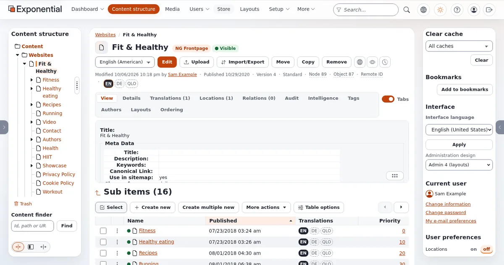
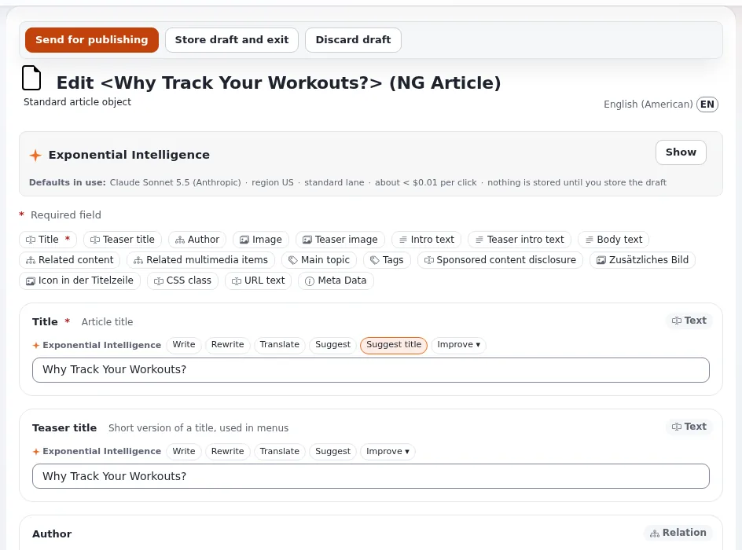
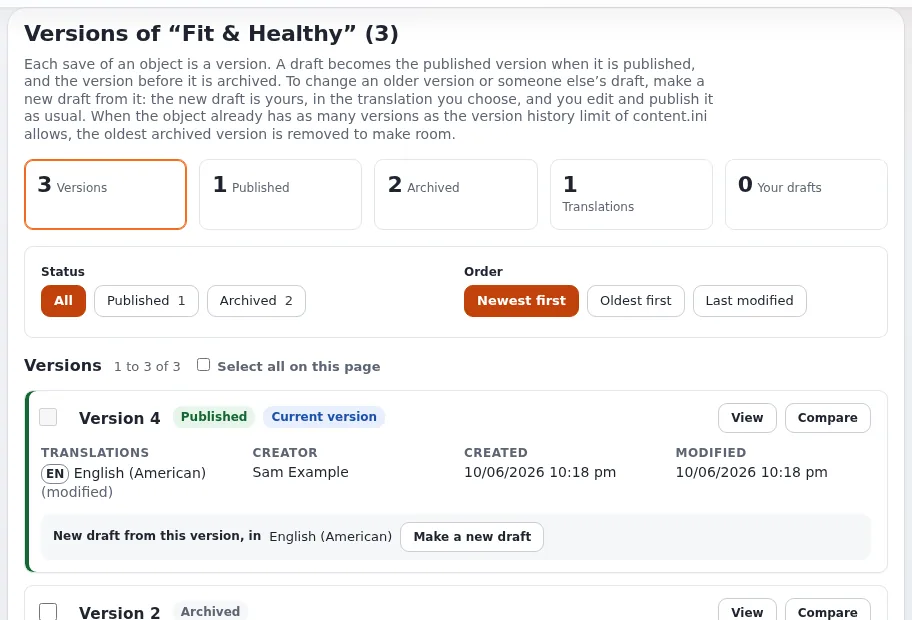
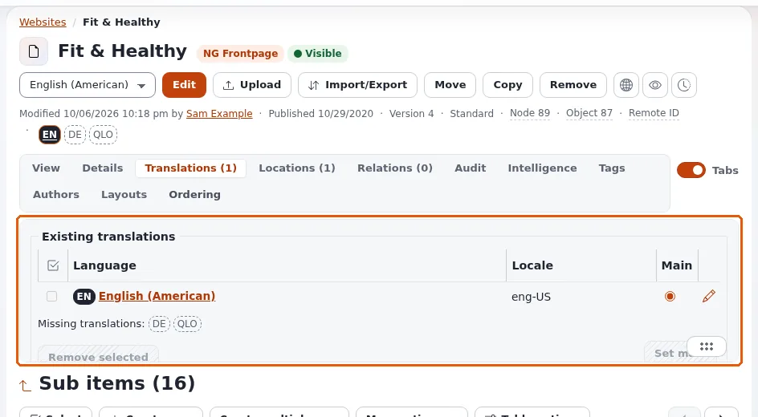

# Demo script: editor tour

This page is for creators who make a video for editors: people who will write and publish in Exponential every day.
The script follows the eight steps of [In action: editing a folder](../admin-tour.md#in-action-editing-a-folder) and
adds languages. It runs about ten minutes. Sign in as a **demo editor** account with invented details, so viewers see
what an editor sees, not what an administrator sees.

Prepare the installation first ([Setting up a demo installation](setting-up-a-demo-installation.md)): a folder with
invented items, a second content language, and no drafts left from a previous take.

## Contents

1. [Part 1: finding your way (2 minutes)](#part-1-finding-your-way-2-minutes)
2. [Part 2: editing a folder (4 minutes)](#part-2-editing-a-folder-4-minutes)
3. [Part 3: versions (1 minute 30)](#part-3-versions-1-minute-30)
4. [Part 4: languages and right to left (2 minutes 30)](#part-4-languages-and-right-to-left-2-minutes-30)
5. [Recovering on camera](#recovering-on-camera)

## Part 1: finding your way (2 minutes)

| Click | Say | Source |
|---|---|---|
| Point at the tabs | "An editor may see only **Dashboard**, **Content structure** and **Media**; administrators see more." | [A tour of the administration](../admin-tour.md) |
| Press `/` | "The slash key jumps to search from anywhere." | [Keyboard shortcuts](../keyboard-shortcuts.md#everywhere-in-the-administration) |
| `Esc`, then the sun button | "Light, dark, or the mode of your computer; it is remembered for your account." | [The header](../admin-tour.md#the-header) |
| Open a folder in the tree | "Click the triangle to open a folder, the name to open the item." | [The left column](../admin-tour.md#the-left-column) |
| On the item's page, point at the buttons | "**Edit**, **Move**, **Copy**, **Remove**, and three round buttons: **View on site**, **Preview** and **Manage versions**." | [An item's page](../admin-tour.md#an-items-page) |

## Part 2: editing a folder (4 minutes)

1. Press **Edit** next to the language list. Say: "The form opens with a new draft, a copy of the published version."
2. Point at the buttons at the top: **Send for publishing**, **Store draft and exit**, **Discard draft**.
3. Point at the **field bar**: "One button per field jumps to its card; a red star marks a required field."
4. Type in **Description**. Point at the toolbar and the **Editor** switch below the field. Say what your
   installation shows, for example: "The **Editor** switch changes the editor of this field; switching keeps what I
   typed." The defaults differ: a fresh installation keeps TinyMCE 3.5.12 as the default with TinyMCE 8 as an opt-in
   engine ([The online editor on TinyMCE 8](../../features/6.0/online-editor-tinymce8.md)), while the demonstration
   server in the [tour](../admin-tour.md) uses TinyMCE 8 with Tiptap as the alternative.
5. Press **Store draft and exit**. Say: "The draft waits under **My drafts**; only I see it. The form also saves by
   itself every few minutes."
6. Open **My drafts** on the dashboard, press **Edit** on the draft.
7. Press **Preview** in the form's left column; show the phone and tablet widths; press **Back to edit**.
8. Press **Send for publishing**. Say: "The draft becomes the published version, and the one before it is kept."

Mention approval only as documented: "If a site uses an approval, the version waits under **My pending items**."

## Part 3: versions (1 minute 30)

1. Press **Manage versions** (the round button with a clock).
2. Press **Compare** between the two newest versions. Say: "I see exactly what changed."
3. Point at **Make a new draft**: "Going back means starting a draft from an older version and publishing it."
   ([Go back to an earlier version](../publishing-and-versions.md#go-back-to-an-earlier-version))

## Part 4: languages and right to left (2 minutes 30)

1. On an item, point at the language badges: "A filled badge exists; a dashed one does not yet."
2. Click the dashed badge, choose **Translate based on** the existing translation, translate the name, publish.
   Say: "Each translation is published on its own." ([Translate an item](../languages.md#translate-an-item))
3. Leave the edit form. In the right column, **Interface**, choose Arabic or Hebrew and press **Apply**. Say: "The
   administration turns around: the side columns change places and text starts at the right."
   ([Right to left](../../features/6.0/right-to-left.md))
4. Switch back to English.

If you give numbers, use the documented ones with their source: 268 locale files usable as content languages, 33
administration translations, nineteen of them complete (19 October 2026) ([Languages in Exponential](../../languages.md)).

## Recovering on camera

| What happens | What to say and do |
|---|---|
| *Possible edit conflict* | "A draft from an earlier take." Open **Manage versions**, discard it; cut in editing |
| No **Interface** box | You are still in the edit form; leave it first |
| A language shows English texts | "This translation of the administration is not complete." |
| An error page | Pause the recording, read it before showing it (it may contain paths), and move on |

More: [Demo scripts, What can go wrong](../business/demo-scripts.md#what-can-go-wrong-and-how-to-recover).

## Related pages

- [A tour of the administration](../admin-tour.md)
- [Creating and editing content](../editing-content.md)
- [Demo script: Exponential Layouts](demo-script-layouts.md)
- [Video walkthrough guide](video-walkthrough-guide.md)
- [Free documentation](../free-documentation.md): this page is free to copy, translate and improve under the GNU FDL 1.3.
